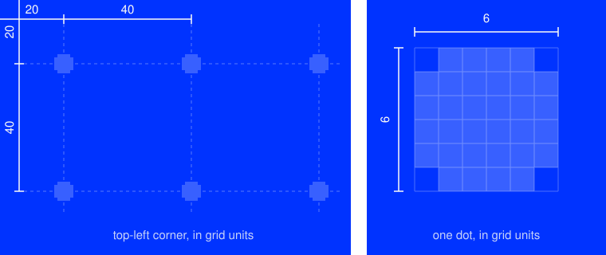

# BACKGROUNDS

<table>
<tr><th><a href="SOCIAL"><code>SOCIAL</code></a></th><th><a href="SIGNAGE"><code>SIGNAGE</code></a></th></tr>
<tr><td valign="top" align="center">Every post. RGB.</td><td valign="top" align="center">Everything printed. RGB and CMYK.</td></tr>
</table>

## DOTS

<table>
<tr><th>Screens</th><th>Lanyards</th><th>Cards</th><th>Poster</th><th>Roll-up</th></tr>
<tr><td valign="top">1 unit = 1 px dot 6 px step 40 px</td><td valign="top">1 unit = 1 px dot 6 px step 40 px</td><td valign="top">1 unit = 2 px dot 12 px step 80 px</td><td valign="top">1 unit = 4 px dot 24 px step 160 px</td><td valign="top">1 unit = 15 px dot 90 px step 600 px</td></tr>
</table>

The grid is centered on the file, so leftover space is split evenly between opposite edges.

## COLORS

<table>
<tr><th></th><th><code>BLUE</code></th><th><code>BLACK</code></th><th><code>WHITE</code></th><th><code>YELLOW</code></th><th><code>NAVY-BLACK</code></th><th><code>WARM-BLACK</code></th></tr>
<tr><th align="left">Screen</th><td valign="top" align="center"> <code>#0033FF</code></td><td valign="top" align="center"> <code>#0A0A0A</code></td><td valign="top" align="center"> <code>#FAFAF7</code></td><td valign="top" align="center"> <code>#F7BF03</code></td><td valign="top" align="center"></td><td valign="top" align="center"></td></tr>
<tr><th align="left">Screen dots</th><td valign="top" align="center"> <code>#3860FF</code></td><td valign="top" align="center"> <code>#3F3F3E</code></td><td valign="top" align="center"> <code>#E2E2DF</code></td><td valign="top" align="center"> <code>#FFDB35</code></td><td valign="top" align="center"></td><td valign="top" align="center"></td></tr>
<tr><th align="left">Print</th><td valign="top" align="center"> <code>C97&nbsp;M73</code></td><td valign="top" align="center"> <code>K97</code></td><td valign="top" align="center"> <code>paper</code></td><td valign="top" align="center"> <code>M27&nbsp;Y100</code></td><td valign="top" align="center"> <code>C90&nbsp;M80&nbsp;Y15&nbsp;K95</code></td><td valign="top" align="center"> <code>C40&nbsp;M50&nbsp;Y90&nbsp;K100</code></td></tr>
<tr><th align="left">Print dots</th><td valign="top" align="center"> <code>C76&nbsp;M57</code></td><td valign="top" align="center"> <code>K70</code>  <code>K85</code></td><td valign="top" align="center"> <code>K22</code>  <code>K15</code></td><td valign="top" align="center"> <code>M14&nbsp;Y50</code>  <code>M12&nbsp;Y84</code></td><td valign="top" align="center"> <code>C66&nbsp;M58&nbsp;Y11&nbsp;K69</code></td><td valign="top" align="center"> <code>C34&nbsp;M43&nbsp;Y77&nbsp;K86</code></td></tr>
</table>

Print is Coated FOGRA39. Which dots each piece uses is in [SIGNAGE](SIGNAGE/README.md).
