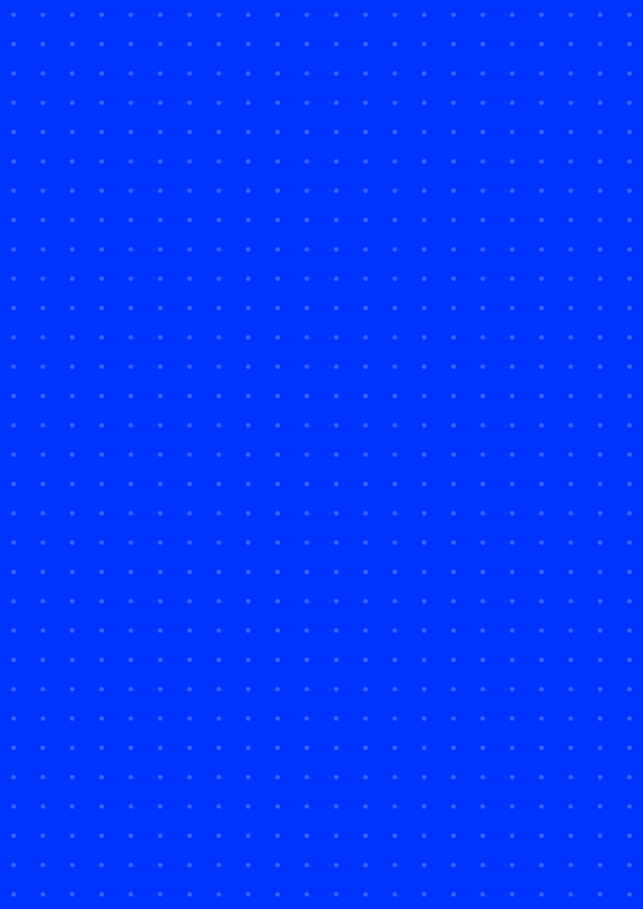

# 297x420mm (POSTER)

<table>
<tr><th><a href="BLACK.png"><code>BLACK</code></a></th><th><a href="BLUE.png"><code>BLUE</code></a></th><th><a href="WHITE.png"><code>WHITE</code></a></th></tr>
<tr><td valign="top" align="center"> 3508 x 4961 px</td><td valign="top" align="center"> 3508 x 4961 px</td><td valign="top" align="center"> 3508 x 4961 px</td></tr>
<tr><th colspan="3"><a href="BLUE-CMYK.tif"><code>BLUE-CMYK</code></a></th></tr>
<tr><td colspan="3" valign="top" align="center"> 3508 x 4961 px</td></tr>
</table>

## PRINT

<table>
<tr><th>Size</th><th>Bleed</th><th>Resolution</th><th>Dots</th><th>RGB <code>.png</code></th><th>CMYK <code>-CMYK.tif</code> Coated FOGRA39</th></tr>
<tr><td valign="top">297 x 420 mm</td><td valign="top">none</td><td valign="top">300 dpi</td><td valign="top">4x</td><td valign="top"> <code>BLACK</code>  <code>BLUE</code>  <code>WHITE</code></td><td valign="top"> <code>BLUE</code> printed</td></tr>
</table>
