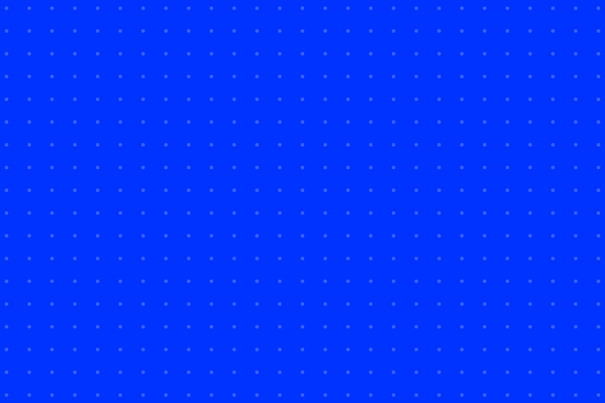

# 90x60mm (CARDS)

<table>
<tr><th><a href="BLACK.png"><code>BLACK</code></a></th><th><a href="BLUE.png"><code>BLUE</code></a></th><th><a href="WHITE.png"><code>WHITE</code></a></th><th><a href="YELLOW.png"><code>YELLOW</code></a></th></tr>
<tr><td valign="top" align="center"> 2126 x 1417 px <a href="BLACK.png"><code>.png</code></a></td><td valign="top" align="center"> 2126 x 1417 px <a href="BLUE.png"><code>.png</code></a></td><td valign="top" align="center"> 2126 x 1417 px <a href="WHITE.png"><code>.png</code></a></td><td valign="top" align="center"> 2126 x 1417 px <a href="YELLOW.png"><code>.png</code></a></td></tr>
<tr><th><a href="BLACK-CMYK.tif"><code>BLACK-CMYK</code></a></th><th><a href="BLUE-CMYK.tif"><code>BLUE-CMYK</code></a></th><th><a href="WHITE-CMYK.tif"><code>WHITE-CMYK</code></a></th><th><a href="YELLOW-CMYK.tif"><code>YELLOW-CMYK</code></a></th></tr>
<tr><td valign="top" align="center"> 2126 x 1417 px <a href="BLACK-CMYK.tif"><code>.tif</code></a></td><td valign="top" align="center"> 2126 x 1417 px <a href="BLUE-CMYK.tif"><code>.tif</code></a></td><td valign="top" align="center"> 2126 x 1417 px <a href="WHITE-CMYK.tif"><code>.tif</code></a></td><td valign="top" align="center"> 2126 x 1417 px <a href="YELLOW-CMYK.tif"><code>.tif</code></a></td></tr>
</table>

## PRINT

<table>
<tr><th>Size</th><th>Bleed</th><th>Resolution</th><th>Dots</th><th>RGB <code>.png</code></th><th>CMYK <code>-CMYK.tif</code> Coated FOGRA39</th></tr>
<tr><td valign="top">85.6 x 54 mm</td><td valign="top">2.2 mm sides 3 mm top and bottom</td><td valign="top">600 dpi</td><td valign="top">2x</td><td valign="top"> <code>BLACK</code>  <code>BLUE</code>  <code>WHITE</code>  <code>YELLOW</code></td><td valign="top"> <code>BLACK</code> ATTENDEE  <code>BLUE</code> CONTRIBUTOR  <code>WHITE</code> CURATOR  <code>YELLOW</code> VOLUNTEER</td></tr>
</table>
