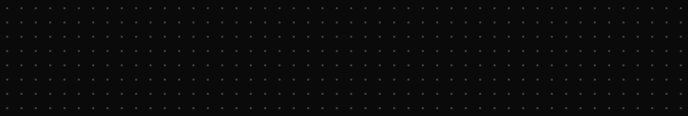
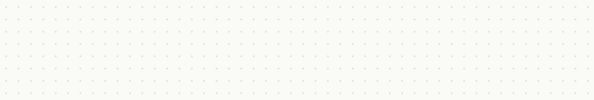

# 1920x325 (5.9∶1, LINKEDIN BANNER ORGANIZATION)

<table>
<tr><th><code>BLACK</code></th></tr>
<tr><td valign="top" align="center"> 1920 x 325 px</td></tr>
<tr><th><code>BLUE</code></th></tr>
<tr><td valign="top" align="center"> 1920 x 325 px</td></tr>
<tr><th><code>WHITE</code></th></tr>
<tr><td valign="top" align="center"> 1920 x 325 px</td></tr>
</table>
