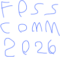

# HAND-DRAWN

<table>
<tr><th><code>LOGO-BLUE</code></th><th><code>LOGO-BLACK</code></th><th><code>LOGO-WHITE</code></th><th><code>MASCOT</code></th></tr>
<tr><td valign="top" align="center"> 285 x 273 px <a href="LOGO-BLUE.svg"><code>.svg</code></a> <a href="LOGO-BLUE.png"><code>.png</code></a></td><td valign="top" align="center"> 285 x 273 px <a href="LOGO-BLACK.svg"><code>.svg</code></a> <a href="LOGO-BLACK.png"><code>.png</code></a></td><td valign="top" align="center"> 285 x 273 px <a href="LOGO-WHITE.svg"><code>.svg</code></a> <a href="LOGO-WHITE.png"><code>.png</code></a></td><td valign="top" align="center"> 203 x 219 px <a href="MASCOT.svg"><code>.svg</code></a> <a href="MASCOT.png"><code>.png</code></a></td></tr>
<tr><th><code>LOGO-BLUE-SMALL</code></th><th><code>LOGO-BLACK-SMALL</code></th><th><code>LOGO-WHITE-SMALL</code></th><th><code>MASCOT-SMALL</code></th></tr>
<tr><td valign="top" align="center"> 121 x 115 px <a href="LOGO-BLUE-SMALL.svg"><code>.svg</code></a> <a href="LOGO-BLUE-SMALL.png"><code>.png</code></a></td><td valign="top" align="center"> 121 x 115 px <a href="LOGO-BLACK-SMALL.svg"><code>.svg</code></a> <a href="LOGO-BLACK-SMALL.png"><code>.png</code></a></td><td valign="top" align="center"> 121 x 115 px <a href="LOGO-WHITE-SMALL.svg"><code>.svg</code></a> <a href="LOGO-WHITE-SMALL.png"><code>.png</code></a></td><td valign="top" align="center"> 87 x 93 px <a href="MASCOT-SMALL.svg"><code>.svg</code></a> <a href="MASCOT-SMALL.png"><code>.png</code></a></td></tr>
</table>
