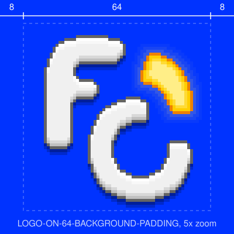

# LOGO

The FOSSCOMM 2026 logo, drawn in pixels: an F and a C on a 64 x 64 grid. The arc at the top right is a light. In `ON` it's lit, in `OFF` it isn't.

| ON | OFF |
|:-:|:-:|
|  |  |

## FILES

Every file comes in `ON` and `OFF`, and in 3 sizes: `64`, `256` and `512`. Shown here at 512.

| | ON | OFF |
|---|:-:|:-:|
| **Transparent** `LOGO-ON-512.png` |  |  |
| **On blue** `LOGO-ON-512-BACKGROUND.png` |  |  |
| **On blue, with padding** `LOGO-ON-512-BACKGROUND-PADDING.png` |  |  |
| **Vector** `LOGO-ON.svg` |  |  |

The logo is white, so the transparent files are made for dark grounds.

## SIZES

Each size is the same 64 x 64 drawing with every pixel turned into a solid square, never smoothed, so every size is equally sharp.

| Size | Scale | 1 logo pixel | File | With padding |
|---|---|---|---|---|
| `64` | 100% | 1 x 1 px | 64 x 64 px | 80 x 80 px |
| `256` | 400% | 4 x 4 px | 256 x 256 px | 320 x 320 px |
| `512` | 800% | 8 x 8 px | 512 x 512 px | 640 x 640 px |

## PADDING

- 8 px of blue on every side of the 64 x 64 logo, so 12.5% of its width per side.
- A padded file is 125% of the logo: 80, 320 or 640 px.
- The blue is `#0033FF`, the same as the [backgrounds](../BACKGROUNDS/README.md#colors).

## COLORS

| Part | Colors |
|---|---|
| F and C | fill `#F0F0F0` `#F8F8F8` `#FFFFFF`, shade `#D8D8D8` `#C0C0C0`, edge `#646464` |
| Lit arc (`ON`) | fill `#FFEE87` `#FFDB35`, shade `#FECE01`, edge `#EE8101`, glow `#FFEE87` at 20%, 10% and 4% |
| Unlit arc (`OFF`) | fill `#BEE7E9` `#F6FFFF`, shade `#99D0DE`, edge `#5A9D9D` |
| Shadow | `#000000` at 39% and 20% |
