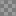

# COLORS

<table>
<tr><th><code>000000-20</code></th><th><code>000000-39</code></th><th><code>0033FF</code></th><th><code>134ADF</code></th><th><code>1736B2</code></th><th><code>1E1E1E</code></th><th><code>2F528C</code></th><th><code>3C3C3C</code></th></tr>
<tr><td valign="top" align="center"> LOGO</td><td valign="top" align="center"> LOGO</td><td valign="top" align="center"> CURSOR SPRITE FLAG</td><td valign="top" align="center"> SPRITE FLAG</td><td valign="top" align="center"> SPRITE FLAG</td><td valign="top" align="center"> SPRITE</td><td valign="top" align="center"> SPRITE FLAG</td><td valign="top" align="center"> SPRITE FLAG</td></tr>
<tr><th><code>4F9080</code></th><th><code>5A9D9D</code></th><th><code>646464</code></th><th><code>64E7E9</code></th><th><code>6E6E6E</code></th><th><code>787878</code></th><th><code>78A817</code></th><th><code>7F99FF</code></th></tr>
<tr><td valign="top" align="center"> SPRITE FLAG</td><td valign="top" align="center"> LOGO SPRITE</td><td valign="top" align="center"> LOGO SPRITE FLAG</td><td valign="top" align="center"> SPRITE</td><td valign="top" align="center"> SPRITE</td><td valign="top" align="center"> SPRITE</td><td valign="top" align="center"> SPRITE FLAG</td><td valign="top" align="center"> CURSOR</td></tr>
<tr><th><code>828282</code></th><th><code>8C8C8C</code></th><th><code>8CD200</code></th><th><code>969696</code></th><th><code>99D0DE</code></th><th><code>9BBFC1</code></th><th><code>9FEF00</code></th><th><code>A0A0A0</code></th></tr>
<tr><td valign="top" align="center"> SPRITE</td><td valign="top" align="center"> SPRITE FLAG</td><td valign="top" align="center"> SPRITE FLAG</td><td valign="top" align="center"> SPRITE FLAG</td><td valign="top" align="center"> LOGO SPRITE</td><td valign="top" align="center"> SPRITE</td><td valign="top" align="center"> SPRITE FLAG</td><td valign="top" align="center"> SPRITE FLAG</td></tr>
<tr><th><code>AAAAAA</code></th><th><code>B4B4B4</code></th><th><code>BEBEBE</code></th><th><code>BEE7E9</code></th><th><code>BFCCFF</code></th><th><code>C0C0C0</code></th><th><code>CCDDA9</code></th><th><code>CFF780</code></th></tr>
<tr><td valign="top" align="center"> SPRITE FLAG</td><td valign="top" align="center"> SPRITE FLAG</td><td valign="top" align="center"> SPRITE</td><td valign="top" align="center"> LOGO SPRITE</td><td valign="top" align="center"> CURSOR</td><td valign="top" align="center"> LOGO</td><td valign="top" align="center"> SPRITE FLAG</td><td valign="top" align="center"> SPRITE FLAG</td></tr>
<tr><th><code>D8D8D8</code></th><th><code>E1E1E1</code></th><th><code>EE8101</code></th><th><code>F0F0F0</code></th><th><code>F2F5FF</code></th><th><code>F2FCDF</code></th><th><code>F6FFFF</code></th><th><code>F7BF01</code></th></tr>
<tr><td valign="top" align="center"> LOGO</td><td valign="top" align="center"> SPRITE FLAG</td><td valign="top" align="center"> LOGO CURSOR SPRITE</td><td valign="top" align="center"> LOGO</td><td valign="top" align="center"> CURSOR</td><td valign="top" align="center"> SPRITE FLAG</td><td valign="top" align="center"> LOGO SPRITE</td><td valign="top" align="center"> SPRITE</td></tr>
<tr><th><code>F7BF03</code></th><th><code>F8F8F8</code></th><th><code>FCDD58</code></th><th><code>FECE01</code></th><th><code>FEDC51</code></th><th><code>FEFEF1</code></th><th><code>FF4673</code></th><th><code>FF6BC3</code></th></tr>
<tr><td valign="top" align="center"> SPRITE</td><td valign="top" align="center"> LOGO</td><td valign="top" align="center"> SPRITE</td><td valign="top" align="center"> LOGO SPRITE</td><td valign="top" align="center"> CURSOR SPRITE</td><td valign="top" align="center"> CURSOR SPRITE</td><td valign="top" align="center"> SPRITE</td><td valign="top" align="center"> SPRITE</td></tr>
<tr><th><code>FFA5DB</code></th><th><code>FFBAE3</code></th><th><code>FFDB35</code></th><th><code>FFEE87</code></th><th><code>FFEE87-10</code></th><th><code>FFEE87-20</code></th><th><code>FFEE87-4</code></th><th><code>FFFFFF</code></th></tr>
<tr><td valign="top" align="center"> SPRITE</td><td valign="top" align="center"> SPRITE</td><td valign="top" align="center"> LOGO SPRITE</td><td valign="top" align="center"> LOGO CURSOR SPRITE</td><td valign="top" align="center"> LOGO</td><td valign="top" align="center"> LOGO</td><td valign="top" align="center"> LOGO</td><td valign="top" align="center"> LOGO SPRITE FLAG</td></tr>
</table>
