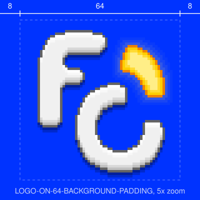
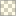
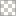
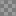

# LOGO

64 x 64 px. Source: [`LOGO.pdn`](LOGO.pdn) (`ON` = layers 2, 4, 5. `OFF` = layers 2, 5, 9).

| ON | OFF |
|:-:|:-:|
|  |  |

## FILES

| | ON | OFF |
|---|:-:|:-:|
| `LOGO-*-512.png` |  |  |
| `LOGO-*-512-BACKGROUND.png` |  |  |
| `LOGO-*-512-BACKGROUND-PADDING.png` |  |  |
| `LOGO-*.svg` |  |  |

## SIZES

| Size | Scale | 1 logo pixel | File | With padding |
|---|---|---|---|---|
| `64` | 100% | 1 x 1 px | 64 x 64 px | 80 x 80 px |
| `256` | 400% | 4 x 4 px | 256 x 256 px | 320 x 320 px |
| `512` | 800% | 8 x 8 px | 512 x 512 px | 640 x 640 px |

## PADDING

8 px per side at 64 (12.5%), so a padded file is 125%. Blue `#0033FF`.

## COLORS

<table>
<tr><th>F and C</th><th>Lit arc (ON)</th><th>Unlit arc (OFF)</th><th>Shadow</th></tr>
<tr><td valign="top"> <code>#F0F0F0</code> fill  <code>#F8F8F8</code> fill  <code>#FFFFFF</code> fill  <code>#D8D8D8</code> shade  <code>#C0C0C0</code> shade  <code>#646464</code> edge</td><td valign="top"> <code>#FFEE87</code> fill  <code>#FFDB35</code> fill  <code>#FECE01</code> shade  <code>#EE8101</code> edge  <code>#FFEE87</code> 20% glow  <code>#FFEE87</code> 10% glow  <code>#FFEE87</code> 4% glow</td><td valign="top"> <code>#BEE7E9</code> fill  <code>#F6FFFF</code> fill  <code>#99D0DE</code> shade  <code>#5A9D9D</code> edge</td><td valign="top"> <code>#000000</code> 39%  <code>#000000</code> 20%</td></tr>
</table>
