# SPRITE

The mascot, a light bulb, drawn in pixels. Every animation is one file: its frames side by side, each 32 x 32 px, played left to right.

## SPRITE SHEET

[`SPRITE-SHEET.png`](SPRITE-SHEET.png) has every animation in one file: one row each, in the order of the table below, frames from the left. 9 x 22 cells of 32 x 32 px, so 288 x 704 px. Empty cells are transparent.

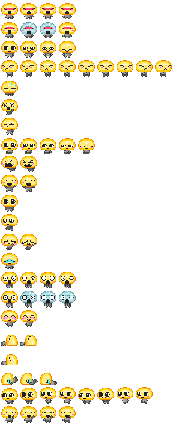

## ANIMATIONS

Shown at 2x. The 18 marked "yes" are the exact files the site uses.

| Row | Animation | Frames | On the site |
|---|---|---|---|
| 1 | **ANGRY** 4 frames |  | no, ANGRY-FLASH is used |
| 2 | **ANGRY-FLASH** 4 frames |  | yes |
| 3 | **BLINK** 4 frames |  | yes |
| 4 | **DISSAGREE** 9 frames |  | yes |
| 5 | **DISSAPOINTED** 1 frame |  | yes |
| 6 | **DIZZY** 1 frame |  | yes |
| 7 | **DRIFT** 1 frame |  | yes |
| 8 | **DROWSY** 5 frames |  | yes |
| 9 | **FALLING** 2 frames |  | yes |
| 10 | **HELD** 2 frames |  | yes |
| 11 | **IDLE** 1 frame |  | yes |
| 12 | **JUMP** 1 frame |  | yes |
| 13 | **SAD** 2 frames | 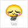 | yes |
| 14 | **SAD-OLD** 1 frame | 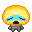 | no, an older SAD |
| 15 | **SHOCKED** 4 frames | 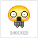 | yes |
| 16 | **SHOCKED-FLASH** 4 frames |  | no, SHOCKED is used |
| 17 | **SHY** 2 frames |  | yes |
| 18 | **SLEEP** 2 frames | 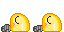 | yes |
| 19 | **SLEEP-STATIC** 1 frame | 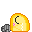 | no, it heads the repo README |
| 20 | **TRIP** 3 frames | 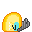 | yes |
| 21 | **WALK** 8 frames |  | yes |
| 22 | **WAVE** 4 frames |  | yes |

## FILES

- `<NAME>.png` is the animation: 32 px tall, one 32 x 32 frame after another.
- `<NAME>.svg` has the same pixels as a vector, sharp at any size.
- `SPRITE-SHEET.png` and `.svg` hold every animation in one sheet.
- `COLOR-MAP.png` and `.svg` are the palette below.

## COLORS

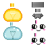

| Part | Colors |
|---|---|
| Lit bulb |  `#FFEE87` &nbsp;  `#FECE01` &nbsp;  `#EE8101` &nbsp;  `#FFDB35`  `#FEDC51` &nbsp;  `#FCDD58` &nbsp;  `#F7BF03` &nbsp;  `#F7BF01` |
| Unlit bulb ANGRY-FLASH, SHOCKED-FLASH |  `#BEE7E9` &nbsp;  `#99D0DE` &nbsp; 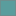 `#5A9D9D` &nbsp;  `#9BBFC1` |
| Base |  `#3C3C3C` &nbsp;  `#646464` &nbsp;  `#A0A0A0` &nbsp;  `#969696`  `#AAAAAA` &nbsp;  `#8C8C8C` &nbsp;  `#B4B4B4` &nbsp;  `#828282`  `#787878` &nbsp;  `#BEBEBE` &nbsp;  `#6E6E6E` |
| Face | eyes  `#1E1E1E` shine  `#FEFEF1` &nbsp;  `#F6FFFF` cheeks 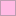 `#FFBAE3` &nbsp; 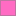 `#FF6BC3` |
| Extras not in the color map | angry 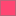 `#FF4673` ANGRY, ANGRY-FLASH tears  `#64E7E9` DISSAPOINTED, SAD-OLD, TRIP blush 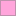 `#FFA5DB` SHY |
