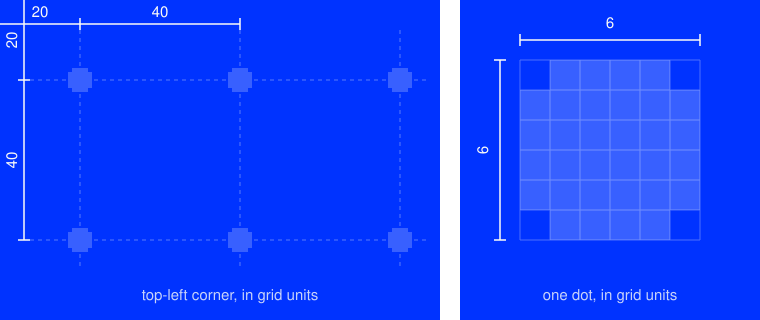
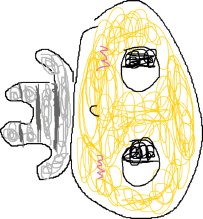
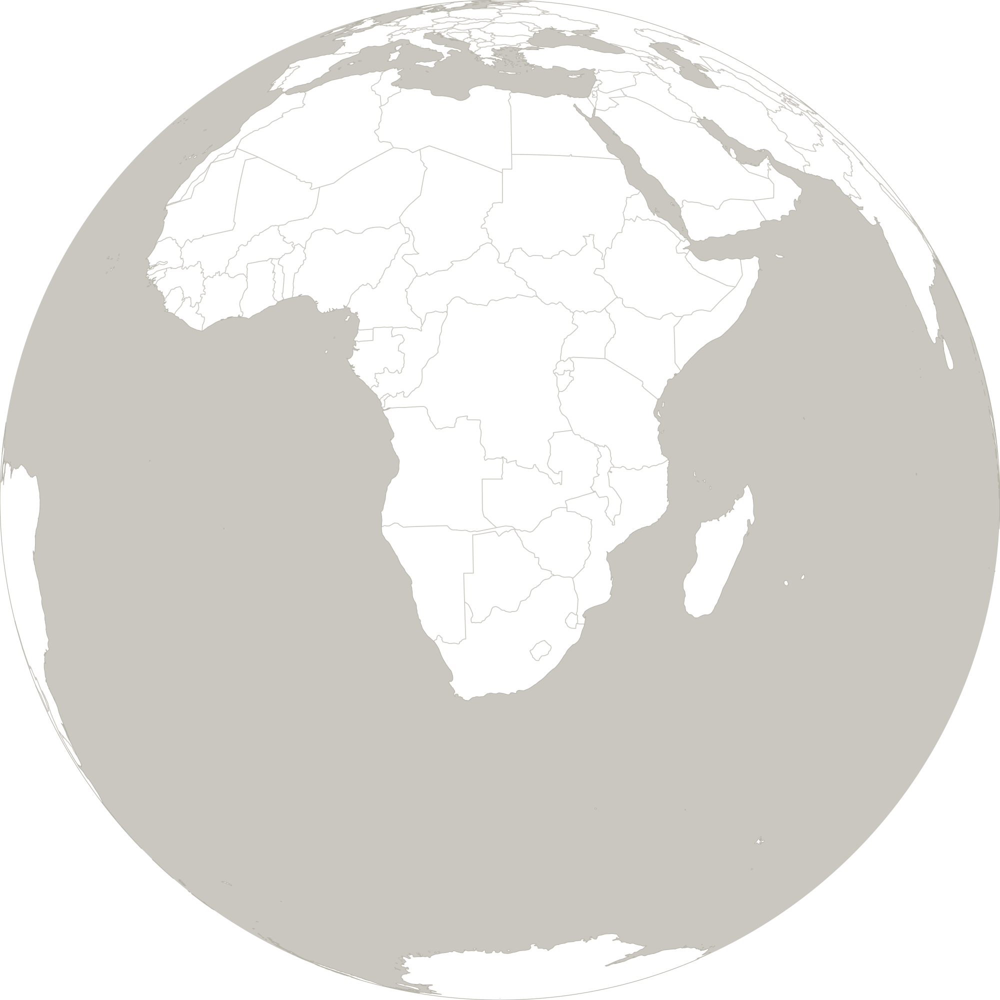
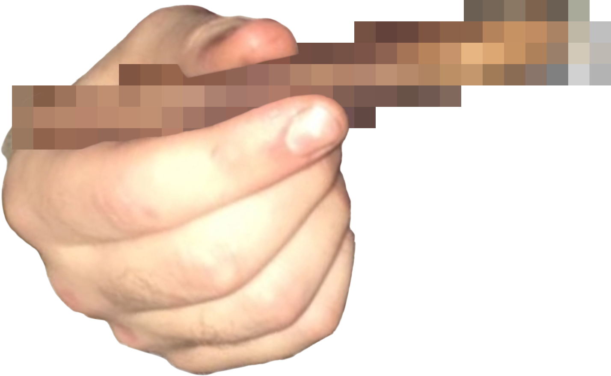

# ASSETS

<table>
<tr><th><a href="BACKGROUNDS"><code>BACKGROUNDS</code></a></th><th><a href="HAND-DRAWN"><code>HAND-DRAWN</code></a></th><th><a href="PIXEL-ART"><code>PIXEL-ART</code></a></th><th><code>GLOBE</code></th></tr>
<tr><td valign="top" align="center"> The dot backgrounds, for posts and print.</td><td valign="top" align="center">  The hand-drawn logo and mascot.</td><td valign="top" align="center">  The logo, cursors, mascot and flag.</td><td valign="top" align="center"> The globe. <a href="GLOBE.svg"><code>.svg</code></a></td></tr>
<tr><th><code>MEGAPHONE</code></th><th><code>QR-DONATION</code></th><th><code>QR-SITE</code></th><th><code>SPLIFF</code></th></tr>
<tr><td valign="top" align="center"> The megaphone. 1536 x 1024 px <a href="MEGAPHONE.png"><code>.png</code></a></td><td valign="top" align="center"> The donation QR code. 992 x 992 px <a href="QR-DONATION.png"><code>.png</code></a></td><td valign="top" align="center"> The site QR code. 992 x 992 px <a href="QR-SITE.png"><code>.png</code></a></td><td valign="top" align="center"> The spliff. 1428 x 880 px <a href="SPLIFF.png"><code>.png</code></a></td></tr>
</table>
