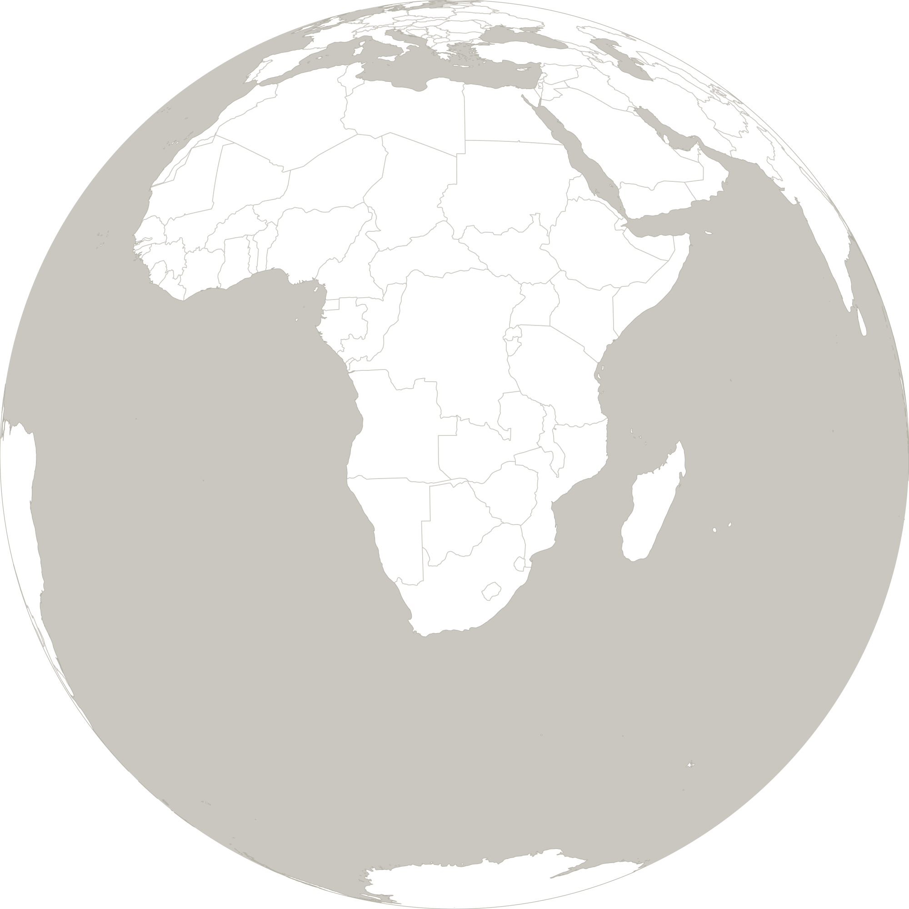
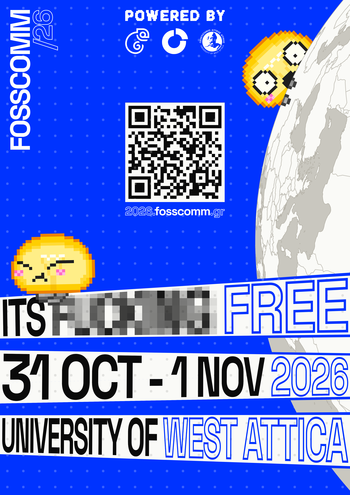
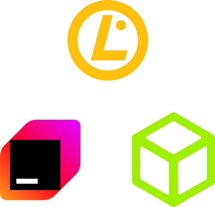

# IDENTITY

<table>
<tr><th><a href="ASSETS"><code>ASSETS</code></a></th><th><a href="SIGNAGE"><code>SIGNAGE</code></a></th></tr>
<tr><td valign="top" align="center">           The backgrounds, pixel art, globe, QR codes, megaphone and spliff.</td><td valign="top" align="center">          Everything printed, cards, lanyards, poster, roll-up, stickers and T-shirt.</td></tr>
<tr><th><a href="SITE"><code>SITE</code></a></th><th><a href="SOCIAL"><code>SOCIAL</code></a></th></tr>
<tr><td valign="top" align="center">             What the site shows, speakers, communities, sponsors and announcements.</td><td valign="top" align="center">       The posts, banners and videos for Instagram, LinkedIn and YouTube.</td></tr>
<tr><th colspan="2"><a href="SPONSOR-BROCHURE"><code>SPONSOR-BROCHURE</code></a></th></tr>
<tr><td colspan="2" valign="top" align="center">      The sponsor brochure, its pages, its PDF and the logos in it.</td></tr>
</table>
