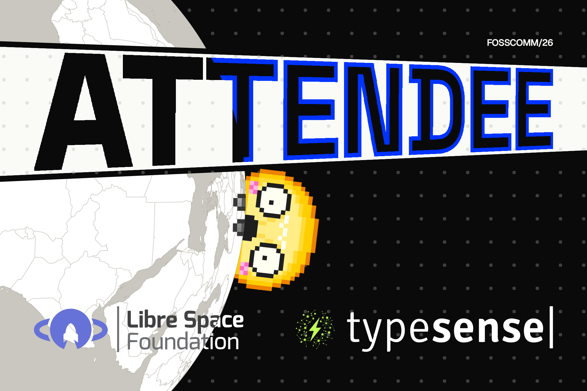
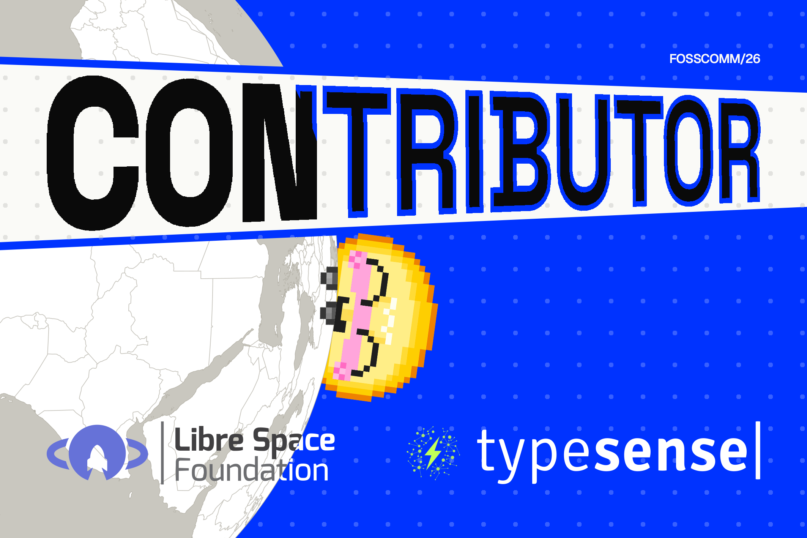
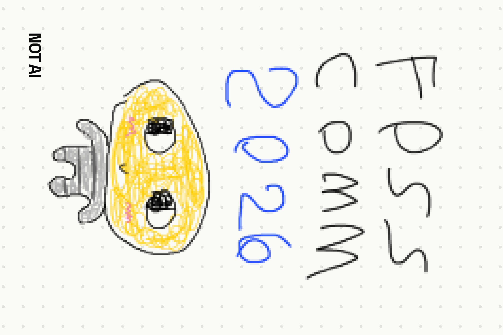
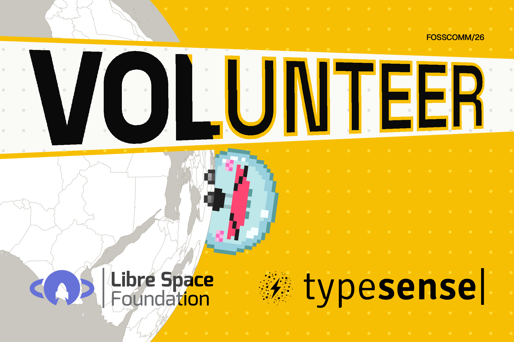
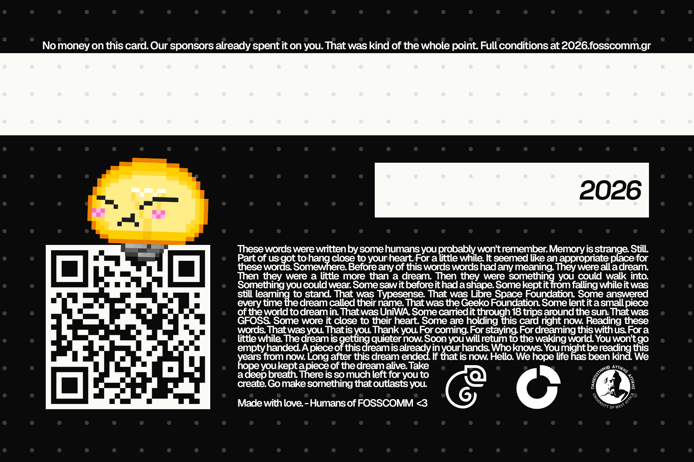
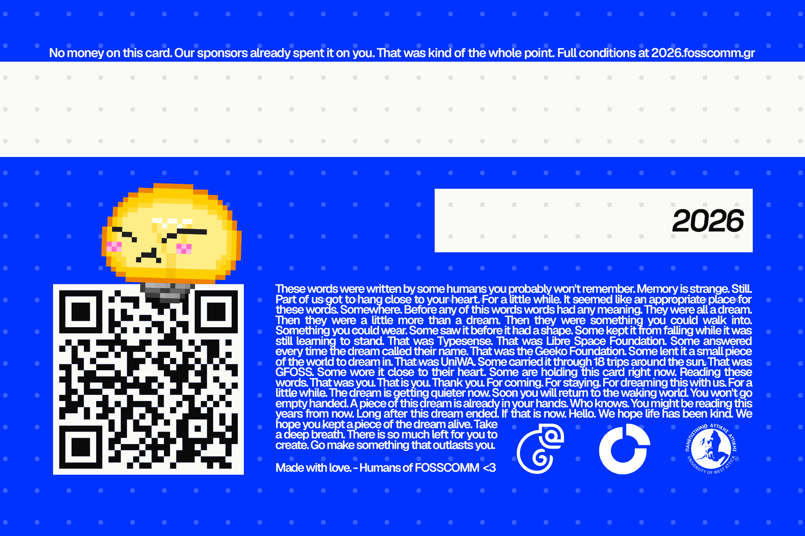
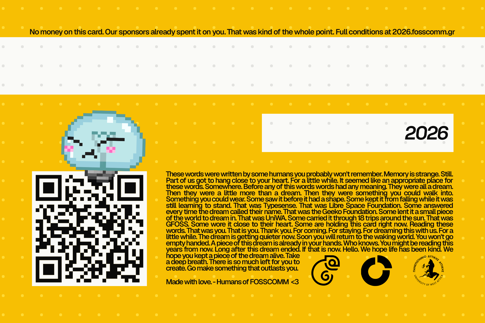

# CARDS

<table>
<tr><th><code>ATTENDEE-FRONT</code></th><th><code>CONTRIBUTOR-FRONT</code></th><th><code>CURATOR-FRONT</code></th><th><code>VOLUNTEER-FRONT</code></th></tr>
<tr><td valign="top" align="center"> 2126 x 1417 px</td><td valign="top" align="center"> 2126 x 1417 px</td><td valign="top" align="center"> 2126 x 1417 px</td><td valign="top" align="center"> 2126 x 1417 px</td></tr>
<tr><th><code>ATTENDEE-BACK</code></th><th><code>CONTRIBUTOR-BACK</code></th><th><code>CURATOR-BACK</code></th><th><code>VOLUNTEER-BACK</code></th></tr>
<tr><td valign="top" align="center"> 2126 x 1417 px</td><td valign="top" align="center"> 2126 x 1417 px</td><td valign="top" align="center"> 2126 x 1417 px</td><td valign="top" align="center"> 2126 x 1417 px</td></tr>
</table>

## PRINT

<table>
<tr><th>Size</th><th>Bleed</th><th>Resolution</th><th>RGB</th><th>CMYK</th></tr>
<tr><td valign="top">85.6 x 54 mm 90 x 60 mm with bleed</td><td valign="top">2.2 mm sides 3 mm top and bottom</td><td valign="top">600 dpi</td><td valign="top"><code>.png</code> <code>.psd</code></td><td valign="top"><code>-CMYK.pdf</code> <code>-CMYK.psd</code> Coated FOGRA39</td></tr>
</table>
