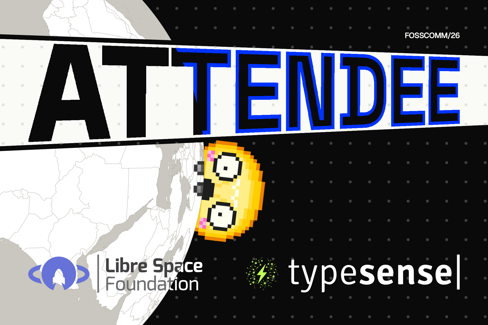
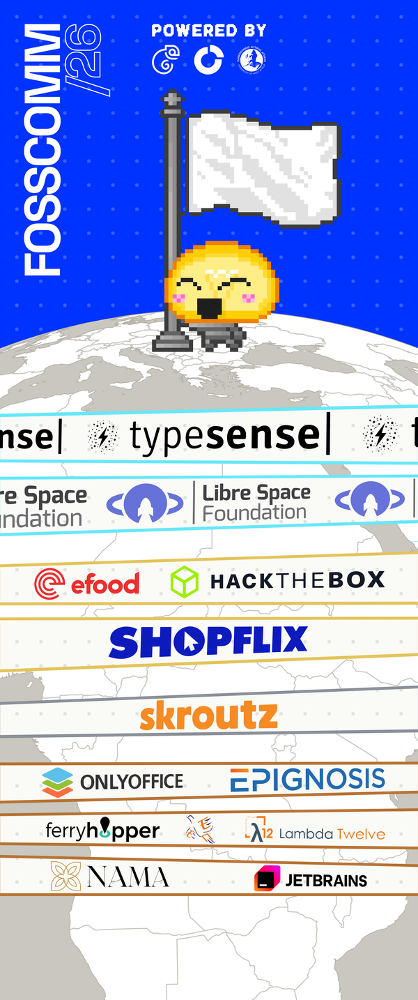

# SIGNAGE

<table>
<tr><th><a href="CARDS"><code>CARDS</code></a></th><th><a href="LANYARDS"><code>LANYARDS</code></a></th><th><a href="POSTER"><code>POSTER</code></a></th></tr>
<tr><td valign="top" align="center"> The badge cards, front and back for every role.</td><td valign="top" align="center">   The lanyards, outside and inside for every role.</td><td valign="top" align="center"> The A3 poster.</td></tr>
<tr><th><a href="ROLL-UP"><code>ROLL-UP</code></a></th><th><a href="STICKERS"><code>STICKERS</code></a></th><th><a href="T-SHIRT"><code>T-SHIRT</code></a></th></tr>
<tr><td valign="top" align="center"> The roll-up banner.</td><td valign="top" align="center">   The stickers.</td><td valign="top" align="center"> The T-shirt print.</td></tr>
</table>
