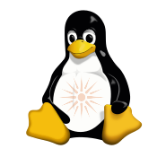

# COMMUNITIES

<table>
<tr><th><code>E-NABLE</code></th><th><code>EUROSTACK</code></th><th><code>GFOSS</code></th><th><code>GNOME</code></th><th><code>GODOT</code></th></tr>
<tr><td valign="top" align="center"> <a href="E-NABLE.svg"><code>.svg</code></a>   <a href="E-NABLE-WHITE.svg"><code>-WHITE.svg</code></a></td><td valign="top" align="center"> <a href="EUROSTACK.svg"><code>.svg</code></a>   <a href="EUROSTACK-WHITE.svg"><code>-WHITE.svg</code></a></td><td valign="top" align="center"> <a href="GFOSS.svg"><code>.svg</code></a>   <a href="GFOSS-BLACK.svg"><code>-BLACK.svg</code></a>   <a href="GFOSS-WHITE.svg"><code>-WHITE.svg</code></a></td><td valign="top" align="center"> <a href="GNOME.svg"><code>.svg</code></a>   <a href="GNOME-WHITE.svg"><code>-WHITE.svg</code></a></td><td valign="top" align="center"> <a href="GODOT.svg"><code>.svg</code></a>   <a href="GODOT-WHITE.svg"><code>-WHITE.svg</code></a></td></tr>
<tr><th><code>GREEKLUG</code></th><th><code>HELLENIC-IT-MUSEUM</code></th><th><code>HELLUG</code></th><th><code>KDE</code></th><th><code>LIBRE-SPACE-FOUNDATION</code></th></tr>
<tr><td valign="top" align="center"> <a href="GREEKLUG.svg"><code>.svg</code></a>   <a href="GREEKLUG-WHITE.svg"><code>-WHITE.svg</code></a></td><td valign="top" align="center"> <a href="HELLENIC-IT-MUSEUM.svg"><code>.svg</code></a>   <a href="HELLENIC-IT-MUSEUM-WHITE.svg"><code>-WHITE.svg</code></a></td><td valign="top" align="center"> <a href="HELLUG.svg"><code>.svg</code></a>   <a href="HELLUG-WHITE.svg"><code>-WHITE.svg</code></a></td><td valign="top" align="center"> <a href="KDE.svg"><code>.svg</code></a>   <a href="KDE-WHITE.svg"><code>-WHITE.svg</code></a></td><td valign="top" align="center"> <a href="LIBRE-SPACE-FOUNDATION.svg"><code>.svg</code></a>   <a href="LIBRE-SPACE-FOUNDATION-WHITE.svg"><code>-WHITE.svg</code></a></td></tr>
<tr><th><code>LICHESS</code></th><th><code>LINUX-PROFESSIONAL-INSTITUTE</code></th><th><code>MURENA</code></th><th><code>NEXT-CLOUD</code></th><th><code>ONASSIS-FOUNDATION</code></th></tr>
<tr><td valign="top" align="center"> <a href="LICHESS.svg"><code>.svg</code></a>   <a href="LICHESS-WHITE.svg"><code>-WHITE.svg</code></a></td><td valign="top" align="center"> <a href="LINUX-PROFESSIONAL-INSTITUTE.svg"><code>.svg</code></a>   <a href="LINUX-PROFESSIONAL-INSTITUTE-WHITE.svg"><code>-WHITE.svg</code></a></td><td valign="top" align="center"> <a href="MURENA.svg"><code>.svg</code></a>   <a href="MURENA-WHITE.svg"><code>-WHITE.svg</code></a></td><td valign="top" align="center"> <a href="NEXT-CLOUD.svg"><code>.svg</code></a>   <a href="NEXT-CLOUD-WHITE.svg"><code>-WHITE.svg</code></a></td><td valign="top" align="center"> <a href="ONASSIS-FOUNDATION.svg"><code>.svg</code></a>   <a href="ONASSIS-FOUNDATION-WHITE.svg"><code>-WHITE.svg</code></a></td></tr>
<tr><th><code>OONI</code></th><th><code>OPEN-SOURCE-UOM</code></th><th><code>OPENSUSE</code></th><th><code>PLATEIA-AI</code></th><th><code>REPORTERS-UNITED</code></th></tr>
<tr><td valign="top" align="center"> <a href="OONI.svg"><code>.svg</code></a>   <a href="OONI-WHITE.svg"><code>-WHITE.svg</code></a>   <a href="OONI-WHITE-REVERSED.svg"><code>-WHITE-REVERSED.svg</code></a></td><td valign="top" align="center"> <a href="OPEN-SOURCE-UOM.svg"><code>.svg</code></a>   <a href="OPEN-SOURCE-UOM-WHITE.svg"><code>-WHITE.svg</code></a></td><td valign="top" align="center"> <a href="OPENSUSE.svg"><code>.svg</code></a>   <a href="OPENSUSE-WHITE.svg"><code>-WHITE.svg</code></a></td><td valign="top" align="center"> <a href="PLATEIA-AI.svg"><code>.svg</code></a>   <a href="PLATEIA-AI-WHITE.svg"><code>-WHITE.svg</code></a></td><td valign="top" align="center"> <a href="REPORTERS-UNITED.svg"><code>.svg</code></a>   <a href="REPORTERS-UNITED-WHITE.svg"><code>-WHITE.svg</code></a></td></tr>
<tr><th><code>SENDIUM</code></th><th><code>SOFTWARE-HERITAGE</code></th><th><code>SOLOMON</code></th><th><code>TINY-TAPEOUT</code></th><th><code>TOR</code></th></tr>
<tr><td valign="top" align="center"> <a href="SENDIUM.svg"><code>.svg</code></a>   <a href="SENDIUM-WHITE.svg"><code>-WHITE.svg</code></a></td><td valign="top" align="center"> <a href="SOFTWARE-HERITAGE.svg"><code>.svg</code></a>   <a href="SOFTWARE-HERITAGE-WHITE.svg"><code>-WHITE.svg</code></a></td><td valign="top" align="center"> <a href="SOLOMON.svg"><code>.svg</code></a>   <a href="SOLOMON-WHITE.svg"><code>-WHITE.svg</code></a></td><td valign="top" align="center"> <a href="TINY-TAPEOUT.svg"><code>.svg</code></a>   <a href="TINY-TAPEOUT-WHITE.svg"><code>-WHITE.svg</code></a></td><td valign="top" align="center"> <a href="TOR.svg"><code>.svg</code></a>   <a href="TOR-WHITE.svg"><code>-WHITE.svg</code></a></td></tr>
<tr><th colspan="3"><code>TOR-LOGO</code></th><th colspan="2"><code>WIKIMEDIA</code></th></tr>
<tr><td colspan="3" valign="top" align="center"> <a href="TOR-LOGO.svg"><code>.svg</code></a>   <a href="TOR-LOGO-WHITE.svg"><code>-WHITE.svg</code></a></td><td colspan="2" valign="top" align="center"> <a href="WIKIMEDIA.svg"><code>.svg</code></a>   <a href="WIKIMEDIA-WHITE.svg"><code>-WHITE.svg</code></a></td></tr>
</table>
