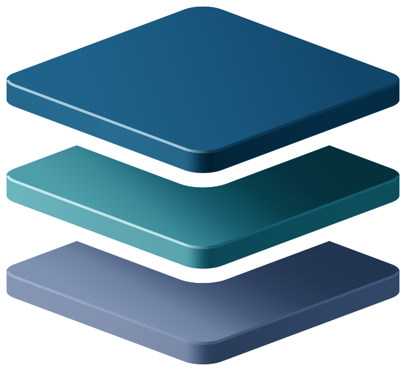
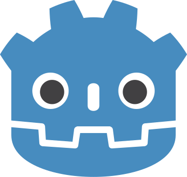
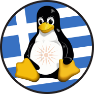
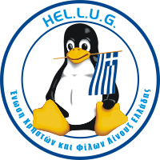
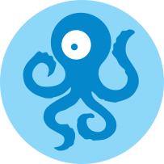
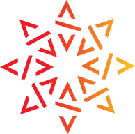

# COMMUNITIES

<table>
<tr><th><code>E-NABLE</code></th><th><code>EUROSTACK</code></th><th><code>GFOSS</code></th><th><code>GNOME</code></th><th><code>GODOT</code></th><th><code>GREEKLUG</code></th></tr>
<tr><td valign="top" align="center"><picture><source media="(prefers-color-scheme: dark)" srcset="https://raw.githubusercontent.com/jimmmyss/FOSSCOMM-2026/main/IDENTITY/SITE/COMMUNITIES/E-NABLE-WHITE.svg?v=26d169de"></picture> -WHITE</td><td valign="top" align="center"><picture><source media="(prefers-color-scheme: dark)" srcset="https://raw.githubusercontent.com/jimmmyss/FOSSCOMM-2026/main/IDENTITY/SITE/COMMUNITIES/EUROSTACK-WHITE.svg?v=2ade10d2"></picture> -WHITE</td><td valign="top" align="center"><picture><source media="(prefers-color-scheme: dark)" srcset="https://raw.githubusercontent.com/jimmmyss/FOSSCOMM-2026/main/IDENTITY/SITE/COMMUNITIES/GFOSS-WHITE.svg?v=f6a4a507"></picture> -BLACK -WHITE</td><td valign="top" align="center"><picture><source media="(prefers-color-scheme: dark)" srcset="https://raw.githubusercontent.com/jimmmyss/FOSSCOMM-2026/main/IDENTITY/SITE/COMMUNITIES/GNOME-WHITE.svg?v=ab82d344"></picture> -WHITE</td><td valign="top" align="center"><picture><source media="(prefers-color-scheme: dark)" srcset="https://raw.githubusercontent.com/jimmmyss/FOSSCOMM-2026/main/IDENTITY/SITE/COMMUNITIES/GODOT-WHITE.svg?v=33fb0614"></picture> -WHITE</td><td valign="top" align="center"><picture><source media="(prefers-color-scheme: dark)" srcset="https://raw.githubusercontent.com/jimmmyss/FOSSCOMM-2026/main/IDENTITY/SITE/COMMUNITIES/GREEKLUG-WHITE.svg?v=2b58fb51"></picture> -WHITE</td></tr>
<tr><th><code>HELLENIC-IT-MUSEUM</code></th><th><code>HELLUG</code></th><th><code>KDE</code></th><th><code>LIBRE-SPACE-FOUNDATION</code></th><th><code>LICHESS</code></th><th><code>LINUX-PROFESSIONAL-INSTITUTE</code></th></tr>
<tr><td valign="top" align="center"><picture><source media="(prefers-color-scheme: dark)" srcset="https://raw.githubusercontent.com/jimmmyss/FOSSCOMM-2026/main/IDENTITY/SITE/COMMUNITIES/HELLENIC-IT-MUSEUM-WHITE.svg?v=930ab455"></picture> -WHITE</td><td valign="top" align="center"><picture><source media="(prefers-color-scheme: dark)" srcset="https://raw.githubusercontent.com/jimmmyss/FOSSCOMM-2026/main/IDENTITY/SITE/COMMUNITIES/HELLUG-WHITE.svg?v=52ed5cff"></picture> -WHITE</td><td valign="top" align="center"><picture><source media="(prefers-color-scheme: dark)" srcset="https://raw.githubusercontent.com/jimmmyss/FOSSCOMM-2026/main/IDENTITY/SITE/COMMUNITIES/KDE-WHITE.svg?v=278a0727"></picture> -WHITE</td><td valign="top" align="center"><picture><source media="(prefers-color-scheme: dark)" srcset="https://raw.githubusercontent.com/jimmmyss/FOSSCOMM-2026/main/IDENTITY/SITE/COMMUNITIES/LIBRE-SPACE-FOUNDATION-WHITE.svg?v=2a876748"></picture> -WHITE</td><td valign="top" align="center"><picture><source media="(prefers-color-scheme: dark)" srcset="https://raw.githubusercontent.com/jimmmyss/FOSSCOMM-2026/main/IDENTITY/SITE/COMMUNITIES/LICHESS-WHITE.svg?v=b672cc79"></picture> -WHITE</td><td valign="top" align="center"><picture><source media="(prefers-color-scheme: dark)" srcset="https://raw.githubusercontent.com/jimmmyss/FOSSCOMM-2026/main/IDENTITY/SITE/COMMUNITIES/LINUX-PROFESSIONAL-INSTITUTE-WHITE.svg?v=0afda2f3"></picture> -WHITE</td></tr>
<tr><th><code>MURENA</code></th><th><code>NEXT-CLOUD</code></th><th><code>ONASSIS-FOUNDATION</code></th><th><code>OONI</code></th><th><code>OPEN-SOURCE-UOM</code></th><th><code>OPENSUSE</code></th></tr>
<tr><td valign="top" align="center"><picture><source media="(prefers-color-scheme: dark)" srcset="https://raw.githubusercontent.com/jimmmyss/FOSSCOMM-2026/main/IDENTITY/SITE/COMMUNITIES/MURENA-WHITE.svg?v=69a388d8"></picture> -WHITE</td><td valign="top" align="center"><picture><source media="(prefers-color-scheme: dark)" srcset="https://raw.githubusercontent.com/jimmmyss/FOSSCOMM-2026/main/IDENTITY/SITE/COMMUNITIES/NEXT-CLOUD-WHITE.svg?v=b5389300"></picture> -WHITE</td><td valign="top" align="center"><picture><source media="(prefers-color-scheme: dark)" srcset="https://raw.githubusercontent.com/jimmmyss/FOSSCOMM-2026/main/IDENTITY/SITE/COMMUNITIES/ONASSIS-FOUNDATION-WHITE.svg?v=809b4995"></picture> -WHITE</td><td valign="top" align="center"><picture><source media="(prefers-color-scheme: dark)" srcset="https://raw.githubusercontent.com/jimmmyss/FOSSCOMM-2026/main/IDENTITY/SITE/COMMUNITIES/OONI-WHITE.svg?v=756135a3"></picture> -WHITE -WHITE-REVERSED</td><td valign="top" align="center"><picture><source media="(prefers-color-scheme: dark)" srcset="https://raw.githubusercontent.com/jimmmyss/FOSSCOMM-2026/main/IDENTITY/SITE/COMMUNITIES/OPEN-SOURCE-UOM-WHITE.svg?v=adbd3b63"></picture> -WHITE</td><td valign="top" align="center"><picture><source media="(prefers-color-scheme: dark)" srcset="https://raw.githubusercontent.com/jimmmyss/FOSSCOMM-2026/main/IDENTITY/SITE/COMMUNITIES/OPENSUSE-WHITE.svg?v=77ea061e"></picture> -WHITE</td></tr>
<tr><th><code>PLATEIA-AI</code></th><th><code>REPORTERS-UNITED</code></th><th><code>SENDIUM</code></th><th><code>SOFTWARE-HERITAGE</code></th><th><code>SOLOMON</code></th><th><code>TINY-TAPEOUT</code></th></tr>
<tr><td valign="top" align="center"><picture><source media="(prefers-color-scheme: dark)" srcset="https://raw.githubusercontent.com/jimmmyss/FOSSCOMM-2026/main/IDENTITY/SITE/COMMUNITIES/PLATEIA-AI-WHITE.svg?v=c390ec7f"></picture> -WHITE</td><td valign="top" align="center"><picture><source media="(prefers-color-scheme: dark)" srcset="https://raw.githubusercontent.com/jimmmyss/FOSSCOMM-2026/main/IDENTITY/SITE/COMMUNITIES/REPORTERS-UNITED-WHITE.svg?v=d9e22cc5"></picture> -WHITE</td><td valign="top" align="center"><picture><source media="(prefers-color-scheme: dark)" srcset="https://raw.githubusercontent.com/jimmmyss/FOSSCOMM-2026/main/IDENTITY/SITE/COMMUNITIES/SENDIUM-WHITE.svg?v=1e1d1933"></picture> -WHITE</td><td valign="top" align="center"><picture><source media="(prefers-color-scheme: dark)" srcset="https://raw.githubusercontent.com/jimmmyss/FOSSCOMM-2026/main/IDENTITY/SITE/COMMUNITIES/SOFTWARE-HERITAGE-WHITE.svg?v=ff389e37"></picture> -WHITE</td><td valign="top" align="center"><picture><source media="(prefers-color-scheme: dark)" srcset="https://raw.githubusercontent.com/jimmmyss/FOSSCOMM-2026/main/IDENTITY/SITE/COMMUNITIES/SOLOMON-WHITE.svg?v=b74736d5"></picture> -WHITE</td><td valign="top" align="center"><picture><source media="(prefers-color-scheme: dark)" srcset="https://raw.githubusercontent.com/jimmmyss/FOSSCOMM-2026/main/IDENTITY/SITE/COMMUNITIES/TINY-TAPEOUT-WHITE.svg?v=240993e8"></picture> -WHITE</td></tr>
<tr><th colspan="2"><code>TOR</code></th><th colspan="2"><code>TOR-LOGO</code></th><th colspan="2"><code>WIKIMEDIA</code></th></tr>
<tr><td colspan="2" valign="top" align="center"><picture><source media="(prefers-color-scheme: dark)" srcset="https://raw.githubusercontent.com/jimmmyss/FOSSCOMM-2026/main/IDENTITY/SITE/COMMUNITIES/TOR-WHITE.svg?v=5d35bc7c"></picture> -WHITE</td><td colspan="2" valign="top" align="center"><picture><source media="(prefers-color-scheme: dark)" srcset="https://raw.githubusercontent.com/jimmmyss/FOSSCOMM-2026/main/IDENTITY/SITE/COMMUNITIES/TOR-LOGO-WHITE.svg?v=ccac0a09"></picture> -WHITE</td><td colspan="2" valign="top" align="center"><picture><source media="(prefers-color-scheme: dark)" srcset="https://raw.githubusercontent.com/jimmmyss/FOSSCOMM-2026/main/IDENTITY/SITE/COMMUNITIES/WIKIMEDIA-WHITE.svg?v=7526ef92"></picture> -WHITE</td></tr>
</table>
