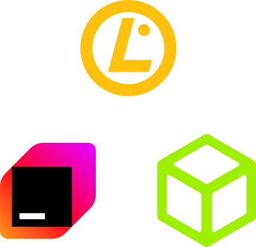
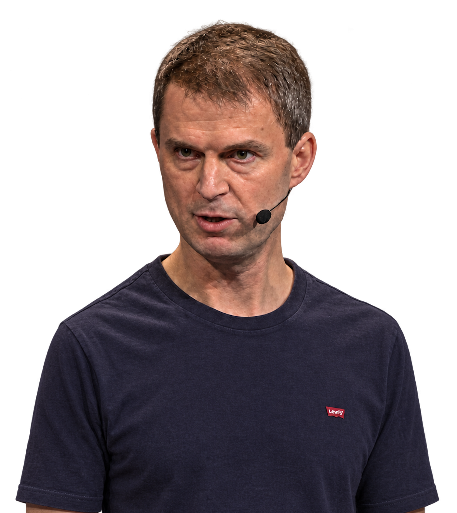

# SITE

<table>
<tr><th><a href="ANNOUNCEMENTS"><code>ANNOUNCEMENTS</code></a></th><th><a href="COMMUNITIES"><code>COMMUNITIES</code></a></th><th><a href="SPEAKERS"><code>SPEAKERS</code></a></th><th><a href="SPONSORS"><code>SPONSORS</code></a></th></tr>
<tr><td valign="top" align="center">    The announcement icons, at rest and hovered.</td><td valign="top" align="center">   The communities' logos.</td><td valign="top" align="center"> The speakers' photos.</td><td valign="top" align="center"><picture><source media="(prefers-color-scheme: dark)" srcset="https://raw.githubusercontent.com/jimmmyss/FOSSCOMM-2026/main/IDENTITY/SITE/SPONSORS/TITLES/DIAMONDS-WHITE.svg?v=a13bd0f1"></picture>  <picture><source media="(prefers-color-scheme: dark)" srcset="https://raw.githubusercontent.com/jimmmyss/FOSSCOMM-2026/main/IDENTITY/SITE/SPONSORS/DIAMONDS/TYPSESENSE.svg?v=f7ed97f3"></picture> <picture><source media="(prefers-color-scheme: dark)" srcset="https://raw.githubusercontent.com/jimmmyss/FOSSCOMM-2026/main/IDENTITY/SITE/SPONSORS/DIAMONDS/LIBRESPACE-WHITE-COLOR.svg?v=65b2f8cb"></picture>   The sponsors' logos by tier, and the tier titles.</td></tr>
</table>
