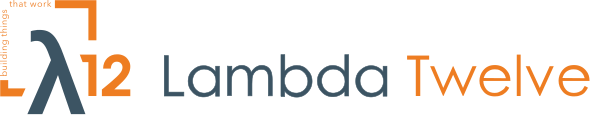
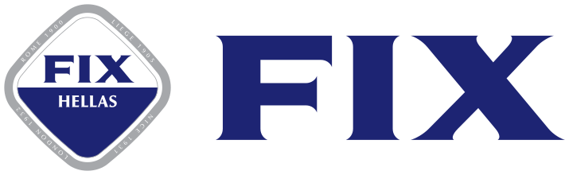
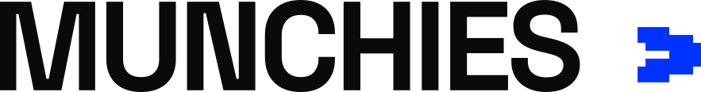
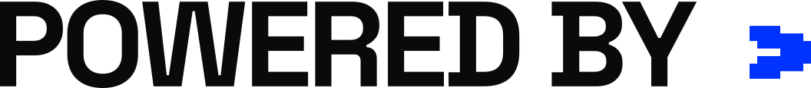

# SPONSORS

<table>
<tr><th><a href="DIAMONDS"><code>DIAMONDS</code></a></th><th><a href="GOLDIES"><code>GOLDIES</code></a></th><th><a href="SILVERS"><code>SILVERS</code></a></th><th><a href="BRONZIES"><code>BRONZIES</code></a></th><th><a href="MUNCHIES"><code>MUNCHIES</code></a></th><th><a href="MEDIA"><code>MEDIA</code></a></th><th><a href="PATRONIES"><code>PATRONIES</code></a></th><th><a href="POWERED-BY"><code>POWERED-BY</code></a></th><th><a href="TITLES"><code>TITLES</code></a></th></tr>
<tr><td valign="top" align="center"><picture><source media="(prefers-color-scheme: dark)" srcset="https://raw.githubusercontent.com/jimmmyss/FOSSCOMM-2026/main/IDENTITY/SITE/SPONSORS/DIAMONDS/TYPSESENSE.svg?v=f7ed97f3"></picture>  <picture><source media="(prefers-color-scheme: dark)" srcset="https://raw.githubusercontent.com/jimmmyss/FOSSCOMM-2026/main/IDENTITY/SITE/SPONSORS/DIAMONDS/LIBRESPACE-WHITE-COLOR.svg?v=65b2f8cb"></picture>  <picture><source media="(prefers-color-scheme: dark)" srcset="https://raw.githubusercontent.com/jimmmyss/FOSSCOMM-2026/main/IDENTITY/SITE/SPONSORS/DIAMONDS/EFOOD-WHITE.svg?v=32131186"></picture></td><td valign="top" align="center"><picture><source media="(prefers-color-scheme: dark)" srcset="https://raw.githubusercontent.com/jimmmyss/FOSSCOMM-2026/main/IDENTITY/SITE/SPONSORS/GOLDIES/HACK-THE-BOX-WHITE.svg?v=102c11f9"></picture>  <picture><source media="(prefers-color-scheme: dark)" srcset="https://raw.githubusercontent.com/jimmmyss/FOSSCOMM-2026/main/IDENTITY/SITE/SPONSORS/GOLDIES/SHOPFLIX-WHITE.svg?v=3e6ad63f"></picture></td><td valign="top" align="center"><picture><source media="(prefers-color-scheme: dark)" srcset="https://raw.githubusercontent.com/jimmmyss/FOSSCOMM-2026/main/IDENTITY/SITE/SPONSORS/SILVERS/SKROUTZ-WHITE.svg?v=272e8137"></picture></td><td valign="top" align="center"><picture><source media="(prefers-color-scheme: dark)" srcset="https://raw.githubusercontent.com/jimmmyss/FOSSCOMM-2026/main/IDENTITY/SITE/SPONSORS/BRONZIES/ONLYOFFICE-WHITE-COLOR.svg?v=736da08d"></picture>  <picture><source media="(prefers-color-scheme: dark)" srcset="https://raw.githubusercontent.com/jimmmyss/FOSSCOMM-2026/main/IDENTITY/SITE/SPONSORS/BRONZIES/TALENTLMS-WHITE.svg?v=95bab409"></picture>  <picture><source media="(prefers-color-scheme: dark)" srcset="https://raw.githubusercontent.com/jimmmyss/FOSSCOMM-2026/main/IDENTITY/SITE/SPONSORS/BRONZIES/FERRYHOPPER-WHITE.svg?v=bc9181a6"></picture>  <picture><source media="(prefers-color-scheme: dark)" srcset="https://raw.githubusercontent.com/jimmmyss/FOSSCOMM-2026/main/IDENTITY/SITE/SPONSORS/BRONZIES/EPE-WHITE.svg?v=1a70d3f1"></picture>  <picture><source media="(prefers-color-scheme: dark)" srcset="https://raw.githubusercontent.com/jimmmyss/FOSSCOMM-2026/main/IDENTITY/SITE/SPONSORS/BRONZIES/LAMDATWELVE-WHITE.svg?v=dfedf6b9"></picture>  <picture><source media="(prefers-color-scheme: dark)" srcset="https://raw.githubusercontent.com/jimmmyss/FOSSCOMM-2026/main/IDENTITY/SITE/SPONSORS/BRONZIES/JETBRAINS-WHITE.svg?v=b505e63d"></picture></td><td valign="top" align="center"><picture><source media="(prefers-color-scheme: dark)" srcset="https://raw.githubusercontent.com/jimmmyss/FOSSCOMM-2026/main/IDENTITY/SITE/SPONSORS/MUNCHIES/KUKI-WHITE.svg?v=5b3a08cc"></picture>  <picture><source media="(prefers-color-scheme: dark)" srcset="https://raw.githubusercontent.com/jimmmyss/FOSSCOMM-2026/main/IDENTITY/SITE/SPONSORS/MUNCHIES/NAMA-WHITE.svg?v=8a7b07e1"></picture>  <picture><source media="(prefers-color-scheme: dark)" srcset="https://raw.githubusercontent.com/jimmmyss/FOSSCOMM-2026/main/IDENTITY/SITE/SPONSORS/MUNCHIES/REDBULL-WHITE.svg?v=0ba6b74a"></picture>  <picture><source media="(prefers-color-scheme: dark)" srcset="https://raw.githubusercontent.com/jimmmyss/FOSSCOMM-2026/main/IDENTITY/SITE/SPONSORS/MUNCHIES/DOMINOS-WHITE.svg?v=74accf31"></picture>  <picture><source media="(prefers-color-scheme: dark)" srcset="https://raw.githubusercontent.com/jimmmyss/FOSSCOMM-2026/main/IDENTITY/SITE/SPONSORS/MUNCHIES/FIX-HELLAS-WHITE.svg?v=95d4e495"></picture></td><td valign="top" align="center"><picture><source media="(prefers-color-scheme: dark)" srcset="https://raw.githubusercontent.com/jimmmyss/FOSSCOMM-2026/main/IDENTITY/SITE/SPONSORS/MEDIA/UNISTUDENTS-WHITE.svg?v=4a9eec6a"></picture>  <picture><source media="(prefers-color-scheme: dark)" srcset="https://raw.githubusercontent.com/jimmmyss/FOSSCOMM-2026/main/IDENTITY/SITE/SPONSORS/MEDIA/ERT-WHITE.svg?v=62293a07"></picture></td><td valign="top" align="center"><picture><source media="(prefers-color-scheme: dark)" srcset="https://raw.githubusercontent.com/jimmmyss/FOSSCOMM-2026/main/IDENTITY/SITE/SPONSORS/PATRONIES/MINISTRY-OF-DIGITAL-GOVERNANCE-WHITE.svg?v=ebbf8e98"></picture></td><td valign="top" align="center"><picture><source media="(prefers-color-scheme: dark)" srcset="https://raw.githubusercontent.com/jimmmyss/FOSSCOMM-2026/main/IDENTITY/SITE/SPONSORS/POWERED-BY/GEEKO-WHITE.svg?v=d0adef83"></picture>  <picture><source media="(prefers-color-scheme: dark)" srcset="https://raw.githubusercontent.com/jimmmyss/FOSSCOMM-2026/main/IDENTITY/SITE/SPONSORS/POWERED-BY/GFOSS-WHITE.svg?v=f6a4a507"></picture>  <picture><source media="(prefers-color-scheme: dark)" srcset="https://raw.githubusercontent.com/jimmmyss/FOSSCOMM-2026/main/IDENTITY/SITE/SPONSORS/POWERED-BY/UNIWA-ICE-WHITE-COLOR.svg?v=53d9e9f7"></picture></td><td valign="top" align="center"><picture><source media="(prefers-color-scheme: dark)" srcset="https://raw.githubusercontent.com/jimmmyss/FOSSCOMM-2026/main/IDENTITY/SITE/SPONSORS/TITLES/DIAMONDS-WHITE.svg?v=a13bd0f1"></picture>  <picture><source media="(prefers-color-scheme: dark)" srcset="https://raw.githubusercontent.com/jimmmyss/FOSSCOMM-2026/main/IDENTITY/SITE/SPONSORS/TITLES/GOLDIES-WHITE.svg?v=130300e1"></picture>  <picture><source media="(prefers-color-scheme: dark)" srcset="https://raw.githubusercontent.com/jimmmyss/FOSSCOMM-2026/main/IDENTITY/SITE/SPONSORS/TITLES/SILVERS-WHITE.svg?v=a350186f"></picture>  <picture><source media="(prefers-color-scheme: dark)" srcset="https://raw.githubusercontent.com/jimmmyss/FOSSCOMM-2026/main/IDENTITY/SITE/SPONSORS/TITLES/BRONZIES-WHITE.svg?v=a41e220e"></picture>  <picture><source media="(prefers-color-scheme: dark)" srcset="https://raw.githubusercontent.com/jimmmyss/FOSSCOMM-2026/main/IDENTITY/SITE/SPONSORS/TITLES/MUNCHIES-WHITE.svg?v=c095713c"></picture>  <picture><source media="(prefers-color-scheme: dark)" srcset="https://raw.githubusercontent.com/jimmmyss/FOSSCOMM-2026/main/IDENTITY/SITE/SPONSORS/TITLES/MEDIA-WHITE.svg?v=94bfe124"></picture>  <picture><source media="(prefers-color-scheme: dark)" srcset="https://raw.githubusercontent.com/jimmmyss/FOSSCOMM-2026/main/IDENTITY/SITE/SPONSORS/TITLES/PATRONIES-WHITE.svg?v=86e16191"></picture>  <picture><source media="(prefers-color-scheme: dark)" srcset="https://raw.githubusercontent.com/jimmmyss/FOSSCOMM-2026/main/IDENTITY/SITE/SPONSORS/TITLES/POWERED-BY-WHITE.svg?v=ad0a3cf6"></picture></td></tr>
</table>
