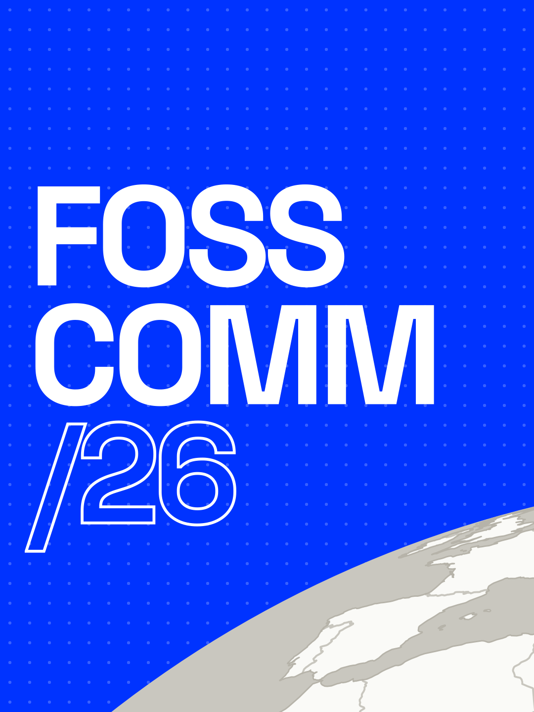
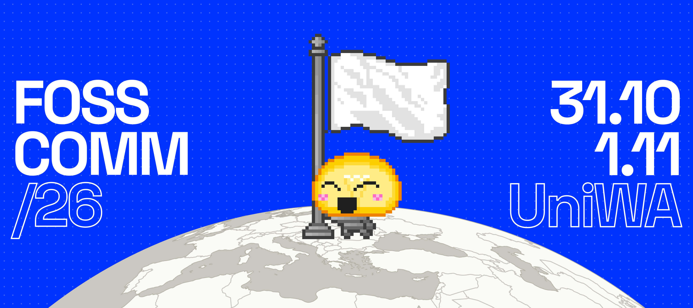
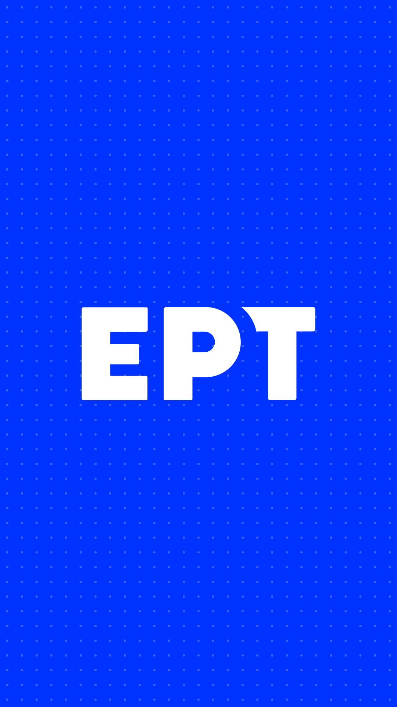
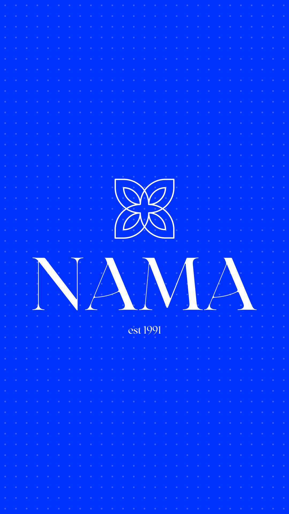

# INSTAGRAM

<table>
<tr><th><code>BANNER-1</code></th><th><code>BANNER-2</code></th><th><code>BANNER-3</code></th><th><code>BANNER</code></th></tr>
<tr><td valign="top" align="center"> 1080 x 1440 px</td><td valign="top" align="center"> 1080 x 1440 px</td><td valign="top" align="center"> 1080 x 1440 px</td><td valign="top" align="center"> 3240 x 1440 px</td></tr>
<tr><th><a href="SPEAKERS"><code>SPEAKERS</code></a></th><th><code>ERT</code></th><th><code>HIGHLIGHT</code></th><th><code>NAMA</code></th></tr>
<tr><td valign="top" align="center"> 17 posts 1080 x 1440 px</td><td valign="top" align="center"> 1080 x 1920 px</td><td valign="top" align="center"> 400 x 400 px</td><td valign="top" align="center"> 1080 x 1920 px</td></tr>
</table>

## VIDEOS

<table>
<tr><th><a href="CALL-FOR-VOLUNTEERS.mp4"><code>CALL-FOR-VOLUNTEERS</code></a></th><th><a href="JJK.mp4"><code>JJK</code></a></th><th><a href="NAMA.mp4"><code>NAMA</code></a></th><th><a href="REGISTRATION-IS-NOW-OPEN.mp4"><code>REGISTRATION-IS-NOW-OPEN</code></a></th></tr>
<tr><td valign="top" align="center">1080 x 1920 px 17.6 s</td><td valign="top" align="center">1920 x 1080 px 32.1 s</td><td valign="top" align="center">1080 x 1920 px 23.8 s</td><td valign="top" align="center">1080 x 1920 px 25.2 s</td></tr>
</table>
