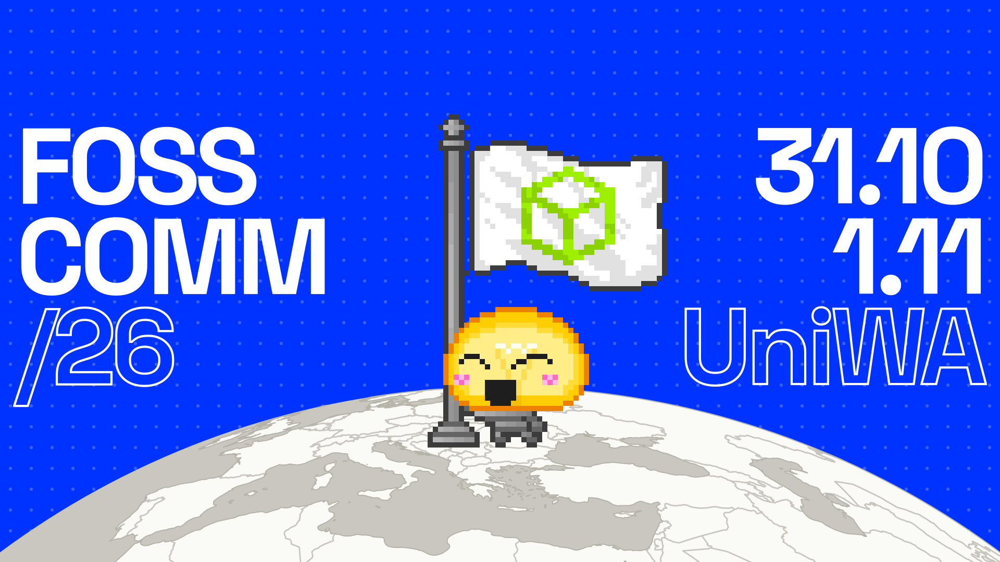
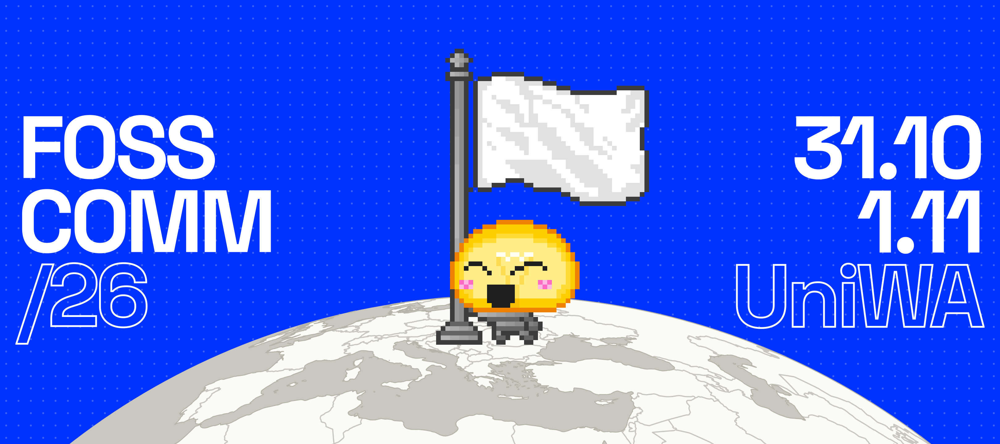
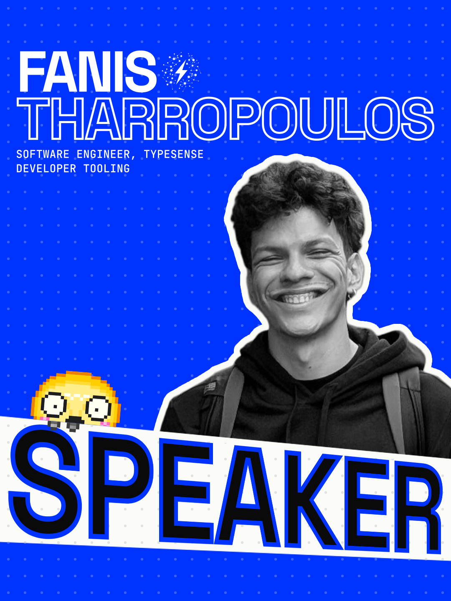
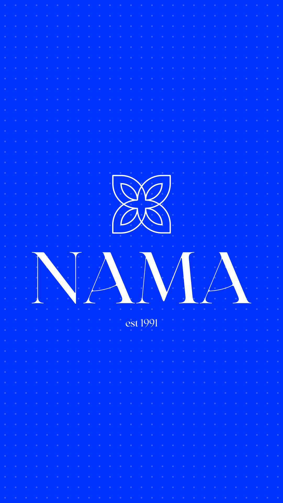
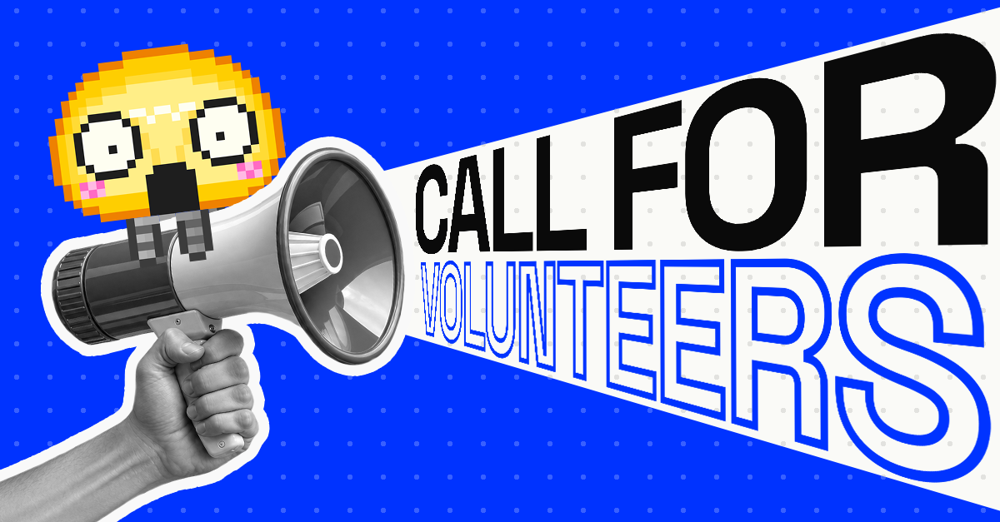
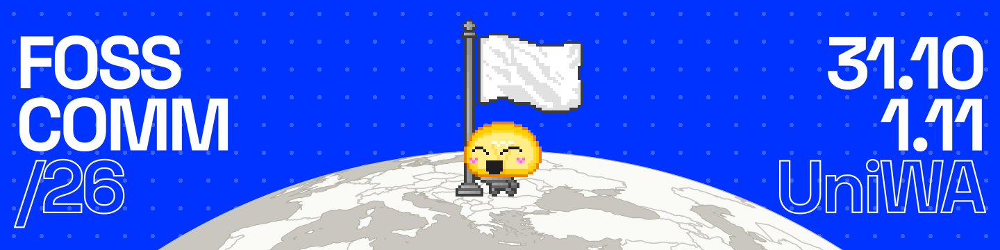
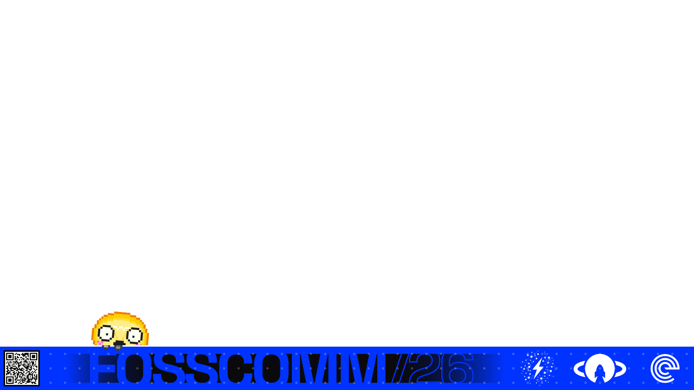

# SOCIAL

<table>
<tr><th><a href="HTB"><code>HTB</code></a></th><th><a href="INSTAGRAM"><code>INSTAGRAM</code></a></th><th><a href="LINKEDIN"><code>LINKEDIN</code></a></th><th><a href="UNISTUDENTS"><code>UNISTUDENTS</code></a></th><th><a href="YOUTUBE"><code>YOUTUBE</code></a></th></tr>
<tr><td valign="top" align="center"> The banner for Hack The Box.</td><td valign="top" align="center">   The posts, carousels, stories, reels and speaker posts.</td><td valign="top" align="center">  The posts, banners and speaker posts.</td><td valign="top" align="center"> The banner for UniStudents.</td><td valign="top" align="center"> The stream overlays and the BRB video.</td></tr>
</table>
