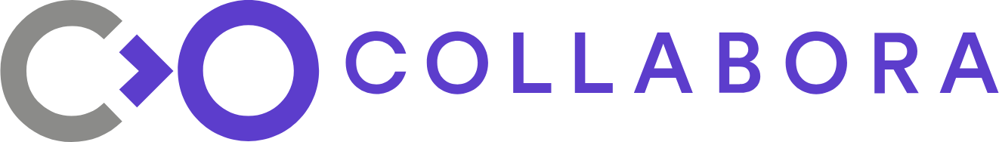

# LOGOS

<table>
<tr><th><code>COLLABORA</code></th><th><code>DELOITTE</code></th><th><code>ENARTIA</code></th><th><code>EY</code></th><th><code>FEDORA</code></th><th><code>GEEKO</code></th></tr>
<tr><td valign="top" align="center"> 1322 x 188 px <a href="COLLABORA.png"><code>.png</code></a></td><td valign="top" align="center"> 1272 x 239 px <a href="DELOITTE.png"><code>.png</code></a></td><td valign="top" align="center"> 1143 x 280 px <a href="ENARTIA.png"><code>.png</code></a></td><td valign="top" align="center"> 500 x 505 px <a href="EY.png"><code>.png</code></a></td><td valign="top" align="center"> 1400 x 394 px <a href="FEDORA.png"><code>.png</code></a></td><td valign="top" align="center"> 729 x 171 px <a href="GEEKO.png"><code>.png</code></a></td></tr>
<tr><th><code>GITLAB</code></th><th><code>HTC</code></th><th><code>JETBRAINS</code></th><th><code>META</code></th><th><code>MOZILLAFOUNDATION</code></th><th><code>NBG</code></th></tr>
<tr><td valign="top" align="center"> 982 x 213 px <a href="GITLAB.png"><code>.png</code></a></td><td valign="top" align="center"> 3743 x 1244 px <a href="HTC.png"><code>.png</code></a></td><td valign="top" align="center"> 1191 x 256 px <a href="JETBRAINS.png"><code>.png</code></a></td><td valign="top" align="center"> 998 x 201 px <a href="META.png"><code>.png</code></a></td><td valign="top" align="center"> 1400 x 292 px <a href="MOZILLAFOUNDATION.png"><code>.png</code></a></td><td valign="top" align="center"> 1000 x 278 px <a href="NBG.png"><code>.png</code></a></td></tr>
<tr><th colspan="2"><code>ONLYOFFICE</code></th><th><code>REDHAT</code></th><th><code>SKROUTZ</code></th><th><code>VIVA</code></th><th><code>WIND</code></th></tr>
<tr><td colspan="2" valign="top" align="center"> 1280 x 822 px <a href="ONLYOFFICE.png"><code>.png</code></a></td><td valign="top" align="center"> 1078 x 255 px <a href="REDHAT.png"><code>.png</code></a></td><td valign="top" align="center"> 1000 x 274 px <a href="SKROUTZ.png"><code>.png</code></a></td><td valign="top" align="center"> 1280 x 282 px <a href="VIVA.png"><code>.png</code></a></td><td valign="top" align="center"> 1194 x 568 px <a href="WIND.png"><code>.png</code></a></td></tr>
</table>
