# PETROS-STRATIS

<table>
<tr><th><code>1</code></th><th><code>2</code></th><th><code>3</code></th><th><code>4</code></th><th><code>5</code></th><th><code>6</code></th></tr>
<tr><td valign="top" align="center">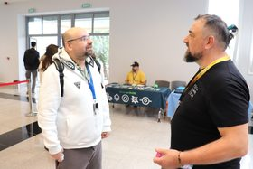 <a href="https://huggingface.co/datasets/jimmysss/FOSSCOMM-2026/resolve/main/PETROS-STRATIS/1.jpg"><code>.jpg</code></a></td><td valign="top" align="center"> <a href="https://huggingface.co/datasets/jimmysss/FOSSCOMM-2026/resolve/main/PETROS-STRATIS/2.jpg"><code>.jpg</code></a></td><td valign="top" align="center">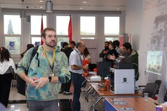 <a href="https://huggingface.co/datasets/jimmysss/FOSSCOMM-2026/resolve/main/PETROS-STRATIS/3.jpg"><code>.jpg</code></a></td><td valign="top" align="center">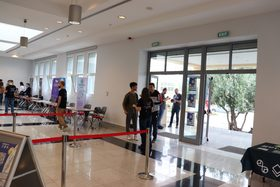 <a href="https://huggingface.co/datasets/jimmysss/FOSSCOMM-2026/resolve/main/PETROS-STRATIS/4.jpg"><code>.jpg</code></a></td><td valign="top" align="center">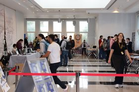 <a href="https://huggingface.co/datasets/jimmysss/FOSSCOMM-2026/resolve/main/PETROS-STRATIS/5.jpg"><code>.jpg</code></a></td><td valign="top" align="center">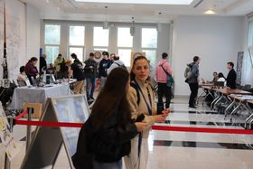 <a href="https://huggingface.co/datasets/jimmysss/FOSSCOMM-2026/resolve/main/PETROS-STRATIS/6.jpg"><code>.jpg</code></a></td></tr>
<tr><th><code>7</code></th><th><code>8</code></th><th><code>9</code></th><th><code>10</code></th><th><code>11</code></th><th><code>12</code></th></tr>
<tr><td valign="top" align="center">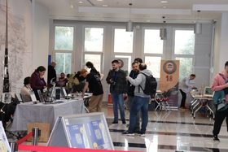 <a href="https://huggingface.co/datasets/jimmysss/FOSSCOMM-2026/resolve/main/PETROS-STRATIS/7.jpg"><code>.jpg</code></a></td><td valign="top" align="center">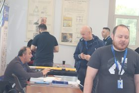 <a href="https://huggingface.co/datasets/jimmysss/FOSSCOMM-2026/resolve/main/PETROS-STRATIS/8.jpg"><code>.jpg</code></a></td><td valign="top" align="center">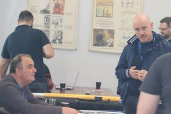 <a href="https://huggingface.co/datasets/jimmysss/FOSSCOMM-2026/resolve/main/PETROS-STRATIS/9.jpg"><code>.jpg</code></a></td><td valign="top" align="center">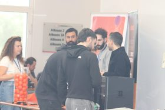 <a href="https://huggingface.co/datasets/jimmysss/FOSSCOMM-2026/resolve/main/PETROS-STRATIS/10.jpg"><code>.jpg</code></a></td><td valign="top" align="center">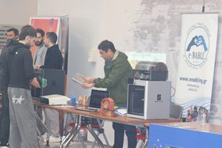 <a href="https://huggingface.co/datasets/jimmysss/FOSSCOMM-2026/resolve/main/PETROS-STRATIS/11.jpg"><code>.jpg</code></a></td><td valign="top" align="center">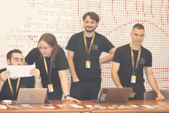 <a href="https://huggingface.co/datasets/jimmysss/FOSSCOMM-2026/resolve/main/PETROS-STRATIS/12.jpg"><code>.jpg</code></a></td></tr>
<tr><th><code>13</code></th><th><code>14</code></th><th><code>15</code></th><th><code>16</code></th><th><code>17</code></th><th><code>18</code></th></tr>
<tr><td valign="top" align="center">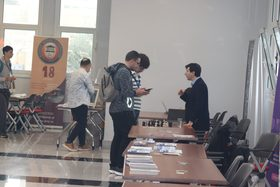 <a href="https://huggingface.co/datasets/jimmysss/FOSSCOMM-2026/resolve/main/PETROS-STRATIS/13.jpg"><code>.jpg</code></a></td><td valign="top" align="center">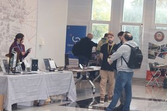 <a href="https://huggingface.co/datasets/jimmysss/FOSSCOMM-2026/resolve/main/PETROS-STRATIS/14.jpg"><code>.jpg</code></a></td><td valign="top" align="center">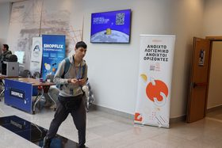 <a href="https://huggingface.co/datasets/jimmysss/FOSSCOMM-2026/resolve/main/PETROS-STRATIS/15.jpg"><code>.jpg</code></a></td><td valign="top" align="center">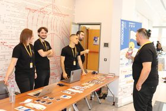 <a href="https://huggingface.co/datasets/jimmysss/FOSSCOMM-2026/resolve/main/PETROS-STRATIS/16.jpg"><code>.jpg</code></a></td><td valign="top" align="center">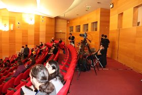 <a href="https://huggingface.co/datasets/jimmysss/FOSSCOMM-2026/resolve/main/PETROS-STRATIS/17.jpg"><code>.jpg</code></a></td><td valign="top" align="center">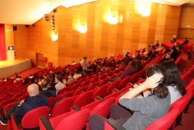 <a href="https://huggingface.co/datasets/jimmysss/FOSSCOMM-2026/resolve/main/PETROS-STRATIS/18.jpg"><code>.jpg</code></a></td></tr>
<tr><th><code>19</code></th><th><code>20</code></th><th><code>21</code></th><th><code>22</code></th><th><code>23</code></th><th><code>24</code></th></tr>
<tr><td valign="top" align="center">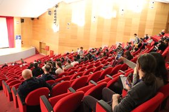 <a href="https://huggingface.co/datasets/jimmysss/FOSSCOMM-2026/resolve/main/PETROS-STRATIS/19.jpg"><code>.jpg</code></a></td><td valign="top" align="center">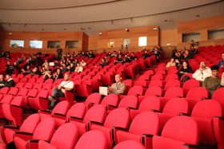 <a href="https://huggingface.co/datasets/jimmysss/FOSSCOMM-2026/resolve/main/PETROS-STRATIS/20.jpg"><code>.jpg</code></a></td><td valign="top" align="center">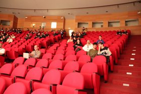 <a href="https://huggingface.co/datasets/jimmysss/FOSSCOMM-2026/resolve/main/PETROS-STRATIS/21.jpg"><code>.jpg</code></a></td><td valign="top" align="center">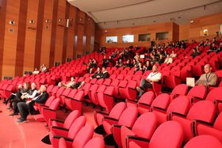 <a href="https://huggingface.co/datasets/jimmysss/FOSSCOMM-2026/resolve/main/PETROS-STRATIS/22.jpg"><code>.jpg</code></a></td><td valign="top" align="center">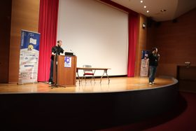 <a href="https://huggingface.co/datasets/jimmysss/FOSSCOMM-2026/resolve/main/PETROS-STRATIS/23.jpg"><code>.jpg</code></a></td><td valign="top" align="center">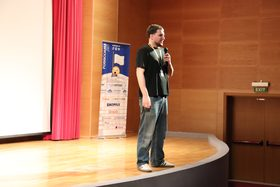 <a href="https://huggingface.co/datasets/jimmysss/FOSSCOMM-2026/resolve/main/PETROS-STRATIS/24.jpg"><code>.jpg</code></a></td></tr>
<tr><th><code>25</code></th><th><code>26</code></th><th><code>27</code></th><th><code>28</code></th><th><code>29</code></th><th><code>30</code></th></tr>
<tr><td valign="top" align="center">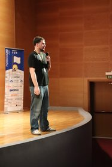 <a href="https://huggingface.co/datasets/jimmysss/FOSSCOMM-2026/resolve/main/PETROS-STRATIS/25.jpg"><code>.jpg</code></a></td><td valign="top" align="center">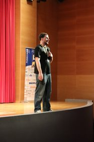 <a href="https://huggingface.co/datasets/jimmysss/FOSSCOMM-2026/resolve/main/PETROS-STRATIS/26.jpg"><code>.jpg</code></a></td><td valign="top" align="center">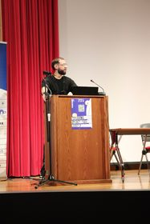 <a href="https://huggingface.co/datasets/jimmysss/FOSSCOMM-2026/resolve/main/PETROS-STRATIS/27.jpg"><code>.jpg</code></a></td><td valign="top" align="center">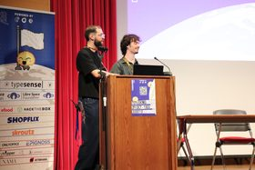 <a href="https://huggingface.co/datasets/jimmysss/FOSSCOMM-2026/resolve/main/PETROS-STRATIS/28.jpg"><code>.jpg</code></a></td><td valign="top" align="center">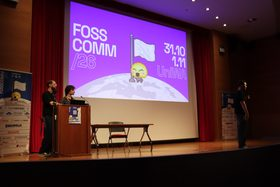 <a href="https://huggingface.co/datasets/jimmysss/FOSSCOMM-2026/resolve/main/PETROS-STRATIS/29.jpg"><code>.jpg</code></a></td><td valign="top" align="center">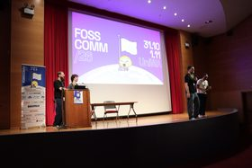 <a href="https://huggingface.co/datasets/jimmysss/FOSSCOMM-2026/resolve/main/PETROS-STRATIS/30.jpg"><code>.jpg</code></a></td></tr>
<tr><th><code>31</code></th><th><code>32</code></th><th><code>33</code></th><th><code>34</code></th><th><code>35</code></th><th><code>36</code></th></tr>
<tr><td valign="top" align="center">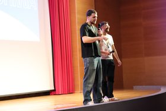 <a href="https://huggingface.co/datasets/jimmysss/FOSSCOMM-2026/resolve/main/PETROS-STRATIS/31.jpg"><code>.jpg</code></a></td><td valign="top" align="center">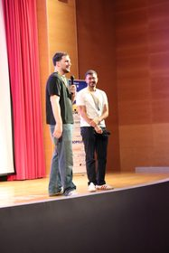 <a href="https://huggingface.co/datasets/jimmysss/FOSSCOMM-2026/resolve/main/PETROS-STRATIS/32.jpg"><code>.jpg</code></a></td><td valign="top" align="center">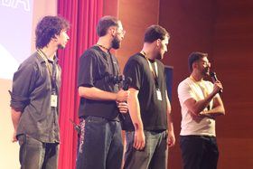 <a href="https://huggingface.co/datasets/jimmysss/FOSSCOMM-2026/resolve/main/PETROS-STRATIS/33.jpg"><code>.jpg</code></a></td><td valign="top" align="center"> <a href="https://huggingface.co/datasets/jimmysss/FOSSCOMM-2026/resolve/main/PETROS-STRATIS/34.jpg"><code>.jpg</code></a></td><td valign="top" align="center"> <a href="https://huggingface.co/datasets/jimmysss/FOSSCOMM-2026/resolve/main/PETROS-STRATIS/35.jpg"><code>.jpg</code></a></td><td valign="top" align="center">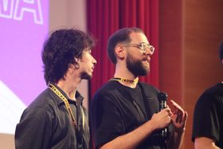 <a href="https://huggingface.co/datasets/jimmysss/FOSSCOMM-2026/resolve/main/PETROS-STRATIS/36.jpg"><code>.jpg</code></a></td></tr>
<tr><th><code>37</code></th><th><code>38</code></th><th><code>39</code></th><th><code>40</code></th><th><code>41</code></th><th><code>42</code></th></tr>
<tr><td valign="top" align="center"> <a href="https://huggingface.co/datasets/jimmysss/FOSSCOMM-2026/resolve/main/PETROS-STRATIS/37.jpg"><code>.jpg</code></a></td><td valign="top" align="center"> <a href="https://huggingface.co/datasets/jimmysss/FOSSCOMM-2026/resolve/main/PETROS-STRATIS/38.jpg"><code>.jpg</code></a></td><td valign="top" align="center"> <a href="https://huggingface.co/datasets/jimmysss/FOSSCOMM-2026/resolve/main/PETROS-STRATIS/39.jpg"><code>.jpg</code></a></td><td valign="top" align="center"> <a href="https://huggingface.co/datasets/jimmysss/FOSSCOMM-2026/resolve/main/PETROS-STRATIS/40.jpg"><code>.jpg</code></a></td><td valign="top" align="center"> <a href="https://huggingface.co/datasets/jimmysss/FOSSCOMM-2026/resolve/main/PETROS-STRATIS/41.jpg"><code>.jpg</code></a></td><td valign="top" align="center">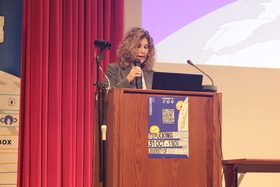 <a href="https://huggingface.co/datasets/jimmysss/FOSSCOMM-2026/resolve/main/PETROS-STRATIS/42.jpg"><code>.jpg</code></a></td></tr>
<tr><th><code>43</code></th><th><code>44</code></th><th><code>45</code></th><th><code>46</code></th><th><code>47</code></th><th><code>48</code></th></tr>
<tr><td valign="top" align="center">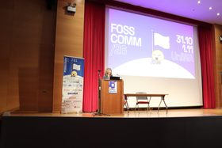 <a href="https://huggingface.co/datasets/jimmysss/FOSSCOMM-2026/resolve/main/PETROS-STRATIS/43.jpg"><code>.jpg</code></a></td><td valign="top" align="center">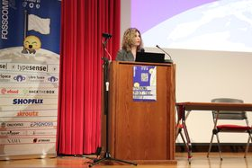 <a href="https://huggingface.co/datasets/jimmysss/FOSSCOMM-2026/resolve/main/PETROS-STRATIS/44.jpg"><code>.jpg</code></a></td><td valign="top" align="center">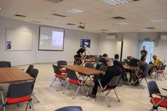 <a href="https://huggingface.co/datasets/jimmysss/FOSSCOMM-2026/resolve/main/PETROS-STRATIS/45.jpg"><code>.jpg</code></a></td><td valign="top" align="center">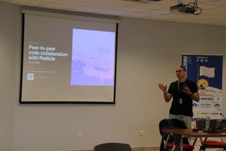 <a href="https://huggingface.co/datasets/jimmysss/FOSSCOMM-2026/resolve/main/PETROS-STRATIS/46.jpg"><code>.jpg</code></a></td><td valign="top" align="center">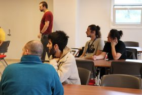 <a href="https://huggingface.co/datasets/jimmysss/FOSSCOMM-2026/resolve/main/PETROS-STRATIS/47.jpg"><code>.jpg</code></a></td><td valign="top" align="center">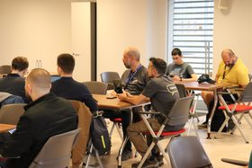 <a href="https://huggingface.co/datasets/jimmysss/FOSSCOMM-2026/resolve/main/PETROS-STRATIS/48.jpg"><code>.jpg</code></a></td></tr>
<tr><th><code>49</code></th><th><code>50</code></th><th><code>51</code></th><th><code>52</code></th><th><code>53</code></th><th><code>54</code></th></tr>
<tr><td valign="top" align="center">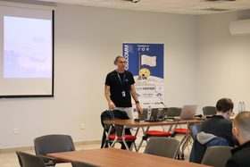 <a href="https://huggingface.co/datasets/jimmysss/FOSSCOMM-2026/resolve/main/PETROS-STRATIS/49.jpg"><code>.jpg</code></a></td><td valign="top" align="center">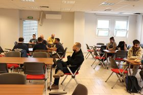 <a href="https://huggingface.co/datasets/jimmysss/FOSSCOMM-2026/resolve/main/PETROS-STRATIS/50.jpg"><code>.jpg</code></a></td><td valign="top" align="center"> <a href="https://huggingface.co/datasets/jimmysss/FOSSCOMM-2026/resolve/main/PETROS-STRATIS/51.jpg"><code>.jpg</code></a></td><td valign="top" align="center">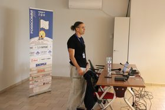 <a href="https://huggingface.co/datasets/jimmysss/FOSSCOMM-2026/resolve/main/PETROS-STRATIS/52.jpg"><code>.jpg</code></a></td><td valign="top" align="center">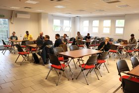 <a href="https://huggingface.co/datasets/jimmysss/FOSSCOMM-2026/resolve/main/PETROS-STRATIS/53.jpg"><code>.jpg</code></a></td><td valign="top" align="center">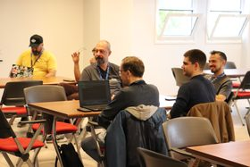 <a href="https://huggingface.co/datasets/jimmysss/FOSSCOMM-2026/resolve/main/PETROS-STRATIS/54.jpg"><code>.jpg</code></a></td></tr>
<tr><th><code>55</code></th><th><code>56</code></th><th><code>57</code></th><th><code>58</code></th><th><code>59</code></th><th><code>60</code></th></tr>
<tr><td valign="top" align="center">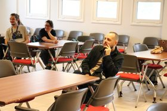 <a href="https://huggingface.co/datasets/jimmysss/FOSSCOMM-2026/resolve/main/PETROS-STRATIS/55.jpg"><code>.jpg</code></a></td><td valign="top" align="center">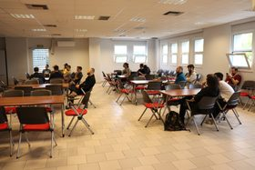 <a href="https://huggingface.co/datasets/jimmysss/FOSSCOMM-2026/resolve/main/PETROS-STRATIS/56.jpg"><code>.jpg</code></a></td><td valign="top" align="center">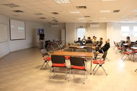 <a href="https://huggingface.co/datasets/jimmysss/FOSSCOMM-2026/resolve/main/PETROS-STRATIS/57.jpg"><code>.jpg</code></a></td><td valign="top" align="center">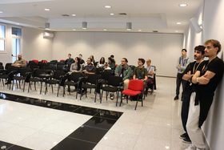 <a href="https://huggingface.co/datasets/jimmysss/FOSSCOMM-2026/resolve/main/PETROS-STRATIS/58.jpg"><code>.jpg</code></a></td><td valign="top" align="center">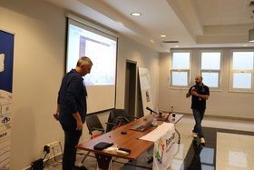 <a href="https://huggingface.co/datasets/jimmysss/FOSSCOMM-2026/resolve/main/PETROS-STRATIS/59.jpg"><code>.jpg</code></a></td><td valign="top" align="center"> <a href="https://huggingface.co/datasets/jimmysss/FOSSCOMM-2026/resolve/main/PETROS-STRATIS/60.jpg"><code>.jpg</code></a></td></tr>
<tr><th><code>61</code></th><th><code>62</code></th><th><code>63</code></th><th><code>64</code></th><th><code>65</code></th><th><code>66</code></th></tr>
<tr><td valign="top" align="center"> <a href="https://huggingface.co/datasets/jimmysss/FOSSCOMM-2026/resolve/main/PETROS-STRATIS/61.jpg"><code>.jpg</code></a></td><td valign="top" align="center"> <a href="https://huggingface.co/datasets/jimmysss/FOSSCOMM-2026/resolve/main/PETROS-STRATIS/62.jpg"><code>.jpg</code></a></td><td valign="top" align="center"> <a href="https://huggingface.co/datasets/jimmysss/FOSSCOMM-2026/resolve/main/PETROS-STRATIS/63.jpg"><code>.jpg</code></a></td><td valign="top" align="center"> <a href="https://huggingface.co/datasets/jimmysss/FOSSCOMM-2026/resolve/main/PETROS-STRATIS/64.jpg"><code>.jpg</code></a></td><td valign="top" align="center"> <a href="https://huggingface.co/datasets/jimmysss/FOSSCOMM-2026/resolve/main/PETROS-STRATIS/65.jpg"><code>.jpg</code></a></td><td valign="top" align="center"> <a href="https://huggingface.co/datasets/jimmysss/FOSSCOMM-2026/resolve/main/PETROS-STRATIS/66.jpg"><code>.jpg</code></a></td></tr>
<tr><th><code>67</code></th><th><code>68</code></th><th><code>69</code></th><th><code>70</code></th><th><code>71</code></th><th><code>72</code></th></tr>
<tr><td valign="top" align="center"> <a href="https://huggingface.co/datasets/jimmysss/FOSSCOMM-2026/resolve/main/PETROS-STRATIS/67.jpg"><code>.jpg</code></a></td><td valign="top" align="center"> <a href="https://huggingface.co/datasets/jimmysss/FOSSCOMM-2026/resolve/main/PETROS-STRATIS/68.jpg"><code>.jpg</code></a></td><td valign="top" align="center"> <a href="https://huggingface.co/datasets/jimmysss/FOSSCOMM-2026/resolve/main/PETROS-STRATIS/69.jpg"><code>.jpg</code></a></td><td valign="top" align="center"> <a href="https://huggingface.co/datasets/jimmysss/FOSSCOMM-2026/resolve/main/PETROS-STRATIS/70.jpg"><code>.jpg</code></a></td><td valign="top" align="center"> <a href="https://huggingface.co/datasets/jimmysss/FOSSCOMM-2026/resolve/main/PETROS-STRATIS/71.jpg"><code>.jpg</code></a></td><td valign="top" align="center"> <a href="https://huggingface.co/datasets/jimmysss/FOSSCOMM-2026/resolve/main/PETROS-STRATIS/72.jpg"><code>.jpg</code></a></td></tr>
<tr><th><code>73</code></th><th><code>74</code></th><th><code>75</code></th><th><code>76</code></th><th><code>77</code></th><th><code>78</code></th></tr>
<tr><td valign="top" align="center"> <a href="https://huggingface.co/datasets/jimmysss/FOSSCOMM-2026/resolve/main/PETROS-STRATIS/73.jpg"><code>.jpg</code></a></td><td valign="top" align="center"> <a href="https://huggingface.co/datasets/jimmysss/FOSSCOMM-2026/resolve/main/PETROS-STRATIS/74.jpg"><code>.jpg</code></a></td><td valign="top" align="center"> <a href="https://huggingface.co/datasets/jimmysss/FOSSCOMM-2026/resolve/main/PETROS-STRATIS/75.jpg"><code>.jpg</code></a></td><td valign="top" align="center"> <a href="https://huggingface.co/datasets/jimmysss/FOSSCOMM-2026/resolve/main/PETROS-STRATIS/76.jpg"><code>.jpg</code></a></td><td valign="top" align="center"> <a href="https://huggingface.co/datasets/jimmysss/FOSSCOMM-2026/resolve/main/PETROS-STRATIS/77.jpg"><code>.jpg</code></a></td><td valign="top" align="center"> <a href="https://huggingface.co/datasets/jimmysss/FOSSCOMM-2026/resolve/main/PETROS-STRATIS/78.jpg"><code>.jpg</code></a></td></tr>
<tr><th><code>79</code></th><th><code>80</code></th><th><code>81</code></th><th><code>82</code></th><th><code>83</code></th><th><code>84</code></th></tr>
<tr><td valign="top" align="center"> <a href="https://huggingface.co/datasets/jimmysss/FOSSCOMM-2026/resolve/main/PETROS-STRATIS/79.jpg"><code>.jpg</code></a></td><td valign="top" align="center"> <a href="https://huggingface.co/datasets/jimmysss/FOSSCOMM-2026/resolve/main/PETROS-STRATIS/80.jpg"><code>.jpg</code></a></td><td valign="top" align="center"> <a href="https://huggingface.co/datasets/jimmysss/FOSSCOMM-2026/resolve/main/PETROS-STRATIS/81.jpg"><code>.jpg</code></a></td><td valign="top" align="center"> <a href="https://huggingface.co/datasets/jimmysss/FOSSCOMM-2026/resolve/main/PETROS-STRATIS/82.jpg"><code>.jpg</code></a></td><td valign="top" align="center"> <a href="https://huggingface.co/datasets/jimmysss/FOSSCOMM-2026/resolve/main/PETROS-STRATIS/83.jpg"><code>.jpg</code></a></td><td valign="top" align="center"> <a href="https://huggingface.co/datasets/jimmysss/FOSSCOMM-2026/resolve/main/PETROS-STRATIS/84.jpg"><code>.jpg</code></a></td></tr>
<tr><th><code>85</code></th><th><code>86</code></th><th><code>87</code></th><th><code>88</code></th><th><code>89</code></th><th><code>90</code></th></tr>
<tr><td valign="top" align="center"> <a href="https://huggingface.co/datasets/jimmysss/FOSSCOMM-2026/resolve/main/PETROS-STRATIS/85.jpg"><code>.jpg</code></a></td><td valign="top" align="center"> <a href="https://huggingface.co/datasets/jimmysss/FOSSCOMM-2026/resolve/main/PETROS-STRATIS/86.jpg"><code>.jpg</code></a></td><td valign="top" align="center"> <a href="https://huggingface.co/datasets/jimmysss/FOSSCOMM-2026/resolve/main/PETROS-STRATIS/87.jpg"><code>.jpg</code></a></td><td valign="top" align="center"> <a href="https://huggingface.co/datasets/jimmysss/FOSSCOMM-2026/resolve/main/PETROS-STRATIS/88.jpg"><code>.jpg</code></a></td><td valign="top" align="center"> <a href="https://huggingface.co/datasets/jimmysss/FOSSCOMM-2026/resolve/main/PETROS-STRATIS/89.jpg"><code>.jpg</code></a></td><td valign="top" align="center"> <a href="https://huggingface.co/datasets/jimmysss/FOSSCOMM-2026/resolve/main/PETROS-STRATIS/90.jpg"><code>.jpg</code></a></td></tr>
<tr><th><code>91</code></th><th><code>92</code></th><th><code>93</code></th><th><code>94</code></th><th><code>95</code></th><th><code>96</code></th></tr>
<tr><td valign="top" align="center"> <a href="https://huggingface.co/datasets/jimmysss/FOSSCOMM-2026/resolve/main/PETROS-STRATIS/91.jpg"><code>.jpg</code></a></td><td valign="top" align="center"> <a href="https://huggingface.co/datasets/jimmysss/FOSSCOMM-2026/resolve/main/PETROS-STRATIS/92.jpg"><code>.jpg</code></a></td><td valign="top" align="center"> <a href="https://huggingface.co/datasets/jimmysss/FOSSCOMM-2026/resolve/main/PETROS-STRATIS/93.jpg"><code>.jpg</code></a></td><td valign="top" align="center"> <a href="https://huggingface.co/datasets/jimmysss/FOSSCOMM-2026/resolve/main/PETROS-STRATIS/94.jpg"><code>.jpg</code></a></td><td valign="top" align="center"> <a href="https://huggingface.co/datasets/jimmysss/FOSSCOMM-2026/resolve/main/PETROS-STRATIS/95.jpg"><code>.jpg</code></a></td><td valign="top" align="center"> <a href="https://huggingface.co/datasets/jimmysss/FOSSCOMM-2026/resolve/main/PETROS-STRATIS/96.jpg"><code>.jpg</code></a></td></tr>
<tr><th><code>97</code></th><th><code>98</code></th><th><code>99</code></th><th><code>100</code></th><th><code>101</code></th><th><code>102</code></th></tr>
<tr><td valign="top" align="center"> <a href="https://huggingface.co/datasets/jimmysss/FOSSCOMM-2026/resolve/main/PETROS-STRATIS/97.jpg"><code>.jpg</code></a></td><td valign="top" align="center"> <a href="https://huggingface.co/datasets/jimmysss/FOSSCOMM-2026/resolve/main/PETROS-STRATIS/98.jpg"><code>.jpg</code></a></td><td valign="top" align="center"> <a href="https://huggingface.co/datasets/jimmysss/FOSSCOMM-2026/resolve/main/PETROS-STRATIS/99.jpg"><code>.jpg</code></a></td><td valign="top" align="center"> <a href="https://huggingface.co/datasets/jimmysss/FOSSCOMM-2026/resolve/main/PETROS-STRATIS/100.jpg"><code>.jpg</code></a></td><td valign="top" align="center"> <a href="https://huggingface.co/datasets/jimmysss/FOSSCOMM-2026/resolve/main/PETROS-STRATIS/101.jpg"><code>.jpg</code></a></td><td valign="top" align="center"> <a href="https://huggingface.co/datasets/jimmysss/FOSSCOMM-2026/resolve/main/PETROS-STRATIS/102.jpg"><code>.jpg</code></a></td></tr>
<tr><th><code>103</code></th><th><code>104</code></th><th><code>105</code></th><th><code>106</code></th><th><code>107</code></th><th><code>108</code></th></tr>
<tr><td valign="top" align="center"> <a href="https://huggingface.co/datasets/jimmysss/FOSSCOMM-2026/resolve/main/PETROS-STRATIS/103.jpg"><code>.jpg</code></a></td><td valign="top" align="center"> <a href="https://huggingface.co/datasets/jimmysss/FOSSCOMM-2026/resolve/main/PETROS-STRATIS/104.jpg"><code>.jpg</code></a></td><td valign="top" align="center"> <a href="https://huggingface.co/datasets/jimmysss/FOSSCOMM-2026/resolve/main/PETROS-STRATIS/105.jpg"><code>.jpg</code></a></td><td valign="top" align="center"> <a href="https://huggingface.co/datasets/jimmysss/FOSSCOMM-2026/resolve/main/PETROS-STRATIS/106.jpg"><code>.jpg</code></a></td><td valign="top" align="center"> <a href="https://huggingface.co/datasets/jimmysss/FOSSCOMM-2026/resolve/main/PETROS-STRATIS/107.jpg"><code>.jpg</code></a></td><td valign="top" align="center"> <a href="https://huggingface.co/datasets/jimmysss/FOSSCOMM-2026/resolve/main/PETROS-STRATIS/108.jpg"><code>.jpg</code></a></td></tr>
<tr><th><code>109</code></th><th><code>110</code></th><th><code>111</code></th><th><code>112</code></th><th><code>113</code></th><th><code>114</code></th></tr>
<tr><td valign="top" align="center"> <a href="https://huggingface.co/datasets/jimmysss/FOSSCOMM-2026/resolve/main/PETROS-STRATIS/109.jpg"><code>.jpg</code></a></td><td valign="top" align="center"> <a href="https://huggingface.co/datasets/jimmysss/FOSSCOMM-2026/resolve/main/PETROS-STRATIS/110.jpg"><code>.jpg</code></a></td><td valign="top" align="center"> <a href="https://huggingface.co/datasets/jimmysss/FOSSCOMM-2026/resolve/main/PETROS-STRATIS/111.jpg"><code>.jpg</code></a></td><td valign="top" align="center"> <a href="https://huggingface.co/datasets/jimmysss/FOSSCOMM-2026/resolve/main/PETROS-STRATIS/112.jpg"><code>.jpg</code></a></td><td valign="top" align="center"> <a href="https://huggingface.co/datasets/jimmysss/FOSSCOMM-2026/resolve/main/PETROS-STRATIS/113.jpg"><code>.jpg</code></a></td><td valign="top" align="center"> <a href="https://huggingface.co/datasets/jimmysss/FOSSCOMM-2026/resolve/main/PETROS-STRATIS/114.jpg"><code>.jpg</code></a></td></tr>
<tr><th><code>115</code></th><th><code>116</code></th><th><code>117</code></th><th><code>118</code></th><th><code>119</code></th><th><code>120</code></th></tr>
<tr><td valign="top" align="center"> <a href="https://huggingface.co/datasets/jimmysss/FOSSCOMM-2026/resolve/main/PETROS-STRATIS/115.jpg"><code>.jpg</code></a></td><td valign="top" align="center"> <a href="https://huggingface.co/datasets/jimmysss/FOSSCOMM-2026/resolve/main/PETROS-STRATIS/116.jpg"><code>.jpg</code></a></td><td valign="top" align="center"> <a href="https://huggingface.co/datasets/jimmysss/FOSSCOMM-2026/resolve/main/PETROS-STRATIS/117.jpg"><code>.jpg</code></a></td><td valign="top" align="center"> <a href="https://huggingface.co/datasets/jimmysss/FOSSCOMM-2026/resolve/main/PETROS-STRATIS/118.jpg"><code>.jpg</code></a></td><td valign="top" align="center"> <a href="https://huggingface.co/datasets/jimmysss/FOSSCOMM-2026/resolve/main/PETROS-STRATIS/119.jpg"><code>.jpg</code></a></td><td valign="top" align="center"> <a href="https://huggingface.co/datasets/jimmysss/FOSSCOMM-2026/resolve/main/PETROS-STRATIS/120.jpg"><code>.jpg</code></a></td></tr>
<tr><th><code>121</code></th><th><code>122</code></th><th><code>123</code></th><th><code>124</code></th><th><code>125</code></th><th><code>126</code></th></tr>
<tr><td valign="top" align="center"> <a href="https://huggingface.co/datasets/jimmysss/FOSSCOMM-2026/resolve/main/PETROS-STRATIS/121.jpg"><code>.jpg</code></a></td><td valign="top" align="center"> <a href="https://huggingface.co/datasets/jimmysss/FOSSCOMM-2026/resolve/main/PETROS-STRATIS/122.jpg"><code>.jpg</code></a></td><td valign="top" align="center"> <a href="https://huggingface.co/datasets/jimmysss/FOSSCOMM-2026/resolve/main/PETROS-STRATIS/123.jpg"><code>.jpg</code></a></td><td valign="top" align="center"> <a href="https://huggingface.co/datasets/jimmysss/FOSSCOMM-2026/resolve/main/PETROS-STRATIS/124.jpg"><code>.jpg</code></a></td><td valign="top" align="center"> <a href="https://huggingface.co/datasets/jimmysss/FOSSCOMM-2026/resolve/main/PETROS-STRATIS/125.jpg"><code>.jpg</code></a></td><td valign="top" align="center"> <a href="https://huggingface.co/datasets/jimmysss/FOSSCOMM-2026/resolve/main/PETROS-STRATIS/126.jpg"><code>.jpg</code></a></td></tr>
<tr><th><code>127</code></th><th><code>128</code></th><th><code>129</code></th><th><code>130</code></th><th><code>131</code></th><th><code>132</code></th></tr>
<tr><td valign="top" align="center"> <a href="https://huggingface.co/datasets/jimmysss/FOSSCOMM-2026/resolve/main/PETROS-STRATIS/127.jpg"><code>.jpg</code></a></td><td valign="top" align="center"> <a href="https://huggingface.co/datasets/jimmysss/FOSSCOMM-2026/resolve/main/PETROS-STRATIS/128.jpg"><code>.jpg</code></a></td><td valign="top" align="center"> <a href="https://huggingface.co/datasets/jimmysss/FOSSCOMM-2026/resolve/main/PETROS-STRATIS/129.jpg"><code>.jpg</code></a></td><td valign="top" align="center"> <a href="https://huggingface.co/datasets/jimmysss/FOSSCOMM-2026/resolve/main/PETROS-STRATIS/130.jpg"><code>.jpg</code></a></td><td valign="top" align="center"> <a href="https://huggingface.co/datasets/jimmysss/FOSSCOMM-2026/resolve/main/PETROS-STRATIS/131.jpg"><code>.jpg</code></a></td><td valign="top" align="center"> <a href="https://huggingface.co/datasets/jimmysss/FOSSCOMM-2026/resolve/main/PETROS-STRATIS/132.jpg"><code>.jpg</code></a></td></tr>
<tr><th><code>133</code></th><th><code>134</code></th><th><code>135</code></th><th><code>136</code></th><th><code>137</code></th><th><code>138</code></th></tr>
<tr><td valign="top" align="center"> <a href="https://huggingface.co/datasets/jimmysss/FOSSCOMM-2026/resolve/main/PETROS-STRATIS/133.jpg"><code>.jpg</code></a></td><td valign="top" align="center"> <a href="https://huggingface.co/datasets/jimmysss/FOSSCOMM-2026/resolve/main/PETROS-STRATIS/134.jpg"><code>.jpg</code></a></td><td valign="top" align="center"> <a href="https://huggingface.co/datasets/jimmysss/FOSSCOMM-2026/resolve/main/PETROS-STRATIS/135.jpg"><code>.jpg</code></a></td><td valign="top" align="center"> <a href="https://huggingface.co/datasets/jimmysss/FOSSCOMM-2026/resolve/main/PETROS-STRATIS/136.jpg"><code>.jpg</code></a></td><td valign="top" align="center"> <a href="https://huggingface.co/datasets/jimmysss/FOSSCOMM-2026/resolve/main/PETROS-STRATIS/137.jpg"><code>.jpg</code></a></td><td valign="top" align="center"> <a href="https://huggingface.co/datasets/jimmysss/FOSSCOMM-2026/resolve/main/PETROS-STRATIS/138.jpg"><code>.jpg</code></a></td></tr>
<tr><th><code>139</code></th><th><code>140</code></th><th><code>141</code></th><th><code>142</code></th><th><code>143</code></th><th><code>144</code></th></tr>
<tr><td valign="top" align="center"> <a href="https://huggingface.co/datasets/jimmysss/FOSSCOMM-2026/resolve/main/PETROS-STRATIS/139.jpg"><code>.jpg</code></a></td><td valign="top" align="center"> <a href="https://huggingface.co/datasets/jimmysss/FOSSCOMM-2026/resolve/main/PETROS-STRATIS/140.jpg"><code>.jpg</code></a></td><td valign="top" align="center"> <a href="https://huggingface.co/datasets/jimmysss/FOSSCOMM-2026/resolve/main/PETROS-STRATIS/141.jpg"><code>.jpg</code></a></td><td valign="top" align="center"> <a href="https://huggingface.co/datasets/jimmysss/FOSSCOMM-2026/resolve/main/PETROS-STRATIS/142.jpg"><code>.jpg</code></a></td><td valign="top" align="center"> <a href="https://huggingface.co/datasets/jimmysss/FOSSCOMM-2026/resolve/main/PETROS-STRATIS/143.jpg"><code>.jpg</code></a></td><td valign="top" align="center"> <a href="https://huggingface.co/datasets/jimmysss/FOSSCOMM-2026/resolve/main/PETROS-STRATIS/144.jpg"><code>.jpg</code></a></td></tr>
<tr><th><code>145</code></th><th><code>146</code></th><th><code>147</code></th><th><code>148</code></th><th><code>149</code></th><th><code>150</code></th></tr>
<tr><td valign="top" align="center"> <a href="https://huggingface.co/datasets/jimmysss/FOSSCOMM-2026/resolve/main/PETROS-STRATIS/145.jpg"><code>.jpg</code></a></td><td valign="top" align="center"> <a href="https://huggingface.co/datasets/jimmysss/FOSSCOMM-2026/resolve/main/PETROS-STRATIS/146.jpg"><code>.jpg</code></a></td><td valign="top" align="center"> <a href="https://huggingface.co/datasets/jimmysss/FOSSCOMM-2026/resolve/main/PETROS-STRATIS/147.jpg"><code>.jpg</code></a></td><td valign="top" align="center"> <a href="https://huggingface.co/datasets/jimmysss/FOSSCOMM-2026/resolve/main/PETROS-STRATIS/148.jpg"><code>.jpg</code></a></td><td valign="top" align="center"> <a href="https://huggingface.co/datasets/jimmysss/FOSSCOMM-2026/resolve/main/PETROS-STRATIS/149.jpg"><code>.jpg</code></a></td><td valign="top" align="center"> <a href="https://huggingface.co/datasets/jimmysss/FOSSCOMM-2026/resolve/main/PETROS-STRATIS/150.jpg"><code>.jpg</code></a></td></tr>
<tr><th><code>151</code></th><th><code>152</code></th><th><code>153</code></th><th><code>154</code></th><th><code>155</code></th><th><code>156</code></th></tr>
<tr><td valign="top" align="center"> <a href="https://huggingface.co/datasets/jimmysss/FOSSCOMM-2026/resolve/main/PETROS-STRATIS/151.jpg"><code>.jpg</code></a></td><td valign="top" align="center"> <a href="https://huggingface.co/datasets/jimmysss/FOSSCOMM-2026/resolve/main/PETROS-STRATIS/152.jpg"><code>.jpg</code></a></td><td valign="top" align="center"> <a href="https://huggingface.co/datasets/jimmysss/FOSSCOMM-2026/resolve/main/PETROS-STRATIS/153.jpg"><code>.jpg</code></a></td><td valign="top" align="center"> <a href="https://huggingface.co/datasets/jimmysss/FOSSCOMM-2026/resolve/main/PETROS-STRATIS/154.jpg"><code>.jpg</code></a></td><td valign="top" align="center"> <a href="https://huggingface.co/datasets/jimmysss/FOSSCOMM-2026/resolve/main/PETROS-STRATIS/155.jpg"><code>.jpg</code></a></td><td valign="top" align="center"> <a href="https://huggingface.co/datasets/jimmysss/FOSSCOMM-2026/resolve/main/PETROS-STRATIS/156.jpg"><code>.jpg</code></a></td></tr>
<tr><th><code>157</code></th><th><code>158</code></th><th><code>159</code></th><th><code>160</code></th><th><code>161</code></th><th><code>162</code></th></tr>
<tr><td valign="top" align="center"> <a href="https://huggingface.co/datasets/jimmysss/FOSSCOMM-2026/resolve/main/PETROS-STRATIS/157.jpg"><code>.jpg</code></a></td><td valign="top" align="center"> <a href="https://huggingface.co/datasets/jimmysss/FOSSCOMM-2026/resolve/main/PETROS-STRATIS/158.jpg"><code>.jpg</code></a></td><td valign="top" align="center"> <a href="https://huggingface.co/datasets/jimmysss/FOSSCOMM-2026/resolve/main/PETROS-STRATIS/159.jpg"><code>.jpg</code></a></td><td valign="top" align="center"> <a href="https://huggingface.co/datasets/jimmysss/FOSSCOMM-2026/resolve/main/PETROS-STRATIS/160.jpg"><code>.jpg</code></a></td><td valign="top" align="center"> <a href="https://huggingface.co/datasets/jimmysss/FOSSCOMM-2026/resolve/main/PETROS-STRATIS/161.jpg"><code>.jpg</code></a></td><td valign="top" align="center"> <a href="https://huggingface.co/datasets/jimmysss/FOSSCOMM-2026/resolve/main/PETROS-STRATIS/162.jpg"><code>.jpg</code></a></td></tr>
<tr><th><code>163</code></th><th><code>164</code></th><th><code>165</code></th><th><code>166</code></th><th><code>167</code></th><th><code>168</code></th></tr>
<tr><td valign="top" align="center"> <a href="https://huggingface.co/datasets/jimmysss/FOSSCOMM-2026/resolve/main/PETROS-STRATIS/163.jpg"><code>.jpg</code></a></td><td valign="top" align="center"> <a href="https://huggingface.co/datasets/jimmysss/FOSSCOMM-2026/resolve/main/PETROS-STRATIS/164.jpg"><code>.jpg</code></a></td><td valign="top" align="center"> <a href="https://huggingface.co/datasets/jimmysss/FOSSCOMM-2026/resolve/main/PETROS-STRATIS/165.jpg"><code>.jpg</code></a></td><td valign="top" align="center"> <a href="https://huggingface.co/datasets/jimmysss/FOSSCOMM-2026/resolve/main/PETROS-STRATIS/166.jpg"><code>.jpg</code></a></td><td valign="top" align="center"> <a href="https://huggingface.co/datasets/jimmysss/FOSSCOMM-2026/resolve/main/PETROS-STRATIS/167.jpg"><code>.jpg</code></a></td><td valign="top" align="center"> <a href="https://huggingface.co/datasets/jimmysss/FOSSCOMM-2026/resolve/main/PETROS-STRATIS/168.jpg"><code>.jpg</code></a></td></tr>
<tr><th><code>169</code></th><th><code>170</code></th><th><code>171</code></th><th><code>172</code></th><th><code>173</code></th><th><code>174</code></th></tr>
<tr><td valign="top" align="center"> <a href="https://huggingface.co/datasets/jimmysss/FOSSCOMM-2026/resolve/main/PETROS-STRATIS/169.jpg"><code>.jpg</code></a></td><td valign="top" align="center"> <a href="https://huggingface.co/datasets/jimmysss/FOSSCOMM-2026/resolve/main/PETROS-STRATIS/170.jpg"><code>.jpg</code></a></td><td valign="top" align="center"> <a href="https://huggingface.co/datasets/jimmysss/FOSSCOMM-2026/resolve/main/PETROS-STRATIS/171.jpg"><code>.jpg</code></a></td><td valign="top" align="center"> <a href="https://huggingface.co/datasets/jimmysss/FOSSCOMM-2026/resolve/main/PETROS-STRATIS/172.jpg"><code>.jpg</code></a></td><td valign="top" align="center"> <a href="https://huggingface.co/datasets/jimmysss/FOSSCOMM-2026/resolve/main/PETROS-STRATIS/173.jpg"><code>.jpg</code></a></td><td valign="top" align="center"> <a href="https://huggingface.co/datasets/jimmysss/FOSSCOMM-2026/resolve/main/PETROS-STRATIS/174.jpg"><code>.jpg</code></a></td></tr>
<tr><th><code>175</code></th><th><code>176</code></th><th><code>177</code></th><th><code>178</code></th><th><code>179</code></th><th><code>180</code></th></tr>
<tr><td valign="top" align="center"> <a href="https://huggingface.co/datasets/jimmysss/FOSSCOMM-2026/resolve/main/PETROS-STRATIS/175.jpg"><code>.jpg</code></a></td><td valign="top" align="center"> <a href="https://huggingface.co/datasets/jimmysss/FOSSCOMM-2026/resolve/main/PETROS-STRATIS/176.jpg"><code>.jpg</code></a></td><td valign="top" align="center"> <a href="https://huggingface.co/datasets/jimmysss/FOSSCOMM-2026/resolve/main/PETROS-STRATIS/177.jpg"><code>.jpg</code></a></td><td valign="top" align="center"> <a href="https://huggingface.co/datasets/jimmysss/FOSSCOMM-2026/resolve/main/PETROS-STRATIS/178.jpg"><code>.jpg</code></a></td><td valign="top" align="center"> <a href="https://huggingface.co/datasets/jimmysss/FOSSCOMM-2026/resolve/main/PETROS-STRATIS/179.jpg"><code>.jpg</code></a></td><td valign="top" align="center"> <a href="https://huggingface.co/datasets/jimmysss/FOSSCOMM-2026/resolve/main/PETROS-STRATIS/180.jpg"><code>.jpg</code></a></td></tr>
<tr><th><code>181</code></th><th><code>182</code></th><th><code>183</code></th><th><code>184</code></th><th><code>185</code></th><th><code>186</code></th></tr>
<tr><td valign="top" align="center"> <a href="https://huggingface.co/datasets/jimmysss/FOSSCOMM-2026/resolve/main/PETROS-STRATIS/181.jpg"><code>.jpg</code></a></td><td valign="top" align="center"> <a href="https://huggingface.co/datasets/jimmysss/FOSSCOMM-2026/resolve/main/PETROS-STRATIS/182.jpg"><code>.jpg</code></a></td><td valign="top" align="center"> <a href="https://huggingface.co/datasets/jimmysss/FOSSCOMM-2026/resolve/main/PETROS-STRATIS/183.jpg"><code>.jpg</code></a></td><td valign="top" align="center"> <a href="https://huggingface.co/datasets/jimmysss/FOSSCOMM-2026/resolve/main/PETROS-STRATIS/184.jpg"><code>.jpg</code></a></td><td valign="top" align="center"> <a href="https://huggingface.co/datasets/jimmysss/FOSSCOMM-2026/resolve/main/PETROS-STRATIS/185.jpg"><code>.jpg</code></a></td><td valign="top" align="center"> <a href="https://huggingface.co/datasets/jimmysss/FOSSCOMM-2026/resolve/main/PETROS-STRATIS/186.jpg"><code>.jpg</code></a></td></tr>
<tr><th><code>187</code></th><th><code>188</code></th><th><code>189</code></th><th><code>190</code></th><th><code>191</code></th><th><code>192</code></th></tr>
<tr><td valign="top" align="center"> <a href="https://huggingface.co/datasets/jimmysss/FOSSCOMM-2026/resolve/main/PETROS-STRATIS/187.jpg"><code>.jpg</code></a></td><td valign="top" align="center"> <a href="https://huggingface.co/datasets/jimmysss/FOSSCOMM-2026/resolve/main/PETROS-STRATIS/188.jpg"><code>.jpg</code></a></td><td valign="top" align="center"> <a href="https://huggingface.co/datasets/jimmysss/FOSSCOMM-2026/resolve/main/PETROS-STRATIS/189.jpg"><code>.jpg</code></a></td><td valign="top" align="center"> <a href="https://huggingface.co/datasets/jimmysss/FOSSCOMM-2026/resolve/main/PETROS-STRATIS/190.jpg"><code>.jpg</code></a></td><td valign="top" align="center"> <a href="https://huggingface.co/datasets/jimmysss/FOSSCOMM-2026/resolve/main/PETROS-STRATIS/191.jpg"><code>.jpg</code></a></td><td valign="top" align="center"> <a href="https://huggingface.co/datasets/jimmysss/FOSSCOMM-2026/resolve/main/PETROS-STRATIS/192.jpg"><code>.jpg</code></a></td></tr>
<tr><th><code>193</code></th><th><code>194</code></th><th><code>195</code></th><th><code>196</code></th><th><code>197</code></th><th><code>198</code></th></tr>
<tr><td valign="top" align="center"> <a href="https://huggingface.co/datasets/jimmysss/FOSSCOMM-2026/resolve/main/PETROS-STRATIS/193.jpg"><code>.jpg</code></a></td><td valign="top" align="center"> <a href="https://huggingface.co/datasets/jimmysss/FOSSCOMM-2026/resolve/main/PETROS-STRATIS/194.jpg"><code>.jpg</code></a></td><td valign="top" align="center"> <a href="https://huggingface.co/datasets/jimmysss/FOSSCOMM-2026/resolve/main/PETROS-STRATIS/195.jpg"><code>.jpg</code></a></td><td valign="top" align="center"> <a href="https://huggingface.co/datasets/jimmysss/FOSSCOMM-2026/resolve/main/PETROS-STRATIS/196.jpg"><code>.jpg</code></a></td><td valign="top" align="center"> <a href="https://huggingface.co/datasets/jimmysss/FOSSCOMM-2026/resolve/main/PETROS-STRATIS/197.jpg"><code>.jpg</code></a></td><td valign="top" align="center"> <a href="https://huggingface.co/datasets/jimmysss/FOSSCOMM-2026/resolve/main/PETROS-STRATIS/198.jpg"><code>.jpg</code></a></td></tr>
<tr><th><code>199</code></th><th><code>200</code></th><th><code>201</code></th><th><code>202</code></th><th><code>203</code></th><th><code>204</code></th></tr>
<tr><td valign="top" align="center"> <a href="https://huggingface.co/datasets/jimmysss/FOSSCOMM-2026/resolve/main/PETROS-STRATIS/199.jpg"><code>.jpg</code></a></td><td valign="top" align="center"> <a href="https://huggingface.co/datasets/jimmysss/FOSSCOMM-2026/resolve/main/PETROS-STRATIS/200.jpg"><code>.jpg</code></a></td><td valign="top" align="center"> <a href="https://huggingface.co/datasets/jimmysss/FOSSCOMM-2026/resolve/main/PETROS-STRATIS/201.jpg"><code>.jpg</code></a></td><td valign="top" align="center"> <a href="https://huggingface.co/datasets/jimmysss/FOSSCOMM-2026/resolve/main/PETROS-STRATIS/202.jpg"><code>.jpg</code></a></td><td valign="top" align="center"> <a href="https://huggingface.co/datasets/jimmysss/FOSSCOMM-2026/resolve/main/PETROS-STRATIS/203.jpg"><code>.jpg</code></a></td><td valign="top" align="center"> <a href="https://huggingface.co/datasets/jimmysss/FOSSCOMM-2026/resolve/main/PETROS-STRATIS/204.jpg"><code>.jpg</code></a></td></tr>
<tr><th><code>205</code></th><th><code>206</code></th><th><code>207</code></th><th><code>208</code></th><th><code>209</code></th><th><code>210</code></th></tr>
<tr><td valign="top" align="center"> <a href="https://huggingface.co/datasets/jimmysss/FOSSCOMM-2026/resolve/main/PETROS-STRATIS/205.jpg"><code>.jpg</code></a></td><td valign="top" align="center"> <a href="https://huggingface.co/datasets/jimmysss/FOSSCOMM-2026/resolve/main/PETROS-STRATIS/206.jpg"><code>.jpg</code></a></td><td valign="top" align="center"> <a href="https://huggingface.co/datasets/jimmysss/FOSSCOMM-2026/resolve/main/PETROS-STRATIS/207.jpg"><code>.jpg</code></a></td><td valign="top" align="center"> <a href="https://huggingface.co/datasets/jimmysss/FOSSCOMM-2026/resolve/main/PETROS-STRATIS/208.jpg"><code>.jpg</code></a></td><td valign="top" align="center"> <a href="https://huggingface.co/datasets/jimmysss/FOSSCOMM-2026/resolve/main/PETROS-STRATIS/209.jpg"><code>.jpg</code></a></td><td valign="top" align="center"> <a href="https://huggingface.co/datasets/jimmysss/FOSSCOMM-2026/resolve/main/PETROS-STRATIS/210.jpg"><code>.jpg</code></a></td></tr>
<tr><th><code>211</code></th><th><code>212</code></th><th><code>213</code></th><th><code>214</code></th><th><code>215</code></th><th><code>216</code></th></tr>
<tr><td valign="top" align="center"> <a href="https://huggingface.co/datasets/jimmysss/FOSSCOMM-2026/resolve/main/PETROS-STRATIS/211.jpg"><code>.jpg</code></a></td><td valign="top" align="center"> <a href="https://huggingface.co/datasets/jimmysss/FOSSCOMM-2026/resolve/main/PETROS-STRATIS/212.jpg"><code>.jpg</code></a></td><td valign="top" align="center"> <a href="https://huggingface.co/datasets/jimmysss/FOSSCOMM-2026/resolve/main/PETROS-STRATIS/213.jpg"><code>.jpg</code></a></td><td valign="top" align="center"> <a href="https://huggingface.co/datasets/jimmysss/FOSSCOMM-2026/resolve/main/PETROS-STRATIS/214.jpg"><code>.jpg</code></a></td><td valign="top" align="center"> <a href="https://huggingface.co/datasets/jimmysss/FOSSCOMM-2026/resolve/main/PETROS-STRATIS/215.jpg"><code>.jpg</code></a></td><td valign="top" align="center"> <a href="https://huggingface.co/datasets/jimmysss/FOSSCOMM-2026/resolve/main/PETROS-STRATIS/216.jpg"><code>.jpg</code></a></td></tr>
<tr><th><code>217</code></th><th><code>218</code></th><th><code>219</code></th><th><code>220</code></th><th><code>221</code></th><th><code>222</code></th></tr>
<tr><td valign="top" align="center"> <a href="https://huggingface.co/datasets/jimmysss/FOSSCOMM-2026/resolve/main/PETROS-STRATIS/217.jpg"><code>.jpg</code></a></td><td valign="top" align="center"> <a href="https://huggingface.co/datasets/jimmysss/FOSSCOMM-2026/resolve/main/PETROS-STRATIS/218.jpg"><code>.jpg</code></a></td><td valign="top" align="center"> <a href="https://huggingface.co/datasets/jimmysss/FOSSCOMM-2026/resolve/main/PETROS-STRATIS/219.jpg"><code>.jpg</code></a></td><td valign="top" align="center"> <a href="https://huggingface.co/datasets/jimmysss/FOSSCOMM-2026/resolve/main/PETROS-STRATIS/220.jpg"><code>.jpg</code></a></td><td valign="top" align="center"> <a href="https://huggingface.co/datasets/jimmysss/FOSSCOMM-2026/resolve/main/PETROS-STRATIS/221.jpg"><code>.jpg</code></a></td><td valign="top" align="center"> <a href="https://huggingface.co/datasets/jimmysss/FOSSCOMM-2026/resolve/main/PETROS-STRATIS/222.jpg"><code>.jpg</code></a></td></tr>
<tr><th><code>223</code></th><th><code>224</code></th><th><code>225</code></th><th><code>226</code></th><th><code>227</code></th><th><code>228</code></th></tr>
<tr><td valign="top" align="center"> <a href="https://huggingface.co/datasets/jimmysss/FOSSCOMM-2026/resolve/main/PETROS-STRATIS/223.jpg"><code>.jpg</code></a></td><td valign="top" align="center"> <a href="https://huggingface.co/datasets/jimmysss/FOSSCOMM-2026/resolve/main/PETROS-STRATIS/224.jpg"><code>.jpg</code></a></td><td valign="top" align="center"> <a href="https://huggingface.co/datasets/jimmysss/FOSSCOMM-2026/resolve/main/PETROS-STRATIS/225.jpg"><code>.jpg</code></a></td><td valign="top" align="center"> <a href="https://huggingface.co/datasets/jimmysss/FOSSCOMM-2026/resolve/main/PETROS-STRATIS/226.jpg"><code>.jpg</code></a></td><td valign="top" align="center"> <a href="https://huggingface.co/datasets/jimmysss/FOSSCOMM-2026/resolve/main/PETROS-STRATIS/227.jpg"><code>.jpg</code></a></td><td valign="top" align="center"> <a href="https://huggingface.co/datasets/jimmysss/FOSSCOMM-2026/resolve/main/PETROS-STRATIS/228.jpg"><code>.jpg</code></a></td></tr>
<tr><th><code>229</code></th><th><code>230</code></th><th><code>231</code></th><th><code>232</code></th><th><code>233</code></th><th><code>234</code></th></tr>
<tr><td valign="top" align="center"> <a href="https://huggingface.co/datasets/jimmysss/FOSSCOMM-2026/resolve/main/PETROS-STRATIS/229.jpg"><code>.jpg</code></a></td><td valign="top" align="center"> <a href="https://huggingface.co/datasets/jimmysss/FOSSCOMM-2026/resolve/main/PETROS-STRATIS/230.jpg"><code>.jpg</code></a></td><td valign="top" align="center"> <a href="https://huggingface.co/datasets/jimmysss/FOSSCOMM-2026/resolve/main/PETROS-STRATIS/231.jpg"><code>.jpg</code></a></td><td valign="top" align="center"> <a href="https://huggingface.co/datasets/jimmysss/FOSSCOMM-2026/resolve/main/PETROS-STRATIS/232.jpg"><code>.jpg</code></a></td><td valign="top" align="center"> <a href="https://huggingface.co/datasets/jimmysss/FOSSCOMM-2026/resolve/main/PETROS-STRATIS/233.jpg"><code>.jpg</code></a></td><td valign="top" align="center"> <a href="https://huggingface.co/datasets/jimmysss/FOSSCOMM-2026/resolve/main/PETROS-STRATIS/234.jpg"><code>.jpg</code></a></td></tr>
<tr><th><code>235</code></th><th><code>236</code></th><th><code>237</code></th><th><code>238</code></th><th><code>239</code></th><th><code>240</code></th></tr>
<tr><td valign="top" align="center"> <a href="https://huggingface.co/datasets/jimmysss/FOSSCOMM-2026/resolve/main/PETROS-STRATIS/235.jpg"><code>.jpg</code></a></td><td valign="top" align="center"> <a href="https://huggingface.co/datasets/jimmysss/FOSSCOMM-2026/resolve/main/PETROS-STRATIS/236.jpg"><code>.jpg</code></a></td><td valign="top" align="center"> <a href="https://huggingface.co/datasets/jimmysss/FOSSCOMM-2026/resolve/main/PETROS-STRATIS/237.jpg"><code>.jpg</code></a></td><td valign="top" align="center"> <a href="https://huggingface.co/datasets/jimmysss/FOSSCOMM-2026/resolve/main/PETROS-STRATIS/238.jpg"><code>.jpg</code></a></td><td valign="top" align="center"> <a href="https://huggingface.co/datasets/jimmysss/FOSSCOMM-2026/resolve/main/PETROS-STRATIS/239.jpg"><code>.jpg</code></a></td><td valign="top" align="center"> <a href="https://huggingface.co/datasets/jimmysss/FOSSCOMM-2026/resolve/main/PETROS-STRATIS/240.jpg"><code>.jpg</code></a></td></tr>
<tr><th><code>241</code></th><th><code>242</code></th><th><code>243</code></th><th><code>244</code></th><th><code>245</code></th><th><code>246</code></th></tr>
<tr><td valign="top" align="center"> <a href="https://huggingface.co/datasets/jimmysss/FOSSCOMM-2026/resolve/main/PETROS-STRATIS/241.jpg"><code>.jpg</code></a></td><td valign="top" align="center"> <a href="https://huggingface.co/datasets/jimmysss/FOSSCOMM-2026/resolve/main/PETROS-STRATIS/242.jpg"><code>.jpg</code></a></td><td valign="top" align="center"> <a href="https://huggingface.co/datasets/jimmysss/FOSSCOMM-2026/resolve/main/PETROS-STRATIS/243.jpg"><code>.jpg</code></a></td><td valign="top" align="center"> <a href="https://huggingface.co/datasets/jimmysss/FOSSCOMM-2026/resolve/main/PETROS-STRATIS/244.jpg"><code>.jpg</code></a></td><td valign="top" align="center"> <a href="https://huggingface.co/datasets/jimmysss/FOSSCOMM-2026/resolve/main/PETROS-STRATIS/245.jpg"><code>.jpg</code></a></td><td valign="top" align="center"> <a href="https://huggingface.co/datasets/jimmysss/FOSSCOMM-2026/resolve/main/PETROS-STRATIS/246.jpg"><code>.jpg</code></a></td></tr>
<tr><th><code>247</code></th><th><code>248</code></th><th><code>249</code></th><th><code>250</code></th><th><code>251</code></th><th><code>252</code></th></tr>
<tr><td valign="top" align="center"> <a href="https://huggingface.co/datasets/jimmysss/FOSSCOMM-2026/resolve/main/PETROS-STRATIS/247.jpg"><code>.jpg</code></a></td><td valign="top" align="center"> <a href="https://huggingface.co/datasets/jimmysss/FOSSCOMM-2026/resolve/main/PETROS-STRATIS/248.jpg"><code>.jpg</code></a></td><td valign="top" align="center"> <a href="https://huggingface.co/datasets/jimmysss/FOSSCOMM-2026/resolve/main/PETROS-STRATIS/249.jpg"><code>.jpg</code></a></td><td valign="top" align="center"> <a href="https://huggingface.co/datasets/jimmysss/FOSSCOMM-2026/resolve/main/PETROS-STRATIS/250.jpg"><code>.jpg</code></a></td><td valign="top" align="center"> <a href="https://huggingface.co/datasets/jimmysss/FOSSCOMM-2026/resolve/main/PETROS-STRATIS/251.jpg"><code>.jpg</code></a></td><td valign="top" align="center"> <a href="https://huggingface.co/datasets/jimmysss/FOSSCOMM-2026/resolve/main/PETROS-STRATIS/252.jpg"><code>.jpg</code></a></td></tr>
<tr><th><code>253</code></th><th><code>254</code></th><th><code>255</code></th><th><code>256</code></th><th><code>257</code></th><th><code>258</code></th></tr>
<tr><td valign="top" align="center"> <a href="https://huggingface.co/datasets/jimmysss/FOSSCOMM-2026/resolve/main/PETROS-STRATIS/253.jpg"><code>.jpg</code></a></td><td valign="top" align="center"> <a href="https://huggingface.co/datasets/jimmysss/FOSSCOMM-2026/resolve/main/PETROS-STRATIS/254.jpg"><code>.jpg</code></a></td><td valign="top" align="center"> <a href="https://huggingface.co/datasets/jimmysss/FOSSCOMM-2026/resolve/main/PETROS-STRATIS/255.jpg"><code>.jpg</code></a></td><td valign="top" align="center"> <a href="https://huggingface.co/datasets/jimmysss/FOSSCOMM-2026/resolve/main/PETROS-STRATIS/256.jpg"><code>.jpg</code></a></td><td valign="top" align="center"> <a href="https://huggingface.co/datasets/jimmysss/FOSSCOMM-2026/resolve/main/PETROS-STRATIS/257.jpg"><code>.jpg</code></a></td><td valign="top" align="center"> <a href="https://huggingface.co/datasets/jimmysss/FOSSCOMM-2026/resolve/main/PETROS-STRATIS/258.jpg"><code>.jpg</code></a></td></tr>
<tr><th><code>259</code></th><th><code>260</code></th><th><code>261</code></th><th><code>262</code></th><th><code>263</code></th><th><code>264</code></th></tr>
<tr><td valign="top" align="center"> <a href="https://huggingface.co/datasets/jimmysss/FOSSCOMM-2026/resolve/main/PETROS-STRATIS/259.jpg"><code>.jpg</code></a></td><td valign="top" align="center"> <a href="https://huggingface.co/datasets/jimmysss/FOSSCOMM-2026/resolve/main/PETROS-STRATIS/260.jpg"><code>.jpg</code></a></td><td valign="top" align="center"> <a href="https://huggingface.co/datasets/jimmysss/FOSSCOMM-2026/resolve/main/PETROS-STRATIS/261.jpg"><code>.jpg</code></a></td><td valign="top" align="center"> <a href="https://huggingface.co/datasets/jimmysss/FOSSCOMM-2026/resolve/main/PETROS-STRATIS/262.jpg"><code>.jpg</code></a></td><td valign="top" align="center"> <a href="https://huggingface.co/datasets/jimmysss/FOSSCOMM-2026/resolve/main/PETROS-STRATIS/263.jpg"><code>.jpg</code></a></td><td valign="top" align="center"> <a href="https://huggingface.co/datasets/jimmysss/FOSSCOMM-2026/resolve/main/PETROS-STRATIS/264.jpg"><code>.jpg</code></a></td></tr>
<tr><th><code>265</code></th><th><code>266</code></th><th><code>267</code></th><th><code>268</code></th><th><code>269</code></th><th><code>270</code></th></tr>
<tr><td valign="top" align="center"> <a href="https://huggingface.co/datasets/jimmysss/FOSSCOMM-2026/resolve/main/PETROS-STRATIS/265.jpg"><code>.jpg</code></a></td><td valign="top" align="center"> <a href="https://huggingface.co/datasets/jimmysss/FOSSCOMM-2026/resolve/main/PETROS-STRATIS/266.jpg"><code>.jpg</code></a></td><td valign="top" align="center"> <a href="https://huggingface.co/datasets/jimmysss/FOSSCOMM-2026/resolve/main/PETROS-STRATIS/267.jpg"><code>.jpg</code></a></td><td valign="top" align="center"> <a href="https://huggingface.co/datasets/jimmysss/FOSSCOMM-2026/resolve/main/PETROS-STRATIS/268.jpg"><code>.jpg</code></a></td><td valign="top" align="center"> <a href="https://huggingface.co/datasets/jimmysss/FOSSCOMM-2026/resolve/main/PETROS-STRATIS/269.jpg"><code>.jpg</code></a></td><td valign="top" align="center"> <a href="https://huggingface.co/datasets/jimmysss/FOSSCOMM-2026/resolve/main/PETROS-STRATIS/270.jpg"><code>.jpg</code></a></td></tr>
<tr><th><code>271</code></th><th><code>272</code></th><th><code>273</code></th><th><code>274</code></th><th><code>275</code></th><th><code>276</code></th></tr>
<tr><td valign="top" align="center"> <a href="https://huggingface.co/datasets/jimmysss/FOSSCOMM-2026/resolve/main/PETROS-STRATIS/271.jpg"><code>.jpg</code></a></td><td valign="top" align="center"> <a href="https://huggingface.co/datasets/jimmysss/FOSSCOMM-2026/resolve/main/PETROS-STRATIS/272.jpg"><code>.jpg</code></a></td><td valign="top" align="center"> <a href="https://huggingface.co/datasets/jimmysss/FOSSCOMM-2026/resolve/main/PETROS-STRATIS/273.jpg"><code>.jpg</code></a></td><td valign="top" align="center"> <a href="https://huggingface.co/datasets/jimmysss/FOSSCOMM-2026/resolve/main/PETROS-STRATIS/274.jpg"><code>.jpg</code></a></td><td valign="top" align="center"> <a href="https://huggingface.co/datasets/jimmysss/FOSSCOMM-2026/resolve/main/PETROS-STRATIS/275.jpg"><code>.jpg</code></a></td><td valign="top" align="center"> <a href="https://huggingface.co/datasets/jimmysss/FOSSCOMM-2026/resolve/main/PETROS-STRATIS/276.jpg"><code>.jpg</code></a></td></tr>
<tr><th><code>277</code></th><th><code>278</code></th><th><code>279</code></th><th><code>280</code></th><th><code>281</code></th><th><code>282</code></th></tr>
<tr><td valign="top" align="center"> <a href="https://huggingface.co/datasets/jimmysss/FOSSCOMM-2026/resolve/main/PETROS-STRATIS/277.jpg"><code>.jpg</code></a></td><td valign="top" align="center"> <a href="https://huggingface.co/datasets/jimmysss/FOSSCOMM-2026/resolve/main/PETROS-STRATIS/278.jpg"><code>.jpg</code></a></td><td valign="top" align="center"> <a href="https://huggingface.co/datasets/jimmysss/FOSSCOMM-2026/resolve/main/PETROS-STRATIS/279.jpg"><code>.jpg</code></a></td><td valign="top" align="center"> <a href="https://huggingface.co/datasets/jimmysss/FOSSCOMM-2026/resolve/main/PETROS-STRATIS/280.jpg"><code>.jpg</code></a></td><td valign="top" align="center"> <a href="https://huggingface.co/datasets/jimmysss/FOSSCOMM-2026/resolve/main/PETROS-STRATIS/281.jpg"><code>.jpg</code></a></td><td valign="top" align="center"> <a href="https://huggingface.co/datasets/jimmysss/FOSSCOMM-2026/resolve/main/PETROS-STRATIS/282.jpg"><code>.jpg</code></a></td></tr>
<tr><th><code>283</code></th><th><code>284</code></th><th><code>285</code></th><th><code>286</code></th><th><code>287</code></th><th><code>288</code></th></tr>
<tr><td valign="top" align="center"> <a href="https://huggingface.co/datasets/jimmysss/FOSSCOMM-2026/resolve/main/PETROS-STRATIS/283.jpg"><code>.jpg</code></a></td><td valign="top" align="center"> <a href="https://huggingface.co/datasets/jimmysss/FOSSCOMM-2026/resolve/main/PETROS-STRATIS/284.jpg"><code>.jpg</code></a></td><td valign="top" align="center"> <a href="https://huggingface.co/datasets/jimmysss/FOSSCOMM-2026/resolve/main/PETROS-STRATIS/285.jpg"><code>.jpg</code></a></td><td valign="top" align="center"> <a href="https://huggingface.co/datasets/jimmysss/FOSSCOMM-2026/resolve/main/PETROS-STRATIS/286.jpg"><code>.jpg</code></a></td><td valign="top" align="center"> <a href="https://huggingface.co/datasets/jimmysss/FOSSCOMM-2026/resolve/main/PETROS-STRATIS/287.jpg"><code>.jpg</code></a></td><td valign="top" align="center"> <a href="https://huggingface.co/datasets/jimmysss/FOSSCOMM-2026/resolve/main/PETROS-STRATIS/288.jpg"><code>.jpg</code></a></td></tr>
<tr><th><code>289</code></th><th><code>290</code></th><th><code>291</code></th><th><code>292</code></th><th><code>293</code></th><th><code>294</code></th></tr>
<tr><td valign="top" align="center"> <a href="https://huggingface.co/datasets/jimmysss/FOSSCOMM-2026/resolve/main/PETROS-STRATIS/289.jpg"><code>.jpg</code></a></td><td valign="top" align="center"> <a href="https://huggingface.co/datasets/jimmysss/FOSSCOMM-2026/resolve/main/PETROS-STRATIS/290.jpg"><code>.jpg</code></a></td><td valign="top" align="center"> <a href="https://huggingface.co/datasets/jimmysss/FOSSCOMM-2026/resolve/main/PETROS-STRATIS/291.jpg"><code>.jpg</code></a></td><td valign="top" align="center"> <a href="https://huggingface.co/datasets/jimmysss/FOSSCOMM-2026/resolve/main/PETROS-STRATIS/292.jpg"><code>.jpg</code></a></td><td valign="top" align="center"> <a href="https://huggingface.co/datasets/jimmysss/FOSSCOMM-2026/resolve/main/PETROS-STRATIS/293.jpg"><code>.jpg</code></a></td><td valign="top" align="center"> <a href="https://huggingface.co/datasets/jimmysss/FOSSCOMM-2026/resolve/main/PETROS-STRATIS/294.jpg"><code>.jpg</code></a></td></tr>
<tr><th><code>295</code></th><th><code>296</code></th><th><code>297</code></th><th><code>298</code></th><th><code>299</code></th><th><code>300</code></th></tr>
<tr><td valign="top" align="center"> <a href="https://huggingface.co/datasets/jimmysss/FOSSCOMM-2026/resolve/main/PETROS-STRATIS/295.jpg"><code>.jpg</code></a></td><td valign="top" align="center"> <a href="https://huggingface.co/datasets/jimmysss/FOSSCOMM-2026/resolve/main/PETROS-STRATIS/296.jpg"><code>.jpg</code></a></td><td valign="top" align="center"> <a href="https://huggingface.co/datasets/jimmysss/FOSSCOMM-2026/resolve/main/PETROS-STRATIS/297.jpg"><code>.jpg</code></a></td><td valign="top" align="center"> <a href="https://huggingface.co/datasets/jimmysss/FOSSCOMM-2026/resolve/main/PETROS-STRATIS/298.jpg"><code>.jpg</code></a></td><td valign="top" align="center"> <a href="https://huggingface.co/datasets/jimmysss/FOSSCOMM-2026/resolve/main/PETROS-STRATIS/299.jpg"><code>.jpg</code></a></td><td valign="top" align="center"> <a href="https://huggingface.co/datasets/jimmysss/FOSSCOMM-2026/resolve/main/PETROS-STRATIS/300.jpg"><code>.jpg</code></a></td></tr>
<tr><th><code>301</code></th><th><code>302</code></th><th><code>303</code></th><th><code>304</code></th><th><code>305</code></th><th><code>306</code></th></tr>
<tr><td valign="top" align="center"> <a href="https://huggingface.co/datasets/jimmysss/FOSSCOMM-2026/resolve/main/PETROS-STRATIS/301.jpg"><code>.jpg</code></a></td><td valign="top" align="center"> <a href="https://huggingface.co/datasets/jimmysss/FOSSCOMM-2026/resolve/main/PETROS-STRATIS/302.jpg"><code>.jpg</code></a></td><td valign="top" align="center"> <a href="https://huggingface.co/datasets/jimmysss/FOSSCOMM-2026/resolve/main/PETROS-STRATIS/303.jpg"><code>.jpg</code></a></td><td valign="top" align="center"> <a href="https://huggingface.co/datasets/jimmysss/FOSSCOMM-2026/resolve/main/PETROS-STRATIS/304.jpg"><code>.jpg</code></a></td><td valign="top" align="center"> <a href="https://huggingface.co/datasets/jimmysss/FOSSCOMM-2026/resolve/main/PETROS-STRATIS/305.jpg"><code>.jpg</code></a></td><td valign="top" align="center"> <a href="https://huggingface.co/datasets/jimmysss/FOSSCOMM-2026/resolve/main/PETROS-STRATIS/306.jpg"><code>.jpg</code></a></td></tr>
<tr><th><code>307</code></th><th><code>308</code></th><th><code>309</code></th><th><code>310</code></th><th><code>311</code></th><th><code>312</code></th></tr>
<tr><td valign="top" align="center"> <a href="https://huggingface.co/datasets/jimmysss/FOSSCOMM-2026/resolve/main/PETROS-STRATIS/307.jpg"><code>.jpg</code></a></td><td valign="top" align="center"> <a href="https://huggingface.co/datasets/jimmysss/FOSSCOMM-2026/resolve/main/PETROS-STRATIS/308.jpg"><code>.jpg</code></a></td><td valign="top" align="center"> <a href="https://huggingface.co/datasets/jimmysss/FOSSCOMM-2026/resolve/main/PETROS-STRATIS/309.jpg"><code>.jpg</code></a></td><td valign="top" align="center"> <a href="https://huggingface.co/datasets/jimmysss/FOSSCOMM-2026/resolve/main/PETROS-STRATIS/310.jpg"><code>.jpg</code></a></td><td valign="top" align="center"> <a href="https://huggingface.co/datasets/jimmysss/FOSSCOMM-2026/resolve/main/PETROS-STRATIS/311.jpg"><code>.jpg</code></a></td><td valign="top" align="center"> <a href="https://huggingface.co/datasets/jimmysss/FOSSCOMM-2026/resolve/main/PETROS-STRATIS/312.jpg"><code>.jpg</code></a></td></tr>
<tr><th><code>313</code></th><th><code>314</code></th><th><code>315</code></th><th><code>316</code></th><th><code>317</code></th><th><code>318</code></th></tr>
<tr><td valign="top" align="center"> <a href="https://huggingface.co/datasets/jimmysss/FOSSCOMM-2026/resolve/main/PETROS-STRATIS/313.jpg"><code>.jpg</code></a></td><td valign="top" align="center"> <a href="https://huggingface.co/datasets/jimmysss/FOSSCOMM-2026/resolve/main/PETROS-STRATIS/314.jpg"><code>.jpg</code></a></td><td valign="top" align="center"> <a href="https://huggingface.co/datasets/jimmysss/FOSSCOMM-2026/resolve/main/PETROS-STRATIS/315.jpg"><code>.jpg</code></a></td><td valign="top" align="center"> <a href="https://huggingface.co/datasets/jimmysss/FOSSCOMM-2026/resolve/main/PETROS-STRATIS/316.jpg"><code>.jpg</code></a></td><td valign="top" align="center"> <a href="https://huggingface.co/datasets/jimmysss/FOSSCOMM-2026/resolve/main/PETROS-STRATIS/317.jpg"><code>.jpg</code></a></td><td valign="top" align="center"> <a href="https://huggingface.co/datasets/jimmysss/FOSSCOMM-2026/resolve/main/PETROS-STRATIS/318.jpg"><code>.jpg</code></a></td></tr>
<tr><th><code>319</code></th><th><code>320</code></th><th><code>321</code></th><th><code>322</code></th><th><code>323</code></th><th><code>324</code></th></tr>
<tr><td valign="top" align="center"> <a href="https://huggingface.co/datasets/jimmysss/FOSSCOMM-2026/resolve/main/PETROS-STRATIS/319.jpg"><code>.jpg</code></a></td><td valign="top" align="center"> <a href="https://huggingface.co/datasets/jimmysss/FOSSCOMM-2026/resolve/main/PETROS-STRATIS/320.jpg"><code>.jpg</code></a></td><td valign="top" align="center"> <a href="https://huggingface.co/datasets/jimmysss/FOSSCOMM-2026/resolve/main/PETROS-STRATIS/321.jpg"><code>.jpg</code></a></td><td valign="top" align="center"> <a href="https://huggingface.co/datasets/jimmysss/FOSSCOMM-2026/resolve/main/PETROS-STRATIS/322.jpg"><code>.jpg</code></a></td><td valign="top" align="center"> <a href="https://huggingface.co/datasets/jimmysss/FOSSCOMM-2026/resolve/main/PETROS-STRATIS/323.jpg"><code>.jpg</code></a></td><td valign="top" align="center"> <a href="https://huggingface.co/datasets/jimmysss/FOSSCOMM-2026/resolve/main/PETROS-STRATIS/324.jpg"><code>.jpg</code></a></td></tr>
<tr><th><code>325</code></th><th><code>326</code></th><th><code>327</code></th><th><code>328</code></th><th><code>329</code></th><th><code>330</code></th></tr>
<tr><td valign="top" align="center"> <a href="https://huggingface.co/datasets/jimmysss/FOSSCOMM-2026/resolve/main/PETROS-STRATIS/325.jpg"><code>.jpg</code></a></td><td valign="top" align="center"> <a href="https://huggingface.co/datasets/jimmysss/FOSSCOMM-2026/resolve/main/PETROS-STRATIS/326.jpg"><code>.jpg</code></a></td><td valign="top" align="center"> <a href="https://huggingface.co/datasets/jimmysss/FOSSCOMM-2026/resolve/main/PETROS-STRATIS/327.jpg"><code>.jpg</code></a></td><td valign="top" align="center"> <a href="https://huggingface.co/datasets/jimmysss/FOSSCOMM-2026/resolve/main/PETROS-STRATIS/328.jpg"><code>.jpg</code></a></td><td valign="top" align="center"> <a href="https://huggingface.co/datasets/jimmysss/FOSSCOMM-2026/resolve/main/PETROS-STRATIS/329.jpg"><code>.jpg</code></a></td><td valign="top" align="center"> <a href="https://huggingface.co/datasets/jimmysss/FOSSCOMM-2026/resolve/main/PETROS-STRATIS/330.jpg"><code>.jpg</code></a></td></tr>
<tr><th><code>331</code></th><th><code>332</code></th><th><code>333</code></th><th><code>334</code></th><th><code>335</code></th><th><code>336</code></th></tr>
<tr><td valign="top" align="center"> <a href="https://huggingface.co/datasets/jimmysss/FOSSCOMM-2026/resolve/main/PETROS-STRATIS/331.jpg"><code>.jpg</code></a></td><td valign="top" align="center"> <a href="https://huggingface.co/datasets/jimmysss/FOSSCOMM-2026/resolve/main/PETROS-STRATIS/332.jpg"><code>.jpg</code></a></td><td valign="top" align="center"> <a href="https://huggingface.co/datasets/jimmysss/FOSSCOMM-2026/resolve/main/PETROS-STRATIS/333.jpg"><code>.jpg</code></a></td><td valign="top" align="center"> <a href="https://huggingface.co/datasets/jimmysss/FOSSCOMM-2026/resolve/main/PETROS-STRATIS/334.jpg"><code>.jpg</code></a></td><td valign="top" align="center"> <a href="https://huggingface.co/datasets/jimmysss/FOSSCOMM-2026/resolve/main/PETROS-STRATIS/335.jpg"><code>.jpg</code></a></td><td valign="top" align="center"> <a href="https://huggingface.co/datasets/jimmysss/FOSSCOMM-2026/resolve/main/PETROS-STRATIS/336.jpg"><code>.jpg</code></a></td></tr>
<tr><th><code>337</code></th><th><code>338</code></th><th><code>339</code></th><th><code>340</code></th><th><code>341</code></th><th><code>342</code></th></tr>
<tr><td valign="top" align="center"> <a href="https://huggingface.co/datasets/jimmysss/FOSSCOMM-2026/resolve/main/PETROS-STRATIS/337.jpg"><code>.jpg</code></a></td><td valign="top" align="center"> <a href="https://huggingface.co/datasets/jimmysss/FOSSCOMM-2026/resolve/main/PETROS-STRATIS/338.jpg"><code>.jpg</code></a></td><td valign="top" align="center"> <a href="https://huggingface.co/datasets/jimmysss/FOSSCOMM-2026/resolve/main/PETROS-STRATIS/339.jpg"><code>.jpg</code></a></td><td valign="top" align="center"> <a href="https://huggingface.co/datasets/jimmysss/FOSSCOMM-2026/resolve/main/PETROS-STRATIS/340.jpg"><code>.jpg</code></a></td><td valign="top" align="center"> <a href="https://huggingface.co/datasets/jimmysss/FOSSCOMM-2026/resolve/main/PETROS-STRATIS/341.jpg"><code>.jpg</code></a></td><td valign="top" align="center"> <a href="https://huggingface.co/datasets/jimmysss/FOSSCOMM-2026/resolve/main/PETROS-STRATIS/342.jpg"><code>.jpg</code></a></td></tr>
<tr><th><code>343</code></th><th><code>344</code></th><th><code>345</code></th><th><code>346</code></th><th><code>347</code></th><th><code>348</code></th></tr>
<tr><td valign="top" align="center"> <a href="https://huggingface.co/datasets/jimmysss/FOSSCOMM-2026/resolve/main/PETROS-STRATIS/343.jpg"><code>.jpg</code></a></td><td valign="top" align="center"> <a href="https://huggingface.co/datasets/jimmysss/FOSSCOMM-2026/resolve/main/PETROS-STRATIS/344.jpg"><code>.jpg</code></a></td><td valign="top" align="center"> <a href="https://huggingface.co/datasets/jimmysss/FOSSCOMM-2026/resolve/main/PETROS-STRATIS/345.jpg"><code>.jpg</code></a></td><td valign="top" align="center"> <a href="https://huggingface.co/datasets/jimmysss/FOSSCOMM-2026/resolve/main/PETROS-STRATIS/346.jpg"><code>.jpg</code></a></td><td valign="top" align="center"> <a href="https://huggingface.co/datasets/jimmysss/FOSSCOMM-2026/resolve/main/PETROS-STRATIS/347.jpg"><code>.jpg</code></a></td><td valign="top" align="center"> <a href="https://huggingface.co/datasets/jimmysss/FOSSCOMM-2026/resolve/main/PETROS-STRATIS/348.jpg"><code>.jpg</code></a></td></tr>
<tr><th><code>349</code></th><th><code>350</code></th><th><code>351</code></th><th><code>352</code></th><th><code>353</code></th><th><code>354</code></th></tr>
<tr><td valign="top" align="center"> <a href="https://huggingface.co/datasets/jimmysss/FOSSCOMM-2026/resolve/main/PETROS-STRATIS/349.jpg"><code>.jpg</code></a></td><td valign="top" align="center"> <a href="https://huggingface.co/datasets/jimmysss/FOSSCOMM-2026/resolve/main/PETROS-STRATIS/350.jpg"><code>.jpg</code></a></td><td valign="top" align="center"> <a href="https://huggingface.co/datasets/jimmysss/FOSSCOMM-2026/resolve/main/PETROS-STRATIS/351.jpg"><code>.jpg</code></a></td><td valign="top" align="center"> <a href="https://huggingface.co/datasets/jimmysss/FOSSCOMM-2026/resolve/main/PETROS-STRATIS/352.jpg"><code>.jpg</code></a></td><td valign="top" align="center"> <a href="https://huggingface.co/datasets/jimmysss/FOSSCOMM-2026/resolve/main/PETROS-STRATIS/353.jpg"><code>.jpg</code></a></td><td valign="top" align="center"> <a href="https://huggingface.co/datasets/jimmysss/FOSSCOMM-2026/resolve/main/PETROS-STRATIS/354.jpg"><code>.jpg</code></a></td></tr>
<tr><th><code>355</code></th><th><code>356</code></th><th><code>357</code></th><th><code>358</code></th><th><code>359</code></th><th><code>360</code></th></tr>
<tr><td valign="top" align="center"> <a href="https://huggingface.co/datasets/jimmysss/FOSSCOMM-2026/resolve/main/PETROS-STRATIS/355.jpg"><code>.jpg</code></a></td><td valign="top" align="center"> <a href="https://huggingface.co/datasets/jimmysss/FOSSCOMM-2026/resolve/main/PETROS-STRATIS/356.jpg"><code>.jpg</code></a></td><td valign="top" align="center"> <a href="https://huggingface.co/datasets/jimmysss/FOSSCOMM-2026/resolve/main/PETROS-STRATIS/357.jpg"><code>.jpg</code></a></td><td valign="top" align="center"> <a href="https://huggingface.co/datasets/jimmysss/FOSSCOMM-2026/resolve/main/PETROS-STRATIS/358.jpg"><code>.jpg</code></a></td><td valign="top" align="center"> <a href="https://huggingface.co/datasets/jimmysss/FOSSCOMM-2026/resolve/main/PETROS-STRATIS/359.jpg"><code>.jpg</code></a></td><td valign="top" align="center"> <a href="https://huggingface.co/datasets/jimmysss/FOSSCOMM-2026/resolve/main/PETROS-STRATIS/360.jpg"><code>.jpg</code></a></td></tr>
<tr><th><code>361</code></th><th><code>362</code></th><th><code>363</code></th><th><code>364</code></th><th><code>365</code></th><th><code>366</code></th></tr>
<tr><td valign="top" align="center"> <a href="https://huggingface.co/datasets/jimmysss/FOSSCOMM-2026/resolve/main/PETROS-STRATIS/361.jpg"><code>.jpg</code></a></td><td valign="top" align="center"> <a href="https://huggingface.co/datasets/jimmysss/FOSSCOMM-2026/resolve/main/PETROS-STRATIS/362.jpg"><code>.jpg</code></a></td><td valign="top" align="center"> <a href="https://huggingface.co/datasets/jimmysss/FOSSCOMM-2026/resolve/main/PETROS-STRATIS/363.jpg"><code>.jpg</code></a></td><td valign="top" align="center"> <a href="https://huggingface.co/datasets/jimmysss/FOSSCOMM-2026/resolve/main/PETROS-STRATIS/364.jpg"><code>.jpg</code></a></td><td valign="top" align="center"> <a href="https://huggingface.co/datasets/jimmysss/FOSSCOMM-2026/resolve/main/PETROS-STRATIS/365.jpg"><code>.jpg</code></a></td><td valign="top" align="center"> <a href="https://huggingface.co/datasets/jimmysss/FOSSCOMM-2026/resolve/main/PETROS-STRATIS/366.jpg"><code>.jpg</code></a></td></tr>
<tr><th><code>367</code></th><th><code>368</code></th><th><code>369</code></th><th><code>370</code></th><th><code>371</code></th><th><code>372</code></th></tr>
<tr><td valign="top" align="center"> <a href="https://huggingface.co/datasets/jimmysss/FOSSCOMM-2026/resolve/main/PETROS-STRATIS/367.jpg"><code>.jpg</code></a></td><td valign="top" align="center"> <a href="https://huggingface.co/datasets/jimmysss/FOSSCOMM-2026/resolve/main/PETROS-STRATIS/368.jpg"><code>.jpg</code></a></td><td valign="top" align="center"> <a href="https://huggingface.co/datasets/jimmysss/FOSSCOMM-2026/resolve/main/PETROS-STRATIS/369.jpg"><code>.jpg</code></a></td><td valign="top" align="center"> <a href="https://huggingface.co/datasets/jimmysss/FOSSCOMM-2026/resolve/main/PETROS-STRATIS/370.jpg"><code>.jpg</code></a></td><td valign="top" align="center"> <a href="https://huggingface.co/datasets/jimmysss/FOSSCOMM-2026/resolve/main/PETROS-STRATIS/371.jpg"><code>.jpg</code></a></td><td valign="top" align="center"> <a href="https://huggingface.co/datasets/jimmysss/FOSSCOMM-2026/resolve/main/PETROS-STRATIS/372.jpg"><code>.jpg</code></a></td></tr>
<tr><th><code>373</code></th><th><code>374</code></th><th><code>375</code></th><th><code>376</code></th><th><code>377</code></th><th><code>378</code></th></tr>
<tr><td valign="top" align="center"> <a href="https://huggingface.co/datasets/jimmysss/FOSSCOMM-2026/resolve/main/PETROS-STRATIS/373.jpg"><code>.jpg</code></a></td><td valign="top" align="center"> <a href="https://huggingface.co/datasets/jimmysss/FOSSCOMM-2026/resolve/main/PETROS-STRATIS/374.jpg"><code>.jpg</code></a></td><td valign="top" align="center"> <a href="https://huggingface.co/datasets/jimmysss/FOSSCOMM-2026/resolve/main/PETROS-STRATIS/375.jpg"><code>.jpg</code></a></td><td valign="top" align="center"> <a href="https://huggingface.co/datasets/jimmysss/FOSSCOMM-2026/resolve/main/PETROS-STRATIS/376.jpg"><code>.jpg</code></a></td><td valign="top" align="center"> <a href="https://huggingface.co/datasets/jimmysss/FOSSCOMM-2026/resolve/main/PETROS-STRATIS/377.jpg"><code>.jpg</code></a></td><td valign="top" align="center"> <a href="https://huggingface.co/datasets/jimmysss/FOSSCOMM-2026/resolve/main/PETROS-STRATIS/378.jpg"><code>.jpg</code></a></td></tr>
<tr><th><code>379</code></th><th><code>380</code></th><th><code>381</code></th><th><code>382</code></th><th><code>383</code></th><th><code>384</code></th></tr>
<tr><td valign="top" align="center"> <a href="https://huggingface.co/datasets/jimmysss/FOSSCOMM-2026/resolve/main/PETROS-STRATIS/379.jpg"><code>.jpg</code></a></td><td valign="top" align="center"> <a href="https://huggingface.co/datasets/jimmysss/FOSSCOMM-2026/resolve/main/PETROS-STRATIS/380.jpg"><code>.jpg</code></a></td><td valign="top" align="center"> <a href="https://huggingface.co/datasets/jimmysss/FOSSCOMM-2026/resolve/main/PETROS-STRATIS/381.jpg"><code>.jpg</code></a></td><td valign="top" align="center"> <a href="https://huggingface.co/datasets/jimmysss/FOSSCOMM-2026/resolve/main/PETROS-STRATIS/382.jpg"><code>.jpg</code></a></td><td valign="top" align="center"> <a href="https://huggingface.co/datasets/jimmysss/FOSSCOMM-2026/resolve/main/PETROS-STRATIS/383.jpg"><code>.jpg</code></a></td><td valign="top" align="center"> <a href="https://huggingface.co/datasets/jimmysss/FOSSCOMM-2026/resolve/main/PETROS-STRATIS/384.jpg"><code>.jpg</code></a></td></tr>
<tr><th><code>385</code></th><th><code>386</code></th><th><code>387</code></th><th><code>388</code></th><th><code>389</code></th><th><code>390</code></th></tr>
<tr><td valign="top" align="center"> <a href="https://huggingface.co/datasets/jimmysss/FOSSCOMM-2026/resolve/main/PETROS-STRATIS/385.jpg"><code>.jpg</code></a></td><td valign="top" align="center"> <a href="https://huggingface.co/datasets/jimmysss/FOSSCOMM-2026/resolve/main/PETROS-STRATIS/386.jpg"><code>.jpg</code></a></td><td valign="top" align="center"> <a href="https://huggingface.co/datasets/jimmysss/FOSSCOMM-2026/resolve/main/PETROS-STRATIS/387.jpg"><code>.jpg</code></a></td><td valign="top" align="center"> <a href="https://huggingface.co/datasets/jimmysss/FOSSCOMM-2026/resolve/main/PETROS-STRATIS/388.jpg"><code>.jpg</code></a></td><td valign="top" align="center"> <a href="https://huggingface.co/datasets/jimmysss/FOSSCOMM-2026/resolve/main/PETROS-STRATIS/389.jpg"><code>.jpg</code></a></td><td valign="top" align="center"> <a href="https://huggingface.co/datasets/jimmysss/FOSSCOMM-2026/resolve/main/PETROS-STRATIS/390.jpg"><code>.jpg</code></a></td></tr>
<tr><th><code>391</code></th><th><code>392</code></th><th><code>393</code></th><th><code>394</code></th><th><code>395</code></th><th><code>396</code></th></tr>
<tr><td valign="top" align="center"> <a href="https://huggingface.co/datasets/jimmysss/FOSSCOMM-2026/resolve/main/PETROS-STRATIS/391.jpg"><code>.jpg</code></a></td><td valign="top" align="center"> <a href="https://huggingface.co/datasets/jimmysss/FOSSCOMM-2026/resolve/main/PETROS-STRATIS/392.jpg"><code>.jpg</code></a></td><td valign="top" align="center"> <a href="https://huggingface.co/datasets/jimmysss/FOSSCOMM-2026/resolve/main/PETROS-STRATIS/393.jpg"><code>.jpg</code></a></td><td valign="top" align="center"> <a href="https://huggingface.co/datasets/jimmysss/FOSSCOMM-2026/resolve/main/PETROS-STRATIS/394.jpg"><code>.jpg</code></a></td><td valign="top" align="center"> <a href="https://huggingface.co/datasets/jimmysss/FOSSCOMM-2026/resolve/main/PETROS-STRATIS/395.jpg"><code>.jpg</code></a></td><td valign="top" align="center"> <a href="https://huggingface.co/datasets/jimmysss/FOSSCOMM-2026/resolve/main/PETROS-STRATIS/396.jpg"><code>.jpg</code></a></td></tr>
<tr><th><code>397</code></th><th><code>398</code></th><th><code>399</code></th><th><code>400</code></th><th><code>401</code></th><th><code>402</code></th></tr>
<tr><td valign="top" align="center"> <a href="https://huggingface.co/datasets/jimmysss/FOSSCOMM-2026/resolve/main/PETROS-STRATIS/397.jpg"><code>.jpg</code></a></td><td valign="top" align="center"> <a href="https://huggingface.co/datasets/jimmysss/FOSSCOMM-2026/resolve/main/PETROS-STRATIS/398.jpg"><code>.jpg</code></a></td><td valign="top" align="center"> <a href="https://huggingface.co/datasets/jimmysss/FOSSCOMM-2026/resolve/main/PETROS-STRATIS/399.jpg"><code>.jpg</code></a></td><td valign="top" align="center"> <a href="https://huggingface.co/datasets/jimmysss/FOSSCOMM-2026/resolve/main/PETROS-STRATIS/400.jpg"><code>.jpg</code></a></td><td valign="top" align="center"> <a href="https://huggingface.co/datasets/jimmysss/FOSSCOMM-2026/resolve/main/PETROS-STRATIS/401.jpg"><code>.jpg</code></a></td><td valign="top" align="center"> <a href="https://huggingface.co/datasets/jimmysss/FOSSCOMM-2026/resolve/main/PETROS-STRATIS/402.jpg"><code>.jpg</code></a></td></tr>
<tr><th><code>403</code></th><th><code>404</code></th><th><code>405</code></th><th><code>406</code></th><th><code>407</code></th><th><code>408</code></th></tr>
<tr><td valign="top" align="center"> <a href="https://huggingface.co/datasets/jimmysss/FOSSCOMM-2026/resolve/main/PETROS-STRATIS/403.jpg"><code>.jpg</code></a></td><td valign="top" align="center"> <a href="https://huggingface.co/datasets/jimmysss/FOSSCOMM-2026/resolve/main/PETROS-STRATIS/404.jpg"><code>.jpg</code></a></td><td valign="top" align="center"> <a href="https://huggingface.co/datasets/jimmysss/FOSSCOMM-2026/resolve/main/PETROS-STRATIS/405.jpg"><code>.jpg</code></a></td><td valign="top" align="center"> <a href="https://huggingface.co/datasets/jimmysss/FOSSCOMM-2026/resolve/main/PETROS-STRATIS/406.jpg"><code>.jpg</code></a></td><td valign="top" align="center"> <a href="https://huggingface.co/datasets/jimmysss/FOSSCOMM-2026/resolve/main/PETROS-STRATIS/407.jpg"><code>.jpg</code></a></td><td valign="top" align="center"> <a href="https://huggingface.co/datasets/jimmysss/FOSSCOMM-2026/resolve/main/PETROS-STRATIS/408.jpg"><code>.jpg</code></a></td></tr>
<tr><th><code>409</code></th><th><code>410</code></th><th><code>411</code></th><th><code>412</code></th><th><code>413</code></th><th><code>414</code></th></tr>
<tr><td valign="top" align="center"> <a href="https://huggingface.co/datasets/jimmysss/FOSSCOMM-2026/resolve/main/PETROS-STRATIS/409.jpg"><code>.jpg</code></a></td><td valign="top" align="center"> <a href="https://huggingface.co/datasets/jimmysss/FOSSCOMM-2026/resolve/main/PETROS-STRATIS/410.jpg"><code>.jpg</code></a></td><td valign="top" align="center"> <a href="https://huggingface.co/datasets/jimmysss/FOSSCOMM-2026/resolve/main/PETROS-STRATIS/411.jpg"><code>.jpg</code></a></td><td valign="top" align="center"> <a href="https://huggingface.co/datasets/jimmysss/FOSSCOMM-2026/resolve/main/PETROS-STRATIS/412.jpg"><code>.jpg</code></a></td><td valign="top" align="center"> <a href="https://huggingface.co/datasets/jimmysss/FOSSCOMM-2026/resolve/main/PETROS-STRATIS/413.jpg"><code>.jpg</code></a></td><td valign="top" align="center"> <a href="https://huggingface.co/datasets/jimmysss/FOSSCOMM-2026/resolve/main/PETROS-STRATIS/414.jpg"><code>.jpg</code></a></td></tr>
<tr><th><code>415</code></th><th><code>416</code></th><th><code>417</code></th><th><code>418</code></th><th><code>419</code></th><th><code>420</code></th></tr>
<tr><td valign="top" align="center"> <a href="https://huggingface.co/datasets/jimmysss/FOSSCOMM-2026/resolve/main/PETROS-STRATIS/415.jpg"><code>.jpg</code></a></td><td valign="top" align="center"> <a href="https://huggingface.co/datasets/jimmysss/FOSSCOMM-2026/resolve/main/PETROS-STRATIS/416.jpg"><code>.jpg</code></a></td><td valign="top" align="center"> <a href="https://huggingface.co/datasets/jimmysss/FOSSCOMM-2026/resolve/main/PETROS-STRATIS/417.jpg"><code>.jpg</code></a></td><td valign="top" align="center"> <a href="https://huggingface.co/datasets/jimmysss/FOSSCOMM-2026/resolve/main/PETROS-STRATIS/418.jpg"><code>.jpg</code></a></td><td valign="top" align="center"> <a href="https://huggingface.co/datasets/jimmysss/FOSSCOMM-2026/resolve/main/PETROS-STRATIS/419.jpg"><code>.jpg</code></a></td><td valign="top" align="center"> <a href="https://huggingface.co/datasets/jimmysss/FOSSCOMM-2026/resolve/main/PETROS-STRATIS/420.jpg"><code>.jpg</code></a></td></tr>
<tr><th><code>421</code></th><th><code>422</code></th><th><code>423</code></th><th><code>424</code></th><th><code>425</code></th><th><code>426</code></th></tr>
<tr><td valign="top" align="center"> <a href="https://huggingface.co/datasets/jimmysss/FOSSCOMM-2026/resolve/main/PETROS-STRATIS/421.jpg"><code>.jpg</code></a></td><td valign="top" align="center"> <a href="https://huggingface.co/datasets/jimmysss/FOSSCOMM-2026/resolve/main/PETROS-STRATIS/422.jpg"><code>.jpg</code></a></td><td valign="top" align="center"> <a href="https://huggingface.co/datasets/jimmysss/FOSSCOMM-2026/resolve/main/PETROS-STRATIS/423.jpg"><code>.jpg</code></a></td><td valign="top" align="center"> <a href="https://huggingface.co/datasets/jimmysss/FOSSCOMM-2026/resolve/main/PETROS-STRATIS/424.jpg"><code>.jpg</code></a></td><td valign="top" align="center"> <a href="https://huggingface.co/datasets/jimmysss/FOSSCOMM-2026/resolve/main/PETROS-STRATIS/425.jpg"><code>.jpg</code></a></td><td valign="top" align="center"> <a href="https://huggingface.co/datasets/jimmysss/FOSSCOMM-2026/resolve/main/PETROS-STRATIS/426.jpg"><code>.jpg</code></a></td></tr>
<tr><th><code>427</code></th><th><code>428</code></th><th><code>429</code></th><th><code>430</code></th><th><code>431</code></th><th><code>432</code></th></tr>
<tr><td valign="top" align="center"> <a href="https://huggingface.co/datasets/jimmysss/FOSSCOMM-2026/resolve/main/PETROS-STRATIS/427.jpg"><code>.jpg</code></a></td><td valign="top" align="center"> <a href="https://huggingface.co/datasets/jimmysss/FOSSCOMM-2026/resolve/main/PETROS-STRATIS/428.jpg"><code>.jpg</code></a></td><td valign="top" align="center"> <a href="https://huggingface.co/datasets/jimmysss/FOSSCOMM-2026/resolve/main/PETROS-STRATIS/429.jpg"><code>.jpg</code></a></td><td valign="top" align="center"> <a href="https://huggingface.co/datasets/jimmysss/FOSSCOMM-2026/resolve/main/PETROS-STRATIS/430.jpg"><code>.jpg</code></a></td><td valign="top" align="center"> <a href="https://huggingface.co/datasets/jimmysss/FOSSCOMM-2026/resolve/main/PETROS-STRATIS/431.jpg"><code>.jpg</code></a></td><td valign="top" align="center"> <a href="https://huggingface.co/datasets/jimmysss/FOSSCOMM-2026/resolve/main/PETROS-STRATIS/432.jpg"><code>.jpg</code></a></td></tr>
<tr><th><code>433</code></th><th><code>434</code></th><th><code>435</code></th><th><code>436</code></th><th><code>437</code></th><th><code>438</code></th></tr>
<tr><td valign="top" align="center"> <a href="https://huggingface.co/datasets/jimmysss/FOSSCOMM-2026/resolve/main/PETROS-STRATIS/433.jpg"><code>.jpg</code></a></td><td valign="top" align="center"> <a href="https://huggingface.co/datasets/jimmysss/FOSSCOMM-2026/resolve/main/PETROS-STRATIS/434.jpg"><code>.jpg</code></a></td><td valign="top" align="center"> <a href="https://huggingface.co/datasets/jimmysss/FOSSCOMM-2026/resolve/main/PETROS-STRATIS/435.jpg"><code>.jpg</code></a></td><td valign="top" align="center"> <a href="https://huggingface.co/datasets/jimmysss/FOSSCOMM-2026/resolve/main/PETROS-STRATIS/436.jpg"><code>.jpg</code></a></td><td valign="top" align="center"> <a href="https://huggingface.co/datasets/jimmysss/FOSSCOMM-2026/resolve/main/PETROS-STRATIS/437.jpg"><code>.jpg</code></a></td><td valign="top" align="center"> <a href="https://huggingface.co/datasets/jimmysss/FOSSCOMM-2026/resolve/main/PETROS-STRATIS/438.jpg"><code>.jpg</code></a></td></tr>
<tr><th><code>439</code></th><th><code>440</code></th><th><code>441</code></th><th><code>442</code></th><th><code>443</code></th><th><code>444</code></th></tr>
<tr><td valign="top" align="center"> <a href="https://huggingface.co/datasets/jimmysss/FOSSCOMM-2026/resolve/main/PETROS-STRATIS/439.jpg"><code>.jpg</code></a></td><td valign="top" align="center"> <a href="https://huggingface.co/datasets/jimmysss/FOSSCOMM-2026/resolve/main/PETROS-STRATIS/440.jpg"><code>.jpg</code></a></td><td valign="top" align="center"> <a href="https://huggingface.co/datasets/jimmysss/FOSSCOMM-2026/resolve/main/PETROS-STRATIS/441.jpg"><code>.jpg</code></a></td><td valign="top" align="center"> <a href="https://huggingface.co/datasets/jimmysss/FOSSCOMM-2026/resolve/main/PETROS-STRATIS/442.jpg"><code>.jpg</code></a></td><td valign="top" align="center"> <a href="https://huggingface.co/datasets/jimmysss/FOSSCOMM-2026/resolve/main/PETROS-STRATIS/443.jpg"><code>.jpg</code></a></td><td valign="top" align="center"> <a href="https://huggingface.co/datasets/jimmysss/FOSSCOMM-2026/resolve/main/PETROS-STRATIS/444.jpg"><code>.jpg</code></a></td></tr>
<tr><th><code>445</code></th><th><code>446</code></th><th><code>447</code></th><th><code>448</code></th><th><code>449</code></th><th><code>450</code></th></tr>
<tr><td valign="top" align="center"> <a href="https://huggingface.co/datasets/jimmysss/FOSSCOMM-2026/resolve/main/PETROS-STRATIS/445.jpg"><code>.jpg</code></a></td><td valign="top" align="center"> <a href="https://huggingface.co/datasets/jimmysss/FOSSCOMM-2026/resolve/main/PETROS-STRATIS/446.jpg"><code>.jpg</code></a></td><td valign="top" align="center"> <a href="https://huggingface.co/datasets/jimmysss/FOSSCOMM-2026/resolve/main/PETROS-STRATIS/447.jpg"><code>.jpg</code></a></td><td valign="top" align="center"> <a href="https://huggingface.co/datasets/jimmysss/FOSSCOMM-2026/resolve/main/PETROS-STRATIS/448.jpg"><code>.jpg</code></a></td><td valign="top" align="center"> <a href="https://huggingface.co/datasets/jimmysss/FOSSCOMM-2026/resolve/main/PETROS-STRATIS/449.jpg"><code>.jpg</code></a></td><td valign="top" align="center"> <a href="https://huggingface.co/datasets/jimmysss/FOSSCOMM-2026/resolve/main/PETROS-STRATIS/450.jpg"><code>.jpg</code></a></td></tr>
<tr><th><code>451</code></th><th><code>452</code></th><th><code>453</code></th><th><code>454</code></th><th><code>455</code></th><th><code>456</code></th></tr>
<tr><td valign="top" align="center"> <a href="https://huggingface.co/datasets/jimmysss/FOSSCOMM-2026/resolve/main/PETROS-STRATIS/451.jpg"><code>.jpg</code></a></td><td valign="top" align="center"> <a href="https://huggingface.co/datasets/jimmysss/FOSSCOMM-2026/resolve/main/PETROS-STRATIS/452.jpg"><code>.jpg</code></a></td><td valign="top" align="center"> <a href="https://huggingface.co/datasets/jimmysss/FOSSCOMM-2026/resolve/main/PETROS-STRATIS/453.jpg"><code>.jpg</code></a></td><td valign="top" align="center"> <a href="https://huggingface.co/datasets/jimmysss/FOSSCOMM-2026/resolve/main/PETROS-STRATIS/454.jpg"><code>.jpg</code></a></td><td valign="top" align="center"> <a href="https://huggingface.co/datasets/jimmysss/FOSSCOMM-2026/resolve/main/PETROS-STRATIS/455.jpg"><code>.jpg</code></a></td><td valign="top" align="center"> <a href="https://huggingface.co/datasets/jimmysss/FOSSCOMM-2026/resolve/main/PETROS-STRATIS/456.jpg"><code>.jpg</code></a></td></tr>
<tr><th><code>457</code></th><th><code>458</code></th><th><code>459</code></th><th><code>460</code></th><th><code>461</code></th><th><code>462</code></th></tr>
<tr><td valign="top" align="center"> <a href="https://huggingface.co/datasets/jimmysss/FOSSCOMM-2026/resolve/main/PETROS-STRATIS/457.jpg"><code>.jpg</code></a></td><td valign="top" align="center"> <a href="https://huggingface.co/datasets/jimmysss/FOSSCOMM-2026/resolve/main/PETROS-STRATIS/458.jpg"><code>.jpg</code></a></td><td valign="top" align="center"> <a href="https://huggingface.co/datasets/jimmysss/FOSSCOMM-2026/resolve/main/PETROS-STRATIS/459.jpg"><code>.jpg</code></a></td><td valign="top" align="center"> <a href="https://huggingface.co/datasets/jimmysss/FOSSCOMM-2026/resolve/main/PETROS-STRATIS/460.jpg"><code>.jpg</code></a></td><td valign="top" align="center"> <a href="https://huggingface.co/datasets/jimmysss/FOSSCOMM-2026/resolve/main/PETROS-STRATIS/461.jpg"><code>.jpg</code></a></td><td valign="top" align="center"> <a href="https://huggingface.co/datasets/jimmysss/FOSSCOMM-2026/resolve/main/PETROS-STRATIS/462.jpg"><code>.jpg</code></a></td></tr>
<tr><th><code>463</code></th><th><code>464</code></th><th><code>465</code></th><th><code>466</code></th><th><code>467</code></th><th><code>468</code></th></tr>
<tr><td valign="top" align="center"> <a href="https://huggingface.co/datasets/jimmysss/FOSSCOMM-2026/resolve/main/PETROS-STRATIS/463.jpg"><code>.jpg</code></a></td><td valign="top" align="center"> <a href="https://huggingface.co/datasets/jimmysss/FOSSCOMM-2026/resolve/main/PETROS-STRATIS/464.jpg"><code>.jpg</code></a></td><td valign="top" align="center"> <a href="https://huggingface.co/datasets/jimmysss/FOSSCOMM-2026/resolve/main/PETROS-STRATIS/465.jpg"><code>.jpg</code></a></td><td valign="top" align="center"> <a href="https://huggingface.co/datasets/jimmysss/FOSSCOMM-2026/resolve/main/PETROS-STRATIS/466.jpg"><code>.jpg</code></a></td><td valign="top" align="center"> <a href="https://huggingface.co/datasets/jimmysss/FOSSCOMM-2026/resolve/main/PETROS-STRATIS/467.jpg"><code>.jpg</code></a></td><td valign="top" align="center"> <a href="https://huggingface.co/datasets/jimmysss/FOSSCOMM-2026/resolve/main/PETROS-STRATIS/468.jpg"><code>.jpg</code></a></td></tr>
<tr><th><code>469</code></th><th><code>470</code></th><th><code>471</code></th><th><code>472</code></th><th><code>473</code></th><th><code>474</code></th></tr>
<tr><td valign="top" align="center"> <a href="https://huggingface.co/datasets/jimmysss/FOSSCOMM-2026/resolve/main/PETROS-STRATIS/469.jpg"><code>.jpg</code></a></td><td valign="top" align="center"> <a href="https://huggingface.co/datasets/jimmysss/FOSSCOMM-2026/resolve/main/PETROS-STRATIS/470.jpg"><code>.jpg</code></a></td><td valign="top" align="center"> <a href="https://huggingface.co/datasets/jimmysss/FOSSCOMM-2026/resolve/main/PETROS-STRATIS/471.jpg"><code>.jpg</code></a></td><td valign="top" align="center"> <a href="https://huggingface.co/datasets/jimmysss/FOSSCOMM-2026/resolve/main/PETROS-STRATIS/472.jpg"><code>.jpg</code></a></td><td valign="top" align="center"> <a href="https://huggingface.co/datasets/jimmysss/FOSSCOMM-2026/resolve/main/PETROS-STRATIS/473.jpg"><code>.jpg</code></a></td><td valign="top" align="center"> <a href="https://huggingface.co/datasets/jimmysss/FOSSCOMM-2026/resolve/main/PETROS-STRATIS/474.jpg"><code>.jpg</code></a></td></tr>
<tr><th><code>475</code></th><th><code>476</code></th><th><code>477</code></th><th><code>478</code></th><th><code>479</code></th><th><code>480</code></th></tr>
<tr><td valign="top" align="center"> <a href="https://huggingface.co/datasets/jimmysss/FOSSCOMM-2026/resolve/main/PETROS-STRATIS/475.jpg"><code>.jpg</code></a></td><td valign="top" align="center"> <a href="https://huggingface.co/datasets/jimmysss/FOSSCOMM-2026/resolve/main/PETROS-STRATIS/476.jpg"><code>.jpg</code></a></td><td valign="top" align="center"> <a href="https://huggingface.co/datasets/jimmysss/FOSSCOMM-2026/resolve/main/PETROS-STRATIS/477.jpg"><code>.jpg</code></a></td><td valign="top" align="center"> <a href="https://huggingface.co/datasets/jimmysss/FOSSCOMM-2026/resolve/main/PETROS-STRATIS/478.jpg"><code>.jpg</code></a></td><td valign="top" align="center"> <a href="https://huggingface.co/datasets/jimmysss/FOSSCOMM-2026/resolve/main/PETROS-STRATIS/479.jpg"><code>.jpg</code></a></td><td valign="top" align="center"> <a href="https://huggingface.co/datasets/jimmysss/FOSSCOMM-2026/resolve/main/PETROS-STRATIS/480.jpg"><code>.jpg</code></a></td></tr>
<tr><th><code>481</code></th><th><code>482</code></th><th><code>483</code></th><th><code>484</code></th><th><code>485</code></th><th><code>486</code></th></tr>
<tr><td valign="top" align="center"> <a href="https://huggingface.co/datasets/jimmysss/FOSSCOMM-2026/resolve/main/PETROS-STRATIS/481.jpg"><code>.jpg</code></a></td><td valign="top" align="center"> <a href="https://huggingface.co/datasets/jimmysss/FOSSCOMM-2026/resolve/main/PETROS-STRATIS/482.jpg"><code>.jpg</code></a></td><td valign="top" align="center"> <a href="https://huggingface.co/datasets/jimmysss/FOSSCOMM-2026/resolve/main/PETROS-STRATIS/483.jpg"><code>.jpg</code></a></td><td valign="top" align="center"> <a href="https://huggingface.co/datasets/jimmysss/FOSSCOMM-2026/resolve/main/PETROS-STRATIS/484.jpg"><code>.jpg</code></a></td><td valign="top" align="center"> <a href="https://huggingface.co/datasets/jimmysss/FOSSCOMM-2026/resolve/main/PETROS-STRATIS/485.jpg"><code>.jpg</code></a></td><td valign="top" align="center"> <a href="https://huggingface.co/datasets/jimmysss/FOSSCOMM-2026/resolve/main/PETROS-STRATIS/486.jpg"><code>.jpg</code></a></td></tr>
<tr><th><code>487</code></th><th><code>488</code></th><th><code>489</code></th><th><code>490</code></th><th><code>491</code></th><th><code>492</code></th></tr>
<tr><td valign="top" align="center"> <a href="https://huggingface.co/datasets/jimmysss/FOSSCOMM-2026/resolve/main/PETROS-STRATIS/487.jpg"><code>.jpg</code></a></td><td valign="top" align="center"> <a href="https://huggingface.co/datasets/jimmysss/FOSSCOMM-2026/resolve/main/PETROS-STRATIS/488.jpg"><code>.jpg</code></a></td><td valign="top" align="center"> <a href="https://huggingface.co/datasets/jimmysss/FOSSCOMM-2026/resolve/main/PETROS-STRATIS/489.jpg"><code>.jpg</code></a></td><td valign="top" align="center"> <a href="https://huggingface.co/datasets/jimmysss/FOSSCOMM-2026/resolve/main/PETROS-STRATIS/490.jpg"><code>.jpg</code></a></td><td valign="top" align="center"> <a href="https://huggingface.co/datasets/jimmysss/FOSSCOMM-2026/resolve/main/PETROS-STRATIS/491.jpg"><code>.jpg</code></a></td><td valign="top" align="center"> <a href="https://huggingface.co/datasets/jimmysss/FOSSCOMM-2026/resolve/main/PETROS-STRATIS/492.jpg"><code>.jpg</code></a></td></tr>
<tr><th><code>493</code></th><th><code>494</code></th><th><code>495</code></th><th><code>496</code></th><th><code>497</code></th><th><code>498</code></th></tr>
<tr><td valign="top" align="center"> <a href="https://huggingface.co/datasets/jimmysss/FOSSCOMM-2026/resolve/main/PETROS-STRATIS/493.jpg"><code>.jpg</code></a></td><td valign="top" align="center"> <a href="https://huggingface.co/datasets/jimmysss/FOSSCOMM-2026/resolve/main/PETROS-STRATIS/494.jpg"><code>.jpg</code></a></td><td valign="top" align="center"> <a href="https://huggingface.co/datasets/jimmysss/FOSSCOMM-2026/resolve/main/PETROS-STRATIS/495.jpg"><code>.jpg</code></a></td><td valign="top" align="center"> <a href="https://huggingface.co/datasets/jimmysss/FOSSCOMM-2026/resolve/main/PETROS-STRATIS/496.jpg"><code>.jpg</code></a></td><td valign="top" align="center"> <a href="https://huggingface.co/datasets/jimmysss/FOSSCOMM-2026/resolve/main/PETROS-STRATIS/497.jpg"><code>.jpg</code></a></td><td valign="top" align="center"> <a href="https://huggingface.co/datasets/jimmysss/FOSSCOMM-2026/resolve/main/PETROS-STRATIS/498.jpg"><code>.jpg</code></a></td></tr>
<tr><th><code>499</code></th><th><code>500</code></th><th><code>501</code></th><th><code>502</code></th><th><code>503</code></th><th><code>504</code></th></tr>
<tr><td valign="top" align="center"> <a href="https://huggingface.co/datasets/jimmysss/FOSSCOMM-2026/resolve/main/PETROS-STRATIS/499.jpg"><code>.jpg</code></a></td><td valign="top" align="center"> <a href="https://huggingface.co/datasets/jimmysss/FOSSCOMM-2026/resolve/main/PETROS-STRATIS/500.jpg"><code>.jpg</code></a></td><td valign="top" align="center"> <a href="https://huggingface.co/datasets/jimmysss/FOSSCOMM-2026/resolve/main/PETROS-STRATIS/501.jpg"><code>.jpg</code></a></td><td valign="top" align="center"> <a href="https://huggingface.co/datasets/jimmysss/FOSSCOMM-2026/resolve/main/PETROS-STRATIS/502.jpg"><code>.jpg</code></a></td><td valign="top" align="center"> <a href="https://huggingface.co/datasets/jimmysss/FOSSCOMM-2026/resolve/main/PETROS-STRATIS/503.jpg"><code>.jpg</code></a></td><td valign="top" align="center"> <a href="https://huggingface.co/datasets/jimmysss/FOSSCOMM-2026/resolve/main/PETROS-STRATIS/504.jpg"><code>.jpg</code></a></td></tr>
<tr><th><code>505</code></th><th><code>506</code></th><th><code>507</code></th><th><code>508</code></th><th><code>509</code></th><th><code>510</code></th></tr>
<tr><td valign="top" align="center"> <a href="https://huggingface.co/datasets/jimmysss/FOSSCOMM-2026/resolve/main/PETROS-STRATIS/505.jpg"><code>.jpg</code></a></td><td valign="top" align="center"> <a href="https://huggingface.co/datasets/jimmysss/FOSSCOMM-2026/resolve/main/PETROS-STRATIS/506.jpg"><code>.jpg</code></a></td><td valign="top" align="center"> <a href="https://huggingface.co/datasets/jimmysss/FOSSCOMM-2026/resolve/main/PETROS-STRATIS/507.jpg"><code>.jpg</code></a></td><td valign="top" align="center"> <a href="https://huggingface.co/datasets/jimmysss/FOSSCOMM-2026/resolve/main/PETROS-STRATIS/508.jpg"><code>.jpg</code></a></td><td valign="top" align="center"> <a href="https://huggingface.co/datasets/jimmysss/FOSSCOMM-2026/resolve/main/PETROS-STRATIS/509.jpg"><code>.jpg</code></a></td><td valign="top" align="center"> <a href="https://huggingface.co/datasets/jimmysss/FOSSCOMM-2026/resolve/main/PETROS-STRATIS/510.jpg"><code>.jpg</code></a></td></tr>
<tr><th><code>511</code></th><th><code>512</code></th><th><code>513</code></th><th><code>514</code></th><th><code>515</code></th><th><code>516</code></th></tr>
<tr><td valign="top" align="center"> <a href="https://huggingface.co/datasets/jimmysss/FOSSCOMM-2026/resolve/main/PETROS-STRATIS/511.jpg"><code>.jpg</code></a></td><td valign="top" align="center"> <a href="https://huggingface.co/datasets/jimmysss/FOSSCOMM-2026/resolve/main/PETROS-STRATIS/512.jpg"><code>.jpg</code></a></td><td valign="top" align="center"> <a href="https://huggingface.co/datasets/jimmysss/FOSSCOMM-2026/resolve/main/PETROS-STRATIS/513.jpg"><code>.jpg</code></a></td><td valign="top" align="center"> <a href="https://huggingface.co/datasets/jimmysss/FOSSCOMM-2026/resolve/main/PETROS-STRATIS/514.jpg"><code>.jpg</code></a></td><td valign="top" align="center"> <a href="https://huggingface.co/datasets/jimmysss/FOSSCOMM-2026/resolve/main/PETROS-STRATIS/515.jpg"><code>.jpg</code></a></td><td valign="top" align="center"> <a href="https://huggingface.co/datasets/jimmysss/FOSSCOMM-2026/resolve/main/PETROS-STRATIS/516.jpg"><code>.jpg</code></a></td></tr>
<tr><th><code>517</code></th><th><code>518</code></th><th><code>519</code></th><th><code>520</code></th><th><code>521</code></th><th><code>522</code></th></tr>
<tr><td valign="top" align="center"> <a href="https://huggingface.co/datasets/jimmysss/FOSSCOMM-2026/resolve/main/PETROS-STRATIS/517.jpg"><code>.jpg</code></a></td><td valign="top" align="center"> <a href="https://huggingface.co/datasets/jimmysss/FOSSCOMM-2026/resolve/main/PETROS-STRATIS/518.jpg"><code>.jpg</code></a></td><td valign="top" align="center"> <a href="https://huggingface.co/datasets/jimmysss/FOSSCOMM-2026/resolve/main/PETROS-STRATIS/519.jpg"><code>.jpg</code></a></td><td valign="top" align="center"> <a href="https://huggingface.co/datasets/jimmysss/FOSSCOMM-2026/resolve/main/PETROS-STRATIS/520.jpg"><code>.jpg</code></a></td><td valign="top" align="center"> <a href="https://huggingface.co/datasets/jimmysss/FOSSCOMM-2026/resolve/main/PETROS-STRATIS/521.jpg"><code>.jpg</code></a></td><td valign="top" align="center"> <a href="https://huggingface.co/datasets/jimmysss/FOSSCOMM-2026/resolve/main/PETROS-STRATIS/522.jpg"><code>.jpg</code></a></td></tr>
<tr><th><code>523</code></th><th><code>524</code></th><th><code>525</code></th><th><code>526</code></th><th><code>527</code></th><th><code>528</code></th></tr>
<tr><td valign="top" align="center"> <a href="https://huggingface.co/datasets/jimmysss/FOSSCOMM-2026/resolve/main/PETROS-STRATIS/523.jpg"><code>.jpg</code></a></td><td valign="top" align="center"> <a href="https://huggingface.co/datasets/jimmysss/FOSSCOMM-2026/resolve/main/PETROS-STRATIS/524.jpg"><code>.jpg</code></a></td><td valign="top" align="center"> <a href="https://huggingface.co/datasets/jimmysss/FOSSCOMM-2026/resolve/main/PETROS-STRATIS/525.jpg"><code>.jpg</code></a></td><td valign="top" align="center"> <a href="https://huggingface.co/datasets/jimmysss/FOSSCOMM-2026/resolve/main/PETROS-STRATIS/526.jpg"><code>.jpg</code></a></td><td valign="top" align="center"> <a href="https://huggingface.co/datasets/jimmysss/FOSSCOMM-2026/resolve/main/PETROS-STRATIS/527.jpg"><code>.jpg</code></a></td><td valign="top" align="center"> <a href="https://huggingface.co/datasets/jimmysss/FOSSCOMM-2026/resolve/main/PETROS-STRATIS/528.jpg"><code>.jpg</code></a></td></tr>
<tr><th><code>529</code></th><th><code>530</code></th><th><code>531</code></th><th><code>532</code></th><th><code>533</code></th><th><code>534</code></th></tr>
<tr><td valign="top" align="center"> <a href="https://huggingface.co/datasets/jimmysss/FOSSCOMM-2026/resolve/main/PETROS-STRATIS/529.jpg"><code>.jpg</code></a></td><td valign="top" align="center"> <a href="https://huggingface.co/datasets/jimmysss/FOSSCOMM-2026/resolve/main/PETROS-STRATIS/530.jpg"><code>.jpg</code></a></td><td valign="top" align="center"> <a href="https://huggingface.co/datasets/jimmysss/FOSSCOMM-2026/resolve/main/PETROS-STRATIS/531.jpg"><code>.jpg</code></a></td><td valign="top" align="center"> <a href="https://huggingface.co/datasets/jimmysss/FOSSCOMM-2026/resolve/main/PETROS-STRATIS/532.jpg"><code>.jpg</code></a></td><td valign="top" align="center"> <a href="https://huggingface.co/datasets/jimmysss/FOSSCOMM-2026/resolve/main/PETROS-STRATIS/533.jpg"><code>.jpg</code></a></td><td valign="top" align="center"> <a href="https://huggingface.co/datasets/jimmysss/FOSSCOMM-2026/resolve/main/PETROS-STRATIS/534.jpg"><code>.jpg</code></a></td></tr>
<tr><th><code>535</code></th><th><code>536</code></th><th><code>537</code></th><th><code>538</code></th><th><code>539</code></th><th><code>540</code></th></tr>
<tr><td valign="top" align="center"> <a href="https://huggingface.co/datasets/jimmysss/FOSSCOMM-2026/resolve/main/PETROS-STRATIS/535.jpg"><code>.jpg</code></a></td><td valign="top" align="center"> <a href="https://huggingface.co/datasets/jimmysss/FOSSCOMM-2026/resolve/main/PETROS-STRATIS/536.jpg"><code>.jpg</code></a></td><td valign="top" align="center"> <a href="https://huggingface.co/datasets/jimmysss/FOSSCOMM-2026/resolve/main/PETROS-STRATIS/537.jpg"><code>.jpg</code></a></td><td valign="top" align="center"> <a href="https://huggingface.co/datasets/jimmysss/FOSSCOMM-2026/resolve/main/PETROS-STRATIS/538.jpg"><code>.jpg</code></a></td><td valign="top" align="center"> <a href="https://huggingface.co/datasets/jimmysss/FOSSCOMM-2026/resolve/main/PETROS-STRATIS/539.jpg"><code>.jpg</code></a></td><td valign="top" align="center"> <a href="https://huggingface.co/datasets/jimmysss/FOSSCOMM-2026/resolve/main/PETROS-STRATIS/540.jpg"><code>.jpg</code></a></td></tr>
<tr><th><code>541</code></th><th><code>542</code></th><th><code>543</code></th><th><code>544</code></th><th><code>545</code></th><th><code>546</code></th></tr>
<tr><td valign="top" align="center"> <a href="https://huggingface.co/datasets/jimmysss/FOSSCOMM-2026/resolve/main/PETROS-STRATIS/541.jpg"><code>.jpg</code></a></td><td valign="top" align="center"> <a href="https://huggingface.co/datasets/jimmysss/FOSSCOMM-2026/resolve/main/PETROS-STRATIS/542.jpg"><code>.jpg</code></a></td><td valign="top" align="center"> <a href="https://huggingface.co/datasets/jimmysss/FOSSCOMM-2026/resolve/main/PETROS-STRATIS/543.jpg"><code>.jpg</code></a></td><td valign="top" align="center"> <a href="https://huggingface.co/datasets/jimmysss/FOSSCOMM-2026/resolve/main/PETROS-STRATIS/544.jpg"><code>.jpg</code></a></td><td valign="top" align="center"> <a href="https://huggingface.co/datasets/jimmysss/FOSSCOMM-2026/resolve/main/PETROS-STRATIS/545.jpg"><code>.jpg</code></a></td><td valign="top" align="center"> <a href="https://huggingface.co/datasets/jimmysss/FOSSCOMM-2026/resolve/main/PETROS-STRATIS/546.jpg"><code>.jpg</code></a></td></tr>
<tr><th><code>547</code></th><th><code>548</code></th><th><code>549</code></th><th><code>550</code></th><th><code>551</code></th><th><code>552</code></th></tr>
<tr><td valign="top" align="center"> <a href="https://huggingface.co/datasets/jimmysss/FOSSCOMM-2026/resolve/main/PETROS-STRATIS/547.jpg"><code>.jpg</code></a></td><td valign="top" align="center"> <a href="https://huggingface.co/datasets/jimmysss/FOSSCOMM-2026/resolve/main/PETROS-STRATIS/548.jpg"><code>.jpg</code></a></td><td valign="top" align="center"> <a href="https://huggingface.co/datasets/jimmysss/FOSSCOMM-2026/resolve/main/PETROS-STRATIS/549.jpg"><code>.jpg</code></a></td><td valign="top" align="center"> <a href="https://huggingface.co/datasets/jimmysss/FOSSCOMM-2026/resolve/main/PETROS-STRATIS/550.jpg"><code>.jpg</code></a></td><td valign="top" align="center"> <a href="https://huggingface.co/datasets/jimmysss/FOSSCOMM-2026/resolve/main/PETROS-STRATIS/551.jpg"><code>.jpg</code></a></td><td valign="top" align="center"> <a href="https://huggingface.co/datasets/jimmysss/FOSSCOMM-2026/resolve/main/PETROS-STRATIS/552.jpg"><code>.jpg</code></a></td></tr>
<tr><th><code>553</code></th><th><code>554</code></th><th><code>555</code></th><th><code>556</code></th><th><code>557</code></th><th><code>558</code></th></tr>
<tr><td valign="top" align="center"> <a href="https://huggingface.co/datasets/jimmysss/FOSSCOMM-2026/resolve/main/PETROS-STRATIS/553.jpg"><code>.jpg</code></a></td><td valign="top" align="center"> <a href="https://huggingface.co/datasets/jimmysss/FOSSCOMM-2026/resolve/main/PETROS-STRATIS/554.jpg"><code>.jpg</code></a></td><td valign="top" align="center"> <a href="https://huggingface.co/datasets/jimmysss/FOSSCOMM-2026/resolve/main/PETROS-STRATIS/555.jpg"><code>.jpg</code></a></td><td valign="top" align="center"> <a href="https://huggingface.co/datasets/jimmysss/FOSSCOMM-2026/resolve/main/PETROS-STRATIS/556.jpg"><code>.jpg</code></a></td><td valign="top" align="center"> <a href="https://huggingface.co/datasets/jimmysss/FOSSCOMM-2026/resolve/main/PETROS-STRATIS/557.jpg"><code>.jpg</code></a></td><td valign="top" align="center"> <a href="https://huggingface.co/datasets/jimmysss/FOSSCOMM-2026/resolve/main/PETROS-STRATIS/558.jpg"><code>.jpg</code></a></td></tr>
<tr><th><code>559</code></th><th><code>560</code></th><th><code>561</code></th><th><code>562</code></th><th><code>563</code></th><th><code>564</code></th></tr>
<tr><td valign="top" align="center"> <a href="https://huggingface.co/datasets/jimmysss/FOSSCOMM-2026/resolve/main/PETROS-STRATIS/559.jpg"><code>.jpg</code></a></td><td valign="top" align="center"> <a href="https://huggingface.co/datasets/jimmysss/FOSSCOMM-2026/resolve/main/PETROS-STRATIS/560.jpg"><code>.jpg</code></a></td><td valign="top" align="center"> <a href="https://huggingface.co/datasets/jimmysss/FOSSCOMM-2026/resolve/main/PETROS-STRATIS/561.jpg"><code>.jpg</code></a></td><td valign="top" align="center"> <a href="https://huggingface.co/datasets/jimmysss/FOSSCOMM-2026/resolve/main/PETROS-STRATIS/562.jpg"><code>.jpg</code></a></td><td valign="top" align="center"> <a href="https://huggingface.co/datasets/jimmysss/FOSSCOMM-2026/resolve/main/PETROS-STRATIS/563.jpg"><code>.jpg</code></a></td><td valign="top" align="center"> <a href="https://huggingface.co/datasets/jimmysss/FOSSCOMM-2026/resolve/main/PETROS-STRATIS/564.jpg"><code>.jpg</code></a></td></tr>
<tr><th><code>565</code></th><th><code>566</code></th><th><code>567</code></th><th><code>568</code></th><th><code>569</code></th><th><code>570</code></th></tr>
<tr><td valign="top" align="center"> <a href="https://huggingface.co/datasets/jimmysss/FOSSCOMM-2026/resolve/main/PETROS-STRATIS/565.jpg"><code>.jpg</code></a></td><td valign="top" align="center"> <a href="https://huggingface.co/datasets/jimmysss/FOSSCOMM-2026/resolve/main/PETROS-STRATIS/566.jpg"><code>.jpg</code></a></td><td valign="top" align="center"> <a href="https://huggingface.co/datasets/jimmysss/FOSSCOMM-2026/resolve/main/PETROS-STRATIS/567.jpg"><code>.jpg</code></a></td><td valign="top" align="center"> <a href="https://huggingface.co/datasets/jimmysss/FOSSCOMM-2026/resolve/main/PETROS-STRATIS/568.jpg"><code>.jpg</code></a></td><td valign="top" align="center"> <a href="https://huggingface.co/datasets/jimmysss/FOSSCOMM-2026/resolve/main/PETROS-STRATIS/569.jpg"><code>.jpg</code></a></td><td valign="top" align="center"> <a href="https://huggingface.co/datasets/jimmysss/FOSSCOMM-2026/resolve/main/PETROS-STRATIS/570.jpg"><code>.jpg</code></a></td></tr>
<tr><th><code>571</code></th><th><code>572</code></th><th><code>573</code></th><th><code>574</code></th><th><code>575</code></th><th><code>576</code></th></tr>
<tr><td valign="top" align="center"> <a href="https://huggingface.co/datasets/jimmysss/FOSSCOMM-2026/resolve/main/PETROS-STRATIS/571.jpg"><code>.jpg</code></a></td><td valign="top" align="center"> <a href="https://huggingface.co/datasets/jimmysss/FOSSCOMM-2026/resolve/main/PETROS-STRATIS/572.jpg"><code>.jpg</code></a></td><td valign="top" align="center"> <a href="https://huggingface.co/datasets/jimmysss/FOSSCOMM-2026/resolve/main/PETROS-STRATIS/573.jpg"><code>.jpg</code></a></td><td valign="top" align="center"> <a href="https://huggingface.co/datasets/jimmysss/FOSSCOMM-2026/resolve/main/PETROS-STRATIS/574.jpg"><code>.jpg</code></a></td><td valign="top" align="center"> <a href="https://huggingface.co/datasets/jimmysss/FOSSCOMM-2026/resolve/main/PETROS-STRATIS/575.jpg"><code>.jpg</code></a></td><td valign="top" align="center"> <a href="https://huggingface.co/datasets/jimmysss/FOSSCOMM-2026/resolve/main/PETROS-STRATIS/576.jpg"><code>.jpg</code></a></td></tr>
<tr><th colspan="2"><code>577</code></th><th colspan="2"><code>578</code></th><th><code>579</code></th><th><code>580</code></th></tr>
<tr><td colspan="2" valign="top" align="center"> <a href="https://huggingface.co/datasets/jimmysss/FOSSCOMM-2026/resolve/main/PETROS-STRATIS/577.jpg"><code>.jpg</code></a></td><td colspan="2" valign="top" align="center"> <a href="https://huggingface.co/datasets/jimmysss/FOSSCOMM-2026/resolve/main/PETROS-STRATIS/578.jpg"><code>.jpg</code></a></td><td valign="top" align="center"> <a href="https://huggingface.co/datasets/jimmysss/FOSSCOMM-2026/resolve/main/PETROS-STRATIS/579.jpg"><code>.jpg</code></a></td><td valign="top" align="center"> <a href="https://huggingface.co/datasets/jimmysss/FOSSCOMM-2026/resolve/main/PETROS-STRATIS/580.jpg"><code>.jpg</code></a></td></tr>
</table>
