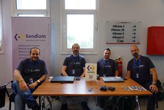
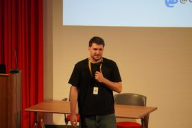
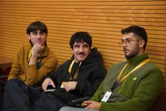
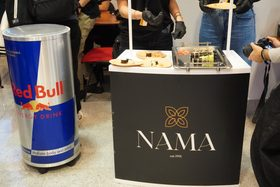
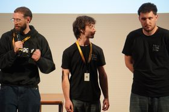
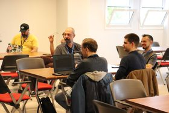
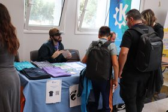
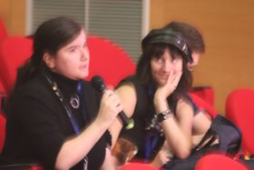
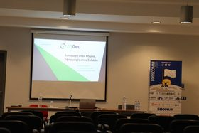
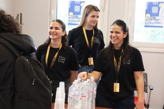

# PHOTOS

The photos sit in a folder per photographer, out of respect for their work. If you need a photographer for anything, reach out to them directly.

### Photographers

<table>
<tr><th align="left" valign="top"><a href="https://www.linkedin.com/in/zoe-ertsou-877772382/">Zoi Ertsou</a><br>1909 photos</th><td rowspan="2"><a href="ZOI-ERTSOU"></a></td></tr>
<tr><th align="left" valign="bottom"><a href="https://huggingface.co/datasets/jimmysss/FOSSCOMM-2026/tree/main/ZOI-ERTSOU"></a></th></tr>
<tr><th align="left" valign="top"><a href="https://www.linkedin.com/in/petros-stratis-a080b935/">Petros Stratis</a><br>580 photos</th><td rowspan="2"><a href="PETROS-STRATIS"></a></td></tr>
<tr><th align="left" valign="bottom"><a href="https://huggingface.co/datasets/jimmysss/FOSSCOMM-2026/tree/main/PETROS-STRATIS"></a></th></tr>
</table>

## License

[](https://creativecommons.org/licenses/by-nc-nd/4.0/)

Copyright © 2026 The FOSSCOMM 2026 Team.

This work is licensed under the [Creative Commons Attribution-NonCommercial-NoDerivatives 4.0 International License](https://creativecommons.org/licenses/by-nc-nd/4.0/). You may share it unchanged, for non-commercial purposes only, with credit in this form, including the link. See [LICENSE](../LICENSE) for the full terms.

```
<number>.jpg by <photographer> for FOSSCOMM 2026 by the FOSSCOMM 2026 Team
https://github.com/jimmmyss/FOSSCOMM-2026
Licensed under CC BY-NC-ND 4.0
```
