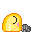
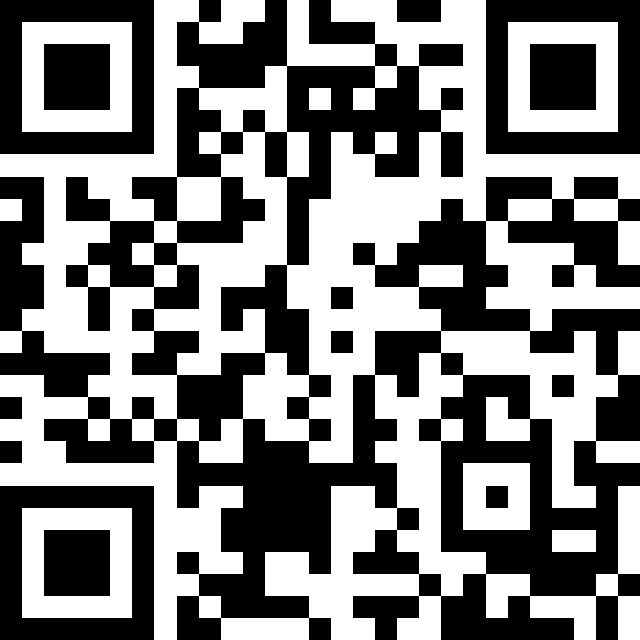

#  FOSSCOMM-2026

Bad time to be here, everyone is slacking.

## Made by those humans (A-Z):

### Curators:
- Dimitris Athanasopoulos
- Nikolas Pissas
- Nikos Tsekos
- Thanasis Giannoulakis

### Suporters:
- Efstathios Iosifidis
- Kostas Papadimas
- Patrick Fitzgerald

### Volunteers:

## Sponsors:
### Diamonds:
- Typesense, Libre Space Foundation
### Goldies:
- efood, Hack the Box, Shopflix
### Silvers:
- Skroutz
### Bronze:
- OnlyOffice, Epignosis, Ferryhopper, Hellenics Informatics Union, Lambda Twelve, JetBrains

### Donate ([CLICK ME](https://donate.stripe.com/4gwg2BaV74DQeBO005)):

## License:

© 2026 The FOSSCOMM 2026 Team. Everything in this repository, including the theme, the identity and anything added later, is licensed under [CC BY-NC-ND 4.0](LICENSE).

- **Share it unchanged only.** No modified versions.
- **No commercial use. At all.** No commercial licenses are offered.
- **Credit is required:** "FOSSCOMM 2026 by the FOSSCOMM 2026 Team, https://github.com/jimmmyss/FOSSCOMM-2026, licensed under CC BY-NC-ND 4.0"
- Sponsor, partner and community logos, speaker photos and fonts belong to their owners and are not covered. No rights are granted to the FOSSCOMM name or logos.

Full terms in [LICENSE](LICENSE).
