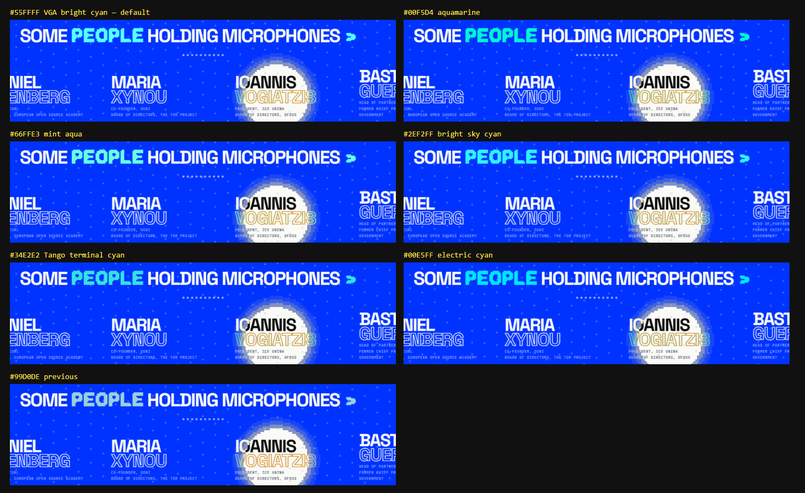

# THEME

<table>
<tr><th width="25%" nowrap><a href="assets"><code>assets</code></a></th><th width="25%" nowrap><a href="inc"><code>inc</code></a></th><th width="25%" nowrap><a href="template-parts"><code>template-parts</code></a></th><th width="25%" nowrap><a href="404.php"><code>404.php</code></a></th></tr>
<tr><td valign="top" align="center">The scripts, styles, fonts, loading screen and mascot.</td><td valign="top" align="center">The PHP behind the site, its pages, helpers and dashboard.</td><td valign="top" align="center">The sections and pages as they are drawn.</td><td valign="top" align="center">The page shown when a URL leads nowhere.</td></tr>
<tr><th width="25%" nowrap><a href="footer.php"><code>footer.php</code></a></th><th width="25%" nowrap><a href="front-page.php"><code>front-page.php</code></a></th><th width="25%" nowrap><a href="functions.php"><code>functions.php</code></a></th><th width="25%" nowrap><a href="header.php"><code>header.php</code></a></th></tr>
<tr><td valign="top" align="center">Closes the page after WordPress's footer scripts.</td><td valign="top" align="center">The one public page, every active section in saved order.</td><td valign="top" align="center">Sets the theme version and boots the theme.</td><td valign="top" align="center">Opens the page and tints the phone browser's bar to match it.</td></tr>
<tr><th width="25%" nowrap><a href="highlight-candidates.png"><code>highlight-candidates.png</code></a></th><th width="25%" nowrap><a href="index.php"><code>index.php</code></a></th><th width="25%" nowrap><a href="photo-spec.mjs"><code>photo-spec.mjs</code></a></th><th width="25%" nowrap><a href="style.css"><code>style.css</code></a></th></tr>
<tr><td valign="top" align="center"> The speakers' highlight colour, seven candidates 1460 x 896 px</td><td valign="top" align="center">The fallback template WordPress requires.</td><td valign="top" align="center">An empty file.</td><td valign="top" align="center">The theme's header for WordPress, its name, version and description.</td></tr>
</table>
